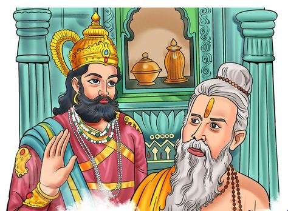

# Нэг ч зүйл санамсаргүй болдоггүй

Нэгэн хаан өөрийн сайдын хамт ордныхоо цэцэрлэгт зугаалж яваад шинэ сэлмэндээ баруун гараа эсгэчихжээ. Хаан уурлаж бухимдах үед нь сайд нь “хаан эзэн минь, айх зүйлгүй ээ. Энэ бол бурханы ивээл” гээд хэлчихжээ. Хаан бүр ч уурлан сайдыгаа шоронд хийв. Маргааш нь хаан анд явах үедээ мэргэн сайд зөвлөгч нь байхгүй тул явсаар хүнээр тахил өргөдөг омгийнхонд олзлогдчихжээ. Нөгөө омгийн удирдагч хааныг нүцгэлэхийг тушаан тахил өргөхөөр шинжтэл нэг хуруу нь зүсэгдсэн байсан тул, шарх сорвигүй хүнээр тахил өргөх ёстой байдагаас түүнийг суллажээ. Хаан үхлийн сарвуунаас амьд мэнд гарсандаа баярлан шууд сайдыгаа суллаж, түүнд болсон явдлыг ярин, -“Би одоо гараа эсгэсэн минь Бурханы ивээл гэдгийг ойлголоо, харин таны шударга бус шоронд ордог тань, бас Бурханы ивээл үү?” гэж сонжингуй асуув. Сайд ёжтой инээмсэглээд “Би хэрэв шоронд ороогүй бол тантай явж тэдгээр омгийнхонд баригдах байсан. Таны шархнаас болж танаас татгалзаад надаар тахилга хийх байсан” гэжээ. Амьдрал заримдаа хатуу санагддаг. Таагүй зүйлс тохиолдох, итгэл найдвартай түнш холбоогоо таслах, осол гэмтэл, гарлага, энэ үед “амьдрал яасан шударга бус юм бэ?” “ Бурхан байдаг уу?” гэж аливаад эргэлзэн орилохоор үе ч гардаг. Тэгвэл, бүх тохиолдол, байдал, үйл явдалд бурханы өгсөн хугацаа, бурханы дэг журам гэж байх бөгөөд бурханы төлөвлөснөөр явагддаг аж. Нэг ч тохиолдол, үйл явдал хэзээ ч санамсаргүй зүгээр тохиолддоггүй бөгөөд ямар нэг зорилго дагуулан явагддаг ба энэ үедээ юу ч мэдэгдэхгүй, харин хэсэг хугацааны дараа зорилгын үр дагаврыг хүн ойлгож байдаг байна.

Ихэвчлэн таныг аврах туслах шинжтэй байдаг. Та, анзаараарай. Тохиолдож буй бүх зүйлийг сэтгэлийн тэнхээгээр даван туулах, эерэгээр харах хэрэгтэй байдаг аж.
