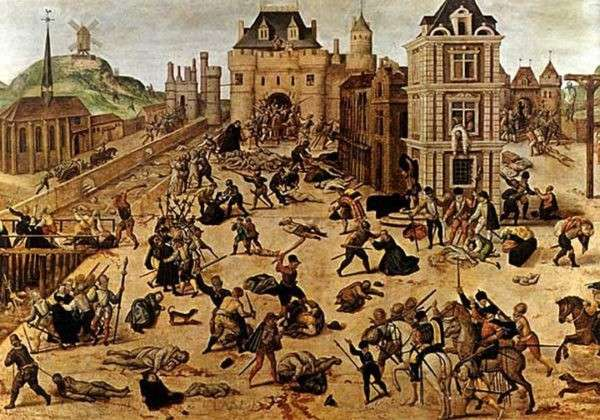

# Немцүүдийг цэвэрч үндэстэн болгоход хэрхэн сургасан тухай түүх

Цэвэрч нямбайгаараа гайхагддаг, мөн үндэснийх нь онцлог гэж хүлээн зөвшөөрөгддөг германчуудын цэвэрч байдал анхнаасаа байгаагүй, төрөлх чанар нь биш бөгөөд тэднийг хэрхэн хүчээр сургасан тухай нэгэн сонирхолтой арга, түүхэн баримт болон үлдсэн байдаг байна. Энэхүү аргыг нэг талаас, ховч мэдээлэгчидийг дэмжсэн, хувь хүний эрх чөлөөнд халдсан таагүй арга гэж үзэж болох ч, нөгөө талаас, асар хурдан хугацаанд хот тосгоддоо төгс гэмээр цэвэр, эрүүл орчиныг бүрдүүлж чадсан, үндэстний соёлын өвийн хэмжээний, удамшин дамжиж, заншил болсон үр дүнтэй үйл ажиллагаа хэмээн үздэг аж.

Дээр үеийн немцүүд, үнс хог, үхсэн тэжээвэр амьтад, ялгадас, өтгөн шингэн, угаадсаа хашаанаасаа гаргаа л бол, хаана ч хамаагүй асгаж хаядаг байжээ. Тэр үед, тэд, бохироос үүдэлтэй өвчилөлд баригдсан, хог бохирт дарагдсан хот тосгодын ард иргэд байсан гэхэд үнэмшмээргүй. XV зууны үед, гүн Вюртемберг хотынхоо өмхий самхайд тэсэхээ больж, ялгадас болон хог хаягдлаа суурингийн гадна гаргаж асгаж байх журам тогтоосон ч, ард иргэдийнх нь ухамсаргүй үйлдэл зогсоогүйгээр барахгүй, журам мөрдөх сонирхолгүйгээс, журам сахиулагчид, шалгагчиддаа хээль хахууль өгөх асуудал цэцэглэн хөгжиж, улмаар даамжирч, мөн шалгах хүмүүсийн тоог ахиулах боломжгүй зэргээс үүдэлтэйгээр огт хэрэгжихгүй байсан аж. Ингээд, гүнтэн өөр нэгэн зарлиг гаргасан бөгөөд үүний үрээр, ход тосгод нь цэвэрхэн болж өнөөгийн немцүүдийн цэвэрч гэсэн тодотголын эх суурь тавигдсан гэнэ. Уг зарлигт, хэрэв хөрш нь хог хаягдлаа цэвэрлэхгүй, гудамжинд асгаж, заваарч бохиртуулж буйг иргэд хараад мэдүүлэхгүй бол, мэдүүлээгүй хүн болон, бохир заваан суугч хөрш хоёр хоёулаа шийтгүүлнэ. Хэрэв цаг тухайд нь мэдүүлдэг, түүнийг нь ойшоодоггүй бол хичнээн удаагийн үйлдлээс нь шалтгаалан тухайн заваан хөршийнх нь газрын хагасаар мэдээлэгчийг шагнах байдлаар арчаатай, ажилсаг хүмүүсийн газрыг томруулах маягаар цэвэр орчины хүрээг тэлэх асуудлыг тусгаж өгсөн байв. Үүний үр дүнд айл бүр, гэр орон, хашаан доторхи газар, хашааныхаа харалдаа газрыг, газраа алдахгүйн тулд, мөн мэдээлэгч нар болон хөршүүдийнхээ урт хэл, хэл амнаас айсандаа хагас сайн өдөр бүр, тогтмол нямбайлан цэвэрлэх болсноор зуун дамжсан цэвэрч үндэстэн үүссэн бөгөөд энэхүү цэвэрч байдал нь, сүүлдээ ард иргэд хоорондоо тохилог байдлаараа өрсөлдөх хэмжээний сайхан үр дүнд хүргэж нийгмийн сэтгэлгээ эрүүлжсэнээр, өнөөгийн хүчирхэг, хөгжингүй улс орон болоход хувь нэмэр оруулсан гэж үздэг байна.
