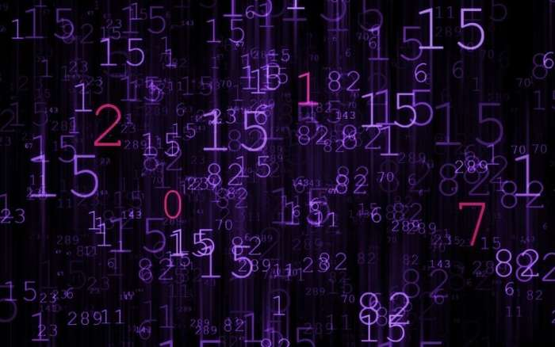
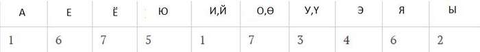

# Нэр, овгийн эгшиг үсгүүдийн тоон утгаар өөрийгөө шинжихүй

Нэр, овгийн эгшиг үсгүүдийн тооны нийлбэрийг амин сүнсний тоон утга гэх бөгөөд үсгүүдэд харгалзах тоонуудыг нэмж, нэг оронтой болгон, тухайн тооны тайлбарыг уншин, өөрийнхөө зүрхний хүсэл, авъяас чадвар, давуу тал, амьдралынхаа талаар мэдээлэл авч болдог байна. Үүний тулд, дараах хүснэгтээс, нэр овог дох эгшиг үсгүүдэд харгалзах тоонуудыг нэмдэг. Жишээ: Доржийн Бат, 7+1+1+1=10, 1+0=1. 1-бол энэ хүний, амины тоо буюу сэтгэл санааны төрлөхийн өгөгдлийг заадаг.

---

1. Өндөр зорилго бүхий, түүндээ туйлбартай зүтгэдэг, сэтгэлийн тэнхээтэй хүний тоо. Хувь хүний өвөрмөц чанар, нэр төрдөө хайртай зан тань үйл хөдлөлд тань түлхэц болж байдаг. Өмнөө тавьсан зорилгодоо хүрэхийн тулд эдгээр хүмүүс, замаасаа хазайхгүй, зөвхөн урагшилдаг. Хил хязгаарт баригдахгүй, тэвчдэггүй зантай, тиймдээ ч аливаа асуудлыг эхний үед нь шийдээд явж чаддаг. Та, зүрх зоригтой тууштай, шийдэмгий манлайлагч байх ёстой аж.\
2. Тайван, зөөлөн, аядуу, аливааг зохицуулах чадвартай, биеэ барьж чаддаг хүн. Эсрэг тэсрэг, үйл хөдлөл эсвэл амар амгалан хоёрын хүчтэй эх булаг дотор тань байдгаас, та, тайван, сэтгэлийн тэнцвэртэй байж чаддаг. Амархан бууж өгдөг, зөөлөн. Та бол зөвлөх, төсөл зохиогч, төлөвлөгч.\
3. Ертөнцийн хүн. Таны дотор эр хүний эр зориг, эмэгтэй хүний хайр зэрэгцэн оршдог. Таны, дотоод “би”-гийн хоёрдмол чанарыг харуулдаг бөгөөд 3-н тоо нь, өнгөрсөн, одоо, ирээдүй буюу төрөлт, амьдрал үхэл гэсэн амьдралын гурвалжинг заадаг. Энэ хүмүүс хөнгөн сэтгэлтэй, өдөр тутмын асуудлуудыг хайхрахгүй, өдрөөрөө амьдардаг сайхан чанартай. Өөрийгөө нээж чаддаггүй тул бусдын дэм авах хэрэгтэй байдаг. Амьдралын гол зорилго нь, ертөнцийн өндөрлөгт хүрэх, бусдыг хянах, удирдах бөгөөд төрлөхөөсөө тушаангуй харьцаатай байх нь элбэг.\
4. Энэ тоо, 4 элемент, 4 улирал, амьдралын 4 үе шатыг илэрхийлдэг. Энэ тооны хүмүүс, хөдөлмөрч, сэтгэл санааны тэнцвэртэй, ухаалаг байдаг. Хүрэхийг хүссэн зорилгодоо, зөвхөн өөрөө л хүрдэг. Яриа хэлэлцээрийн үед эсрэг байр суурь илэрхийлдэг ч хэзээ ч сэтгэл хөдлөлдөө захирагддаггүй. Дүрэм, зааварчилгыг ойшоохгүй, харин хувьсгал өөрчлөлтийг эрэлхийлдэг. Техник, технологийн салбарт амжилтад хүрнэ.\
5. Нэг газраа тогтдоггүй, өөрийгөө боловсруулах аргыг эрэлхийлдэг мөн туршлагыг эрж хайх, эзэмшихийг эрмэлздэг хүмүүс. Та, эрсдэл, адал явдалд дуртай, урам зориг, өөдрөг үзлээр дүүрэн хүн. Шийдвэрүүдээ гэнэт, санамсаргүй гаргадаг. Таны амьдралыг өөдрөг, сэргэлэн, хурц ухаан, амьдралд хайртай, амьдралын баяр баясгалантай байдал тань хөтөлж явдаг. Та, үргэлж урагшаа харж явдаг бөгөөд юу ч хийсэн төгсгөлийг нь, зөвхөн сайн эерэг талаас хардаг. Мөн бухимдуу, адал явдалтай, хөдөлгөөнтэй байдаг.\
6. Эрэгтэй, эмэгтэй хүмүүсийн нэгдэл, гэр бүлийн үүсэл, уран бүтээлчдийн билэгдэл тоо. Мөн, Бурхан Хүн хоёрын холбоог билэгдэх нь ч бий. Энэ хүмүүс найдвартай, шударга, хүндлэл хүлээх чадвартай, өөрийн амьдралыг дээшлүүлэхээс гадна бусдын амьдралыг ч дээшлүүлэхэд анхаарч байдаг. Тэвчээртэй, төрлөхийн бусдыг татах чадвартай, гэхдээ төлөвлөгөөгөө хэрэгжүүлэх үедээ, тууштай хатуу зантай байдаг. Мөн тэд, маш романтик, урлагт хайртай, хардалт, хэрүүл маргааныг үзэн яддаг. Хүмүүстэй маш амархан хэл амаа ололцдог, найз нөхдөөр хүрээлүүлэх онцгой чадвартай, мөн тэднийхээ өмнө хүлээх үүргээ маш өндөрт тавьдаг. Гэртээ байх дуртай, ойр дотныхоо дунд аз жаргалтай байдаг.\
7. Нууцлаг зүйлс ба мэдлэгийг билэгддэг ариун тоо гэдэг. 7-гийн тоог эрт дээр үеэс хүний нийгмийн үүсэл хөгжлийн үндэстэй холбодог, мөн долоо хоног, солонгын долоон өнгө, хөгжмийн долоон ноот гэх мэт илэрхийлэгддэг утга учиртай тоо гэж үздэг. Энэ тооны хүмүүс өвөрмөц зантай, ихэвчлэн уран бүтээлч хүмүүс байдаг. Зөн совинтой, шинжлэн судлах авъяастай, уран зөгнөл, төсөөлөн бодох чадвар нь хөгжсөн хүмүүс. Зураач, яруу найрагч, урлагийн зүтгэлтнүүд болдог.\
8. Материаллаг байдлын амжилтыг билэгддэг. Эхэлсэн бүх зүйлээ төгс хэмжээнд дуусгах чадвартай, итгэл найдвартай хүмүүсийн тоо. Мөн, нэг талаас, хувьсгал, эргэлт, нөгөө талаас шашин, итгэл үнэмшил, гүн ухаан, зайлшгүй хэтийн төлөв, хамрах хүрээг билэгддэг гэх бөгөөд эдгээр хүмүүс бусад хүмүүсээс ялгарч байдаг. Тэд дотоод сэтгэлээ нуудаг, тиймээс бусад хүмүүс буруу ойлгож шүүх нь бий. Сэтгэлдээ ганцаардмал, бусадтай ойлголцохдоо тааруу, тиймээс нас эцэслэснээсээ хойш алдарших нь элбэг байдаг. Таны амин тоо, амьдралын бүх хүрээнд зоримогоор оролцох, мэргэжлийн хувьд бизнест амжилт олох, үйлдвэрлэл, худалдааны салбарт амжилт олохыг зааж байна. Та, хамт олныг удирдан чиглүүлэх болон засаг захиргааны ажлын гайхалтай авъяастай.\
9. Бүх тоонуудын утгыг нэгтгэсэн тоо. Амжилт, төгс төгөлдөрийг заадаг. Хүний амьдралын бүх үе шатанд үйлчилдэг, төрөлт, амьдрал үхлийн нууцыг нээх чадвартай гэдэг. Асар их боломжоо нээх, хөгжүүлэх чадвар бүхий, бие мах бодын эрч хүчээр дүүрэн, өндөр оюунлаг хүмүүсийн тоо бөгөөд амжилт нь уран бүтээл, жүжигчний мэргэжлээр илрэх нь олонтаа байдаг. хүмүүсийг татах гайхалтай чадвар танд байдаг. Энэ хүмүүсийн асуудалтай тал нь, аль замаар нь явахаа сонгож чаддаггүйд байдаг, мөн өөрсдийн ур чадварыг мэдэхгүй байх нь элбэг байдаг. Сэтгэлийн хөдөлгөөнтэй, цочмог зангаасаа болж таагүй зүйлд өртөх нь бий.
