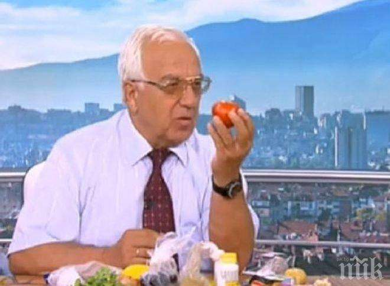

# Нэрт генетикчийн урт наслах жор буюу өвчлөлүүдийн 66%-г хоол хүнсээр эмчилж болно

Болгарын генетикч, профессор Христо Мемерски нь, урт наслалт, эрүүл мэндийн талаар олон ном нийтлүүлж олны хүртээл болгосон, 63 орны 200-д орны их, дээд сургуулиудад лекц уншдаг зөв хооллолтын асуудлаар мэргэшсэн хүн юм. Тэр, бид, хоол хүнс хэрэглээгээ буруу сонгон, яг, өөрийнхөө авсны таганд хадаас хадаж байгаа юм шиг аймшигт буруу үйлдэл хийдгээ мэддэггүй гээд дараах зөвлөгөөг өгчээ.

#### Хөгшрөлтийн талаар

Хөгшрөлт нь байгалийн жам болсон зүйл биш гэнэ. Бодолгүй хүнсний хэрэглээнээс болдог өвчин гэж авч үзэж байна. Дэлхийн хэмжээнд нас барж буй хүмүүсийн 70%-нь өөрийнхөө хоол хүнсэнд анхаардаггүй бараг гэмт хэрэг гэмээр үйлдлээс нас бардаг, мөн тулай, чихрийн шижин, төрөл бүрийн эрхтэнүүдийн шархлаа, цус харвалт, зүрхний шигдээс, хорт хавдар өвчнүүдийг хөгжил дэвшлийн хорт уршиг гэж үзжээ.

#### Хөгшрөлтийг удаашруулдаг хүнснүүд

Маш энгийн дүрэм, хэтрүүлэн идэхгүй бага багаар идэж хэвшихэд л хангалттай байдаг гэнэ. Мөн хүнсний ногоо, жимс жимсгэнэ, ойгурт, сүү, вино хэрэглэх хэрэгтэй аж. Эдгээр хүнснүүдийг аль болох өөрсдийн гараар бэлтгэж хэрэглэх хэрэгтэй аж.

#### Бие цэвэрлэх жин хасах

500 г үйлдвэрийн бус аргаар, жинхэнэ сүүгээр хийсэн йогурт, 1 халбага зөгийн бал, 1 халбага алимны цуу, 1 цайны халбага корица, 40 дусал 30%-н зөгийн зөгийн жилийг хольж өглөө орой хэрэглэх

#### Гоо үзэсгэлэнгээ хадгалахад тустай байгалийн амин дэмүүд

Хамгийн сайн амин дэмүүд лууван, сармисанд байдаг гэж үзэж болно. Азербайджанд, нэг аяга усанд 80-д төрлийн нян бактеритай ус хийж, өөр аяганд сармис хийж зэрэгцүүлэн тавихад хэдэн цагийн дараа нян бактеритай усанд нян устсан болох нь илэрсэн гайхалтай туршилт явуулж, сармис зайнаас үйлчилдэг болохыг харуулсан туршилт хийсэн байдаг. Мөн зөгийн жилийг усанд найруулж уух маш тустай.

#### Хоол хүнсэн дэх хорууд

Дэлхийн хэмжээнд хүнсэнд, сайхан амт үнэр оруулах зориулалттай 200-д төрлийн хор бүтээгдсэн байдаг. Хүнсний бүтээгдэхүүн худалдаж авахдаа, орц найрлагыг заасан маш жижигээр бичигдсэн зүйлийг маш сайн уншиж авч байх хэрэгтэйг зөвлөжээ. Үүнд, натрийн нитрат, натрийн нитрит, бутилат гидроситолуол, будилат гидросианизол, бромины тос ордог ба эдгээр нь хүний эрүүл мэндэд маш хортой бодисууд юм. Тиймээс, эдгээр хорт бодисууд ордог, хиам, сосиск, утсан мах, лаазалсан бүтээгдэхүүн, чипс, бэлэн салатууд, торт, бохь, гоймон, жүүсийг хэрэглэхгүй байхыг зөвлөжээ. Эрүүл мэнд, залуу насандаа хайртай бол эдгээрийг бүү хэрэглэ гэсэн байна.

#### Энэ генетикч, давс сахар нь, авсруу хөтөлнө гэж хатуухан давтан хэлдэг

20-р зууны эхэн үед давс сахарыг 5 дахин бага хэрэглэдэг байжээ. Одооны өвчнүүд энэ хоёр зүйлээс үүдэлтэй бий болж буйг, нэрвэгдэж байгааг хүн төрөлхтөн мэдэхгүй байгаад их харамсдаг ба цусны даралт ихдэх өвчин давснаас болдог гээд, өлөн элгэн дээрээ идсэн чипс, попкорн, давсалсан самар амиа хорлохтой адил үр дүнтэй гэсэн байна.

#### Урт наслах жор:

1. Зарцуулахаасаа их калоритой хүнс бүү хэрэглэ\
2. Өдөр бүр нэг алим идэх\
3. Хөлдөөж хайлуулсан ус уух, ургамлын ханд цайны оронд хэрэглэх\
4. Идэвхитэй хөдлөх\
5. Өдөр бүр душэнд орох\
6. Сэрүүн тасалгаанд унтах\
7. Амралтын өдрүүдээр, 10-15 километр алхах, дугуй унах\
8. Найз нөхөд, ойр дотныхонтойгоо харьцаж, хөгжилдөх, баярлах, идэвхитэй харилцаанд байх, /сексээс татгалзахгүй байх/\
9. Хөгширч байна гэж хэзээ ч бодохгүй, ярихгүй байх
