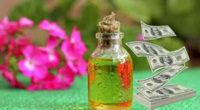

# Үнэрт тоснууд, мөнгө эд баялагийг татдаг

Үнэр эмчилгээний мэргэжилтэнүүд, үнэрийг, уламжлалт бус эмчилгээний хүчтэй арга, мөн хүний амьдралын бүхий л хүрээнд чухал үүрэг гүйцэтгэх чадвартай гэж нотолдог.

Таагүй, муу үнэр хүний дархлааг устгах, мөн сэтгэл санаанд нөлөөлж, сэтгэл санаа хямраах, унагах нөлөө үзүүлдэг бол, ургамал цэцэгс, байгалийн гаралтай үнэр нь, өөдрөг сэтгэл, сайн сайхныг татах, эрүүл мэндэд эерэгээр нөлөөлөхийн зэрэгцээ, мөнгө, эд баялаг, аз, амжилтыг дуудах увидастай байдаг аж. Эдгээрийн амжилтад хүрэх, мөнгө татах увидасыг эрт дээр үеэс ашиглаж ирсэн бөгөөд эртний грекчүүд, мөнгө үнэрээр татагддаг гэж үздэг, худалдаачид нь, эд бараандаа цацах, язгууртанууд гэр орондоо үнэртүүлэх зэргээр хэргэлж ирсэн байдаг. Хэтэвчиндээ дусаах, тодорхой нэг мөнгөн дэвсгэртэд шингээж түрийвчиндээ үрэхгүй хадгалах, банкны картад түрхэх, машиндаа үнэртүүлэх, чухал бичиг баримттай цүнх, шүүгээнд түрхэх, үнэртүүлэгч сууринд дусааж үнэртүүлэх, үнэртүүлэгч зүүлтэнд дусааж зүүх зэргээр хэргэлнэ. Амжилт мөнгө татах увидаст эфирийн тоснуудад, хамгийн хүчтэй нь, пачулийн эфирийн тос, мөн сандал, корица, хуш, апельсин ордог байна.
