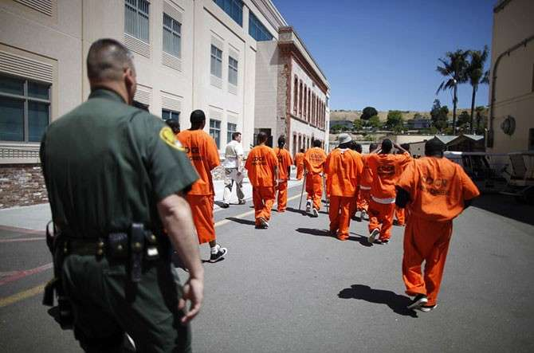

# Нидерланд, хоригдолгүй болсноор бүх шоронгуудаа хааж байна

2013 онд, Нидерландад, 19 шорон хоригдолгүй болсон тул хаагдсан бөгөөд оны сүүл рүү дахиад 5 шорон хаагдах юм байна.

Үүнээс болж, 2000-д хүн ажилгүй болохоос, дөнгөж 700-нь хууль сахиулах өөр бусад байгууллагад ажиллах бололцоотой байгаа аж. Гэмт хэрэг ийнхүү буурч байгаа шалтгаан нь, 2004 оноос хэрэгжүүлж ирсэн, гэмт хэргийн эсрэг авсан арга хэмжээнүүдтэй нь холбоотой бөгөөд Нидерландын Хууль зүйн яамны сайд Ард ван дер Стюр, Норвегоос 240 хоригдол “импорт”-оор авч ирж, өөрсдийн шоронд хорьж байгаа хэдий ч, хагас нь хоосон шорон байлгах нь, эдийн засагт хохиролтой юм гэж, улсынхаа парламентад мэдээлжээ. Гэмт хэрэг ийнхүү буурсан шалтгаанууд нь, хар тамхитай холбоотой гэмт хэргийг шийдвэрлэх хуульд өөрчилөлт оруулж, шийтгэх биш харин албадан эмчилгээнд хүчээр хамруулахаар шийддэг болсон, хоригдогсдод электрон бугуйвч ашиглан хянадаг системд шилжсэнээр, тэд сул чөлөөтэй ажил төрөл эрхлэн амьдрах бололцоогоор хангагдсан зэрэгтэй холбоотой аж. 2008 оны судалгаагаар, электрон бугуйвч нь гэмт хэргийг 50% бууруулж буйг харуулсан үзүүлэлт гарчээ. Гэмт хэрэгтнүүдийг, татвар төлөгчидийн мөнгөөр шоронд хорихын оронд, нийгэмд хөдөлмөрлүүлэх нь ашиг тустай юм гэж, мөн энэ нийтлэлд дурджээ.
