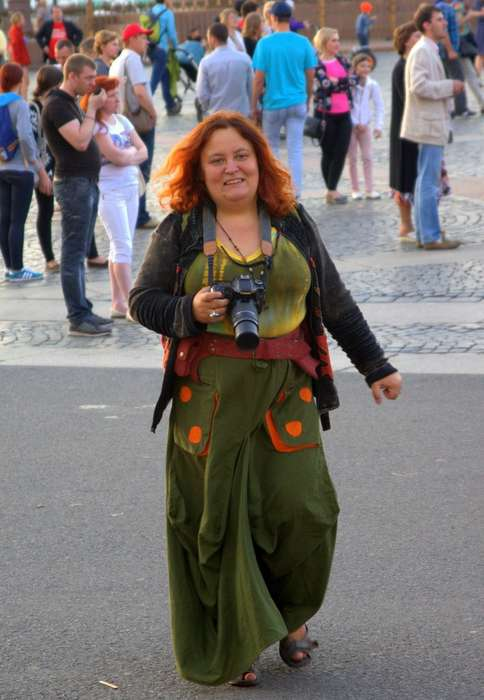

# Ника Батхены дурлалын тухай гайхалтай  сонирхолтой нийтлэл

Ника Батхен, оросын утга зохиолын бүх салбарт нэрээ дуурсгаж яваа, яруу найрагч, зохиолч, нийтлэлч, сэтгүүлч, редактор, утга зохиолын шүүмжлэгч, фото зурагчин, хоёр охиноо ганцаар өсгөж байгаа ганц бие эх, маш олон тооны муур тэжээдгээрээ гайхал төрүүлдэг, өвөрмөц сэтгэхүйтэй нэгэн юм. Тэрээр, би залуу ч, маш баялаг, гайхалтай амьдарлаар амьдарч явна. Хосын болоод хамтын амьдарлын талаар, өөрийн туршлага мөн бусдын амьдралаас харж тунгаасны эцэст, энэхүү нүцгэн үнэнийг бичихээр шийдсэн гээд дараах зүйлийг бичжээ.

Хүмүүс хамт байхыг хүссэн үедээ л хамт байдаг бөгөөд үүрэг, хариуцлага, нэр төр, ёс суртахууны аль нь ч хүнийг нөгөө хүнд нь гинжилж чаддаггүй. Хэрэв хүсвэл хүн хаанаас ч, гэр орноосоо, гэр бүлээсээ, үр хүүхдээсээ, өвчин үхлийг ч тоохгүй явдаг. Харин хамт байхыг хүсч буй үедээ, нөгөөгийнхөө ямар ч дутагдлуудыг олж хардаггүй. Хүн явахыг хүсэх л юм бол, түүнийг нөгөөгийнх нь ямар ч сайн чанар тогтоохгүй. Муухай дүр төрх, зан чанар муутай хүнийг ч, таалах нэгэн байж л байдаг. Сайхан дүр төрхтэй, хүсүүштэй зан чанартай хүнийг ч түлхээд орхих нэгэн мөн байж л байх. Хэн нэгэнд орхигдчихсон хүн, үүнээс болж сайн ч болохгүй, мөн муу ч болохгүй, тиймээс аймшигт зүйл биш юм. Хүнд хүлээн зөвшөөрөгдөж, хамт байсан ч, амьдрал биш юм гэхэд үхэл салгана. Харин байгаа байдлаа үнэлж, орхигдсондоо бүү харамс, мөн гээхээс бүү ай. Гэрэл гэгээ өгөх хүн байгаа бол баярлаж, өөрөө ч мөн гэгээлэг бай. Гэгээлэг, өөртөө итгэлтэй байх тусам айдас бага, айдас хэр бага байна төдийчинээ сэтгэл зүрхний “харанхуй” бага байна. Модноос тасран унасан навч, мод түүнийг хуучин мөчирөнд нь ургуулж чадахгүйг мэдэхгүйгээр буцаж модондоо хүрэхийн тулд, урсгал, салхийг сөрөн хийсэх үйлдэл хийх боломжгүй. Хэдий их хайрлана төдийчинээ их хайр ундарч, дундардаггүй. Харин хайрлах үедээ өвдөлт мэдэрч байвал, энэ нь уг хүнд хайр биш шоколадаар бүрсэн хор өгч байна гэсэн үг. Тиймээс, ийм бэлэгнийхээ төлөө талархал хэзээ ч авахгүй. Түүний оронд суллан тавь. Өөрийнхөө хайрын тольны тусгал биш, харин өөрөөрөө байхад нь тусал. Хайртай хүндээ уусах нь ховор чадвар ч, мөн хүсэшгүй хараал. Өөрөөрөө, нэр төртэй байж, айдас болгоомжилолыг март. Итгэ, найд, сэтгэлээ дулаацуул, таларх. Юу болох талаар урьдчилан бүү бодож шанал. Зөвхөн одоо цаг болон, энд, дэргэд чинь байгаа бүхэн, мөн оддын дор энэ хоромд чинь байгаа гал, усан доторхи буцалж байгаа зүйлс мэт амьдралын тухай бод. Унтарсан хайр өмхий үнэртүүлэхээс өмнө амжиж яв. Хүсэл нь сэтгэл хөдлөл болохоос өмнө амжиж ир. Мөнгөөр авсан юмс, мөнгөний л үнэтэй. Залбирч, хүсч, гуйж, уяж, уйлж, булааж авсан зүйл, хэзээ нэгэн цагт мөн тэгж л үүрд одно. Хүний өөрийнх нь хүслээр зүрхнээс нь өгөгдсөн зүйл л үнэлшгүй юм. Өөрийн хүнээ яаж таних вэ гэж үү? Амархан. Зүгээр л таардаг юм. Тэр мэдээгүй. Чи ч дуудаагүй. Тэгээд л ололцсон. Хаашаа ч явж байсан бай, зам тань нэг л хөнгөн санагдна.

