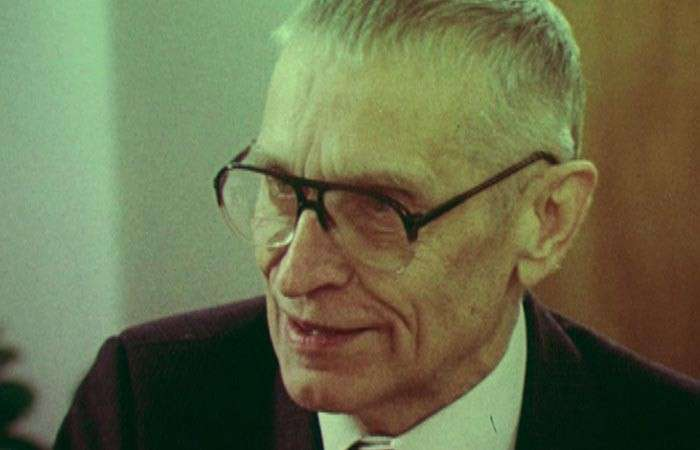

# Николай Амосов: Хүмүүс залхуурал, шуналаас болж өвчилцгөөдөг

Н.М.Амосов, эрдэмтэн, мянга мянган хүний амийг аварсан зүрхний мэс засалч. Тэрээр 79 насандаа мэс засал хийхээ больсон. 89 настайдаа таалал төгссөн. Эрүүл мэнд, урт наслах аргуудыг судлаж, амьдралын сүүлийн жилүүддээ амьдралын зөв хэв маягийг баримталж, үүн дээрээ үндсэлсэн олон судалгаа хийж байв. Тэр өөрийнхөө тухай: Биеийн тамир бол миний хувьд амьдралын үндэс. Хүүхэд насанд минь хэн ч надад, биеийн тамирын ашиг тусын тухай ойлголт өгч байгаагүй. Гэр орны гадаах ажилууд хүч тамир өгснөөс, авхаалж самбаа сургаагүй. Сэлж, бүжиглэж, дугуй унаж чаддаггүй байлаа, дунд сургууль, их сургуульд байхдаа, биеийн тамирын хичээлээс аль болох зугтдаг байсан. Гэхдээ их эрүүл байсан минь гэр орны хар бор ажил их хийдэг байсантай минь холбоотой. Дайны үед, удаан зогсож хагалгаа хийдэг байснаас байх, анх удаагаа хүнд хэлбэрийн үе мөчний үрэвсэлт өвчинөөр өвдөж, 1954 онд нурууны ясны өөрчилөлттэй болсон маань илэрсэн. Энэ үеэс би 1000 хөдөлгөөнт дасгал буюу 10 төрлийн хөдөлгөөнийг зуу зуун удаа хийх дасгалыг өөртөө зориулан боловсруулж хийж эхэлснээр сайжирч эхэлсэн ба нэмж өглөөд гүйх болж, хоолны хэмжээгээ багасгаж хязгаарлан, биеийн жингээ 54 кг-с хэтрүүлэхгүй барих болсон. Ийнхүү, эрүүл мэндийн “Ачаалал ба хязгаарлалтын дэглэм” хэмээх аргыг өөрийнхөө бие дээр туршиж боловсруулсан юм гээд, дараах зөвлөгөөнүүдийг бичиж үлдээжээ.

Тэрээр, хүн бол өөрийнхөө өвчилөлд өөрөө буруутай. Тэд дандаа өөрсдийн залхуу байдал, шунал, ухаангүй үйлдэл, мэдлэггүй байдлаас болж өвддөг. Анагаах ухаанд бүү найд. Эмч нарын гарт олзлогдохоос ай. Тэд олон өвчинийг эмчлэн анагаах ч, эрүүлжүүлж мөн эрүүл болохыг зааж сургаж чаддаггүй. Эрүүл байхын тулд, хүн зөвхөн өөрөө байнгын хүчин зүтгэл гаргах ёстой. Үүнийг орлуулах зүйл үгүй. Азаар, хүн өөрөө төгс зүйл бөгөөд хэзээ ч эрүүлжих боломжтой байдаг нь сайхан. Эрүүл урт наслахад, хүн бие мах бодоо ачаалах, хооллолтоо хязгаарлах, бие организмаа хатуужуулах, амрах цаг гаргах ба амарч чаддаг байх гэсэн дөрвөн үндсэн нөхцөл хамгаас чухал. Өдөрт 20-30 минутын дасгал хийх хангалттай. Хооллолтоо хязгаарла. Биеийн жингээ өндрийн хэмжээнээсээ 10 см хасахад гарах хэмжээнд барь. Биеэ суллаж тайвширч сур. Эмч нар өвчинийг эмчилнэ, харин эрүүл болоход таны өөрийн зүтгэл л хэрэгтэй. Өвчинөө эмчилүүлсэн бол биеэ чагнахаа боль, өвчин хэвтэж амарснаар эдгэрэхгүй. Нэн түрүүнд бие мах бодоо ачаалж эхэл. Юуг ямар хэмжээгээр идэж ууж байгаагаа анхаар. Хүнсний ногоо, жимс жимсгэнэ гол хоол тань байг. Өөх тос судасны хананд холестерин болон хуралддаг тул туйлаас бага хэрэглэ. Тархины судасны склерозын үед бол яалт ч үгүй эмийн эмчилгээ хэрэгтэй байдгийг сануулая. Сахар бүү хэрэглэ. 1 грамм нь 4 к/кал гээд бод гэх мэтээр уйгагүй зөвлөдөг байв. Мөн сонирхолтой нь, тэр хэдийгээр насан туршдаа анагаах ухаанд зүтгэсэн боловч, анагаахад ихэд шүүмжлэлтэй хандаж ийнхүү бичиж, ярьдаг байжээ. Анагаах хэдийгээр өвчинийг эмчилдэг ч, өвчитний тоо жил ирэх тусам өссөөр байгаа нь, өвчилөлийн учир шалтгаанд анхаарахгүй байгаатай холбоотой болохыг нотлохыг уйгагүй оролдож, эмч нар, эм тарианы хүчинд хэт итгэж сохорсон талаар, мөн эмч нарын олзлогдогч болохоос ай хэмээн хүмүүсийг сэрэмжлүүлж, анагаах ухаан зөвхөн өвчинд төвлөрч, эрүүл байх, эрүүлжүүлэх асуудлуудыг орхигдуулдаг, хүний бие организмын төрөлх хамгаалах механизмд итгэдэггүй, дурсдаг ч үгүй алдаатай, эмч нарын өвчитөнд өгдөг, бага хөдлөх, тайван хэвтэх, сайн хооллох гэсэн зөвлөгөө зааврууд хүний байгальлаг төрөлх чанарыг бүдүүлгээр зөрчдөг. Араатан амьтад өвдөхдөө хоолноос гарч биеэ цэвэрлэн эдгэдэг гэх мэт харьцуулсан дүгнэлтүүд хийж баримттайгаар хүний төрмөл чанаруудыг судлах, ашиглахыг шаарддаг байжээ. Хүнийг хөдөлгөөн болон булчингийн идэвхижил, хэсэгчилсэн мацаг барилт л эрүүлжүүлж, өвчинөөс салгах хүчтэйг өөрийн бие дээр нотолсноо, мөн хүн бол маш бөх амьтан бөгөөд харамсалтай нь, өвчин зовлонгоо өөрөө өөртөө тарьдагаа мэддэггүй. Бие мах бодынхоо ажиллаж хөдөлж байх ёстой төрлөх үүргээ умартсан ухаангүй байдал болон нийгмийн амьдралын нөхцөлөөс гарч ирсэн биологи чанартаа зөрчилдөх амьдралын хэв маягийг сохроор дагадгаасаа болж зовдог. Бидний өнөө үеийн соёл иргэншил, хүмүүс өнөөдөр эрүүл урт наслахад тустай төрөлх боломжуудаа ашиглахыг сануулж, шаардаж эхэллээ. Гэр орон, өрөө тасалгаанд халуун дулаан агаарын хэм бүрдүүлэхийг чухалчилахаас татгалз, хэтрүүлэн идэхээс татгалз, мөн хамгийн гол нь хөдөлгөөний дутагдалд орохгүй байхыг байгальллаг төрөлх чанар тань сануулж, шаарддаг, зөвхөн эдгээр нь эрүүл байхын тань үндэс хэмээн зөвлөж уриалдаг байжээ.
