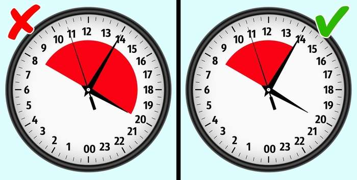

# Нобелийн шагнал хүртсэн, японы Окно хэмээх хооллолтын дэглэм

2017 онд хийгдсэн нэгэн томоохон судалгаагаар, өглөөний 8 цагаас оройн 20 цагийн хооронд хооллодог хүмүүсээс, өглөөний 8 цагаас өдрийн 14 цагийн хооронд хооллодог хүмүүс эрүүл мэндийн хувьд илүү эрүүл, чихрийн шижин, цус багадалт, таргалалтад өртөх эрсдэл хамаагүй бага байдаг болохыг тогтоожээ. Японы эрдэмтэн Ёсинори Осуми, судалгааныхаа явцад хүн хэсэг хугацаанд өлсөх үед, эд эсүүд бүх хуучин хэрэггүй хэсгүүдээ дахин боловсруулж шинэчилдэгээс бие организм залууждаг гэсэн дүгнэлтэд хүрчээ. Энэ процессыг аутофагия гэдэг бөгөөд үүнийг ашиглан эрүүлжих, жин хасах хооллолтын дэглэм боловсруулсан байна.

Бидний хоол иддэг үе эхлэх цаг ба дуусах цагийн хоорондох хугацааг Окно буюу “Цонх” гэж нэрлэжээ. Өглөө 7 цагт босч цагийн дараа өглөөний ундаа уудаг бол, тухайн хүн 8 цагт “Ходоодны цонхоо нээж”, оройн 20-22 цагт оройн хоолоо идсэнээр “Цонх”-оо хаадаг гэсэн үг. Тэр хүний “Цонх” 12-14 цаг нээлттэй байна. Урд нь, бага багаар хэсэгчилэн хооллохыг хоолны зөв дэглэмд тооцож, хооллох үеийн эхлэх, дуусах хугацааг хязгаарладаггүй байсан бол, энэхүү 2017 оны судалгаа, “Ходоодны цонх”-ны нээлттэй байх хугацааг багасгаж 6-8 цаг болгосноор олон өвчин, өвчиллөөс сэргийлэхээс гадна жин хасах өндөр үр дүнтэй, мөн цусан дах холестерин, сахарын түвшин, хоолны дуршил, биеийн жинд гайхалтай нөлөөлдөг болохыг тогтоосон бөгөөд энэ үедээ, туршилтад хамрагдагсдын “Цонх”-ны нээлттэй байх хугацааг 12, 8, 6 бүр 4 цаг болгон багасгаж дурын хүнс тэжээл хэрэглүүлж байсан байна. Бие организм, шөнөдөө өөхийг илүү шатааж, өлсөх мэдрэмжийг багасган, энергийн зарцуулалт багасч, бодисын солилцоо сайжирч, жин хасах өндөр үр дүн үзүүлж буй нь харагдсан бөгөөд мөн бие организмын ультра ягаан туяанаас хамгаалах чадвар нэмэгдэж арьсны рак, арьсны хөгшрөлтөөс сэргийлэх, хөхний хорт хавдар, цусны даралт ихсэх өвчин, зүрхний өвчилөлүүдээс урьдчилан сэргийлэхэд тустай болох нь харагджээ. Зөв бүрэн нойрсолтыг мөн дэмжиж байсан байна. Энэхүү “Цонх”-ны нээлттэй байх хугацааг багасгах дэглэмийг барих үед, хооллох цаг үе ихээхэн чухал байдаг аж. Өглөө сэрсний дараа 30-60 минутын дараа хооллоно. Өглөөний цай нь, өдрийн хоолноос илүү их байхаар бэлтгэж иднэ. Судлаачид өглөө нь сайн хооллож, өдөр нь бага идсэн хүн илүү хурдан жин хасч байгааг тогтоосон байна. Эхний үед энэ дэглэмийг сахих хэцүү байх боловч долоо хоногийн дараа бие организм дасч, хоолны дуршил багасч, илүү сайн нойрсож унтдаг болж, өглөөд сэтгэл санаа өндөр, бие хөнгөн сэрэх зэрэг сайхан үр дүнд хүргэдэг гэж зөвлөжээ.

