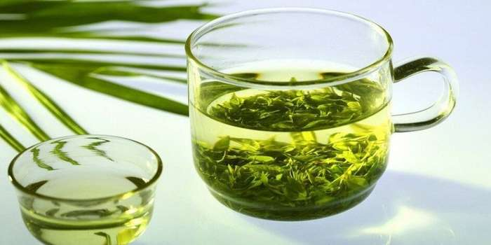
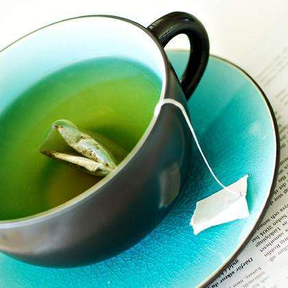

# Ногоон цай нь, “Үхлээс аврагч эм”. /Сайн чанарын ногоон цайг хэрхэн сонгох вэ?/

Хятадын шинжлэх ухааны академийн эрдэмтэд 7 жилийн турш, 15 мужийн 100 гаруй мянган иргэдийг хамруулсан, ажиглалт судалгааны үндсэн дээр ногоон цайг “Үхлээс аврагч эм” хэмээн зарлажээ. Ногоон цай нь, цус харвах, зүрхний шигдээсээр үхэх эрсдэлийг 20%, зүрх судасны өвчинөөр нас барах эрдэлийг 22%, бусад өвчиний улмаас нас эцэслэхийг 15%-аар бууруулдаг болохыг дараах туршилтаар нотолжээ. Оролцогчидыг, а/ долоо хоногт 3-с олон удаа ногоон цай тогтмол уудаг, б/ 3 удаагаас илүүгүй удаа уудаг ба огт уудаггүй гэж ангилан судалсан ажээ. Ногоон цайнд, их хэмжээгээр бие организмыг өвчилөлөөс хамгаалдаг идэвхитэй полифенол-антиоксидантууд байдаг, хир удаан ногоон цайг тогтмол хэрэглэнэ, төдий чинээ бие организмын хамгаалах чадвар өсдөг гэж онцлон тэмдэглэжээ. Мөн ердийн байхуу цай, хар байхуунд бие организмыг хамгаалах шинж чанар байдаггүй болохыг мөн дурджээ.

Сайн чанарын ногоон цайг хэрхэн сонгох вэ?

-нэг өнгийн, хуурай, бутрамтгай, үл ялиг өвс ногооны үнэртэй навчнууд

-хураасан цаг хугацаа ба савласан цаг хугацаа ихэвчилэн заагдсан байдаг

-хагас жилээс илүү хадгалагдаагүй байх

-хавар, намрын ургацынх гэж байна. Эрт ургацынх нь илүү чанартай

-сайн чанарын ногоон цай нь олон улсын цайны стандартын FOR /Flowery Orange Pekoe/ гэсэн тэмдэглэгээтэй байхын зэрэгцээ, нэмэлт дараах тэмдэглэгээнүүд нь, B-/broken/ хэрчсэн, D- /dust/ тоос нунтаг гэх мэтээр цайны дунд, дундаас доош чанарыг заана

Хятад бол ногоон цайны орон. 4000-д жилийн өмнөөс 700-д сортын цай тариалж иржээ. Тайванд дэлхийд алдартай өндөр уулын “улун” цай ургадаг. Энэтхэгийн хойд нутгаар бага хэмжээгээр тариалдаг. Саяхнаас Индонези, Шри-Ланкад тариалж дэлхийн зах зээлд гаргаж эхлээд байна. Японд хамгийн сайн ногоон цай тариалдаг ч экспортолдоггүй учираас танигдаагүй байгаа аж.

<https://journals.sagepub.com/>

