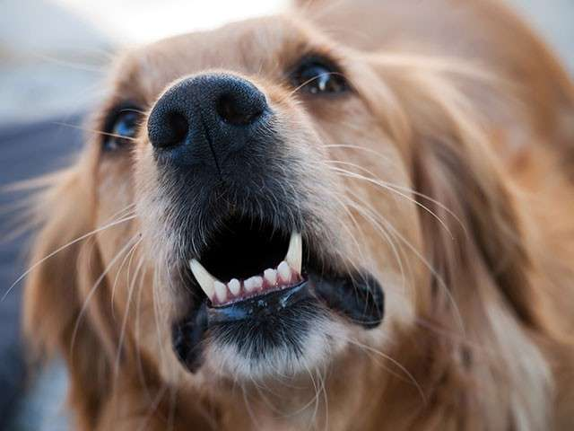
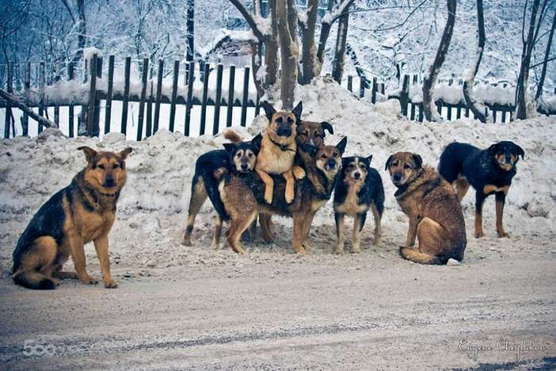

# Нохой дайрах үед яавал зохих вэ?

Урдаг нохой дайрах үед өөрийгөө хамгаалахын тулд:

1/. Гарын дорх өөрийгөө хамгаалж болох зүйлсийг олж ашиглах.\
2/. Айж байгаагаа огт мэдэгдэхгүй байх. Үүнийг мэдсэн нохой хазаж байж салдаг. \
3/. Ар нуруугаа харуулах, эргэх байрлалд орж болохгүй. \
4/. Бүү зугт. Хичнээн айсан ч зугтаж болохгүй. \
Хүн нохой дайрах үед сандарч, хяналтаа алддаг бөгөөд энэ үед нохой хаздаг. Тиймээс маш түргэн өөрийгөө гартаа авч, хир хурдан байр байдлаа цэгнэж өрийгөө хамгаална, төдийчинээ хазуулахаас сэргийлнэ. Архирч буй нохой шууд хазах гэж буйн шинж. Нохой хуцах, араас чинь дагавал, зогсож тайван чанга дуугаар, гараа далайх, өргөх хөдөлгөөн үзүүлэхгүйгээр хөөх хэрэгтэй. Мөн ойр байгаа дуу чимээ их гаргахаар зүйлийг нүдэж цохин чанга дуугаар хашгирч загинах, хөөх үр дүнтэй. Азаар халаасанд нь, гялгар уут байж, үлээгээд цохиж чанга дуу гарган аврагдсан тохиолдлууд бүртгэгдсэн байдаг. Нохой дайрахдаа хажуу талаас, ар талаас хаздаг тул, тийм байрлалд орж болохгүй, боломжоороо ар талаа хамгаал. Сүрэглэн явж байгаа нохдыг харвал, тойрч гарах, аль болох ойртохгүй байсан нь дээр.
