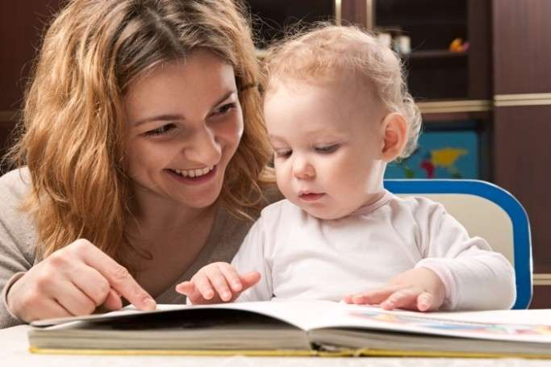
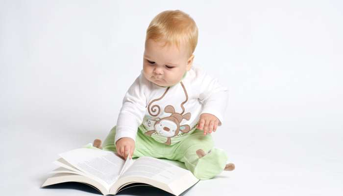

# Ном уншиж өгөх нь хүүхдийн хөгжилд маш сайн нөлөөлдөг

Английн Боловсролын Их Сургуулиас, засгийн газрын захиалгаар, таван настай 8 000 хүүхдүүдийг хамруулан явуулсан судалгаа, эцэг эх нь хүүхдүүддээ ном уншиж өгдөг гэр бүлд өсч байгаа хүүхдийн суралцах, танин мэдэхүйн чадвар маш өндөр байдаг болохыг харуулжээ.

Эдгээр хүүхдүүдийн үгсийн сан илүү баялаг, ой тогтоолт нь сайн, аливааг сурах хүлээн авах чадвар нь илүү хөгжсөн, биеэ зөв авч явах чадвартай байдаг гэж дүгнэсэн байна. Англи гэр бүлийн 4/5- нь, хүүхдээ төрмөгц, унтахын өмнө, дунджаар 22 минут ном уншиж өгдөг. 18%- нь 6 сартайгаас нь, ном уншиж өгдөг болох нь харагджээ. Харин зурагтын өмнө 3 цагаас дээш суух боломж өгдөг гэр бүлүүдийн хүүхдүүд суралцах чадвар сул, муу үзүүлэлттэй гарсан аж. Ном уншиж өгдөггүй ч байнга хүүхэдтэйгээ ярилцдаг, зааж тайлбарладаг гэр бүлийн хүүхдүүдийн чадавхи муугүй гарсан боловч ном уншиж сонсгодог хүүхдүүдийн чадавхийн үзүүлэлтэд хүрэхгүй байсан байна.

Манай эцэг эхчүүд, үүнийг хэрэгжүүлэх зайлшгүй шаардлагатай байна. Хүүхдийг төрмөгц ном уншиж өгч сурах хэрэгтэй ба ойлгохгүй гэсэн үгээр шалтгаацан бүү хойш тавиарай. Үр хүүхдээ нялх багаас нь хүмүүжүүлэх хамгийн сайн арга бол ном уншиж өгөх, номтой нөхөрлүүлэх асуудал юм. Хүүхдээ, бага, ойлгохгүй гэсэн бодол төрвөл, тархины тайлагдашгүй нэгэн нууц үйлчилж, бяцхан ухаанд нь хураагдан үлдэж байх боломжийг бүү үгүйсгээрэй.

.
