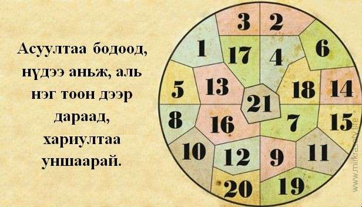
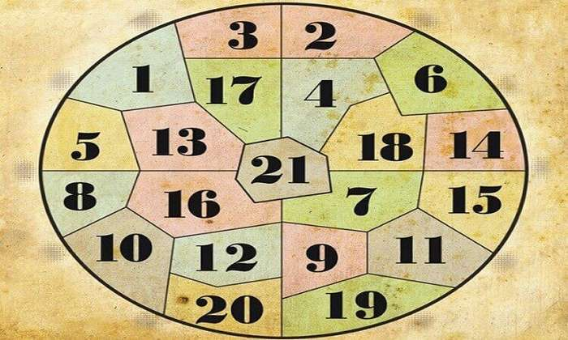
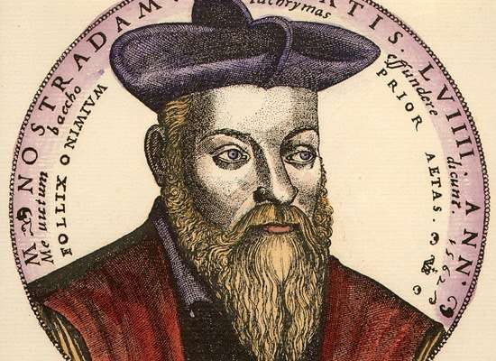

# Нострадамусын, тойргийн мэрэг

Асуух зүйлээ, бодоод нүдээ аниад, тоонуудаас дарж нэгийг нь сонгож хариултаа уншаарай.

Мишель де Нострадамус, зурхайч, эмч, алхимич хүн байсан бөгөөд урьдчилан харах авъяасаараа дэлхийд алдаршсан билээ. Түүний урьдчилан харж бичиж үлдээсэн зүйлс одоо ч биелэлээ олсоор байдаг. Энэхүү тойргийн мэргийг 97% таардаг гэж үздэг байна.\
Нүдээ аниад дарсан тоо, таны, асуусан зүйлийн тань, хариултыг заана.

---

#### Хариулт:

1. Та, хүнд хэцүү байдалд ч тэнцвэрээ алддаггүй хүн юм. Алив асуудлаас бүү халшраарай. Танд, хангалттай тэвчээр, хүч чадал бий. Таныг амжилт хүлээж байна. Өөртөө болон бусдад итгээрэй.\
2. Өнөө, маргаашдаа өөрчлөлтгүй. Хэн нэгэн саад болно. Хүндээр бүү тусгаарай. Асуудлынхаа аль ашигтай талыг илүү тооц.\
3. Ойрын өдрүүдэд болох үйл явдлууд, хүсч хүлээснээс тань давах нь. Хүч чадал, зүтгэлээ зөв ашиглавал бүх зүйл тан руу эргэнэ. Өөртөө болон бусдад, тэвчээртэй хандаарай.\
4. Яг одоо танд, амжилт тань, гарт тань юм шиг л байна. Бүү эргэлзээрэй. Амжилт таныг, удаан дагах нь. Үүнийгээ үр дүнтэй ашиглаарай.\
5. Өнөөдрийн байдлаар, та, бусдын бодол санаанд илүү анхаарал тавиад, аятайхан зүйлсээ өнгөрөөгөөд байна. Удаан хүлээлгүйгээр, тайлан тавих цаг гэж байдгийг ойлгуул.\
6. Хүсч буй зүйл тань санаснаас тань түвэгтэй байна. Бусдын бодол өөр. Хуурмаг найдлагад хөтлөгдөлгүй, сайн, ойр дотны хүнээс зөвлөгөө аваарай.\
7. Асуудал шийдэгдээгүй байна. Өөртөө, хугацаа өгч, түүхий санаа бодлуудаар тархи толгойгоо бүү дүүргэ. Өдрөөрөө амьдар. Цаг нь болоогүй байна.\
8. Болгоомжтой байх. Бусдын ярьж хэлж буй зүйлд, тэр бүрчлэн итгээд хэрэггүй. Зарим тохиолдолд, зайгаа барих хэрэгтэй байна. Эргэн тойронд чинь ашигтай мэт байгаа зүйлс, үнэн биш. Дараа нь харамсахгүйн төлөө, болгоомжтой байгаарай.\
9. Бүтнэ. Гэхдээ танд хэн нэгний тусламж хэрэгтэй. Тэр, таны асуудлыг сонирхохгүй байгаа, тиймээс өөр өнцгөөс харж үнэтэй зөвлөгөө өгнө.\
10. Тийм. Гэхдээ өөрийгөө бүү төөрөлдүүлээрэй. Өөртөө маш их итгэл өг. Тэгвэл бүх зүйл чинь бүтнэ. Зөвхөн өөрийгөө сонсоорой. Дараа нь та, харамсахгүй.\
11. Асуултыг арай л эрт тавьж байна. Бүрэн боловсроогүй, тиймээс цаг хугацаа хэрэгтэй. Буулт хийгээд байвал, үнэлэгдэх нь.\
12. Тун магадлалтай. Бүх зүйлс таны бодсоноос илүү түргэн, нааштай явагдаж байна. Сонирхолоо идэвхжүүл. Мөн хэн нэгэн тантай нөхөрлөхийг чин сэтгэлээсээ хүсч буйг анхааралгүй бүү орхиорой.\
13. Бүх зүйл тань төлөвлөсний тань, дагуу явахгүй нь. Та, итгэлгүй байгаа учраас бусдыг эргэлзүүлээд байна. Энэ нь ашиггүй. Энэ байдлаа өөрчил. \
14. Сайн. Идэвхи зүтгэл тань талаар өнгөрөхгүй. Бүх зүйл, нээлттэй харин удаашруулж болохгүй. Санаачлагыг гартаа авбал, бүгдийг гайхшруулж болохоор байна.\
15. Аз жаргалдаа итгэлтэй байж болно. Таныг санаанд тань ч байгаагүй, сайхан зүйл хүлээж байна. Зөвхөн хүлээ. Яарч хэрэггүй.\
16. Бүх хүслүүд тань биелэнэ. Гэхдээ таны, бодсоноор бус. Туйлшрахгүй, санаанд тань байгаагүй, тэрхүү өөрчлөлтүүдэд бэлэн бай. Ямар ч зүйлсийг уян хатнаар, хүлээн аваарай.\
17. Шийдэгдээгүй байна. Хүсч буй зүйлээ дахин сайн бодож нягтал. Гадны маш их хамааралтай. Ойрын өдрүүдэд, бүх юм хуучнаараа байна. Гэхдээ нэг азтай тохиолдол гарна, өөрийнхөө зөн совинг сонсоорой.\
18. Хүндрэл гарч болзошгүй. Хямрах магадлалтай. Гэхдээ бүх зүйл “тэг”-д орчихоогүй. Эерэг зүйлс бий болох хугацаа өг. Найз нөхдийн хүрээ өргөсөх хандлагатай. Илүү сайн, тогтвортой хүрээлэл бий болно.\
19. Муу зүйлс танаас, хол байна. Хэрэв та, эргэлзээ болгоомжлолоосоо, эртхэн салахгүй бол, буруутна. Хэрэв таныг аз тойроод гарвал, өөрийнхөө, өөртөө итгэлгүй, санаачлагагүй байдлаа буруутгаарай. Бусадтай нээлттэй, найрсаг харьцаа тогтоогоорой.\
20. Тиймээ, аз хийморь тань, таны гарт байна. Бүтэх эсэхэд эргэлзээд хэрэггүй. Энэхүү аз, амжилт, урт удаанаар таныг дагах болно.\
21. Тиймээ, зорилгодоо хүрэхэд багахан л зүтгэх үлдлээ. Та, сүүлийн удаа хүчээ гарга, бүтнэ. Эргэн тойрондоо болж буй зүйлст анхааралтай байгаарай, энгийн нэг тохиолдол гэж байдаггүй юм шүү.
