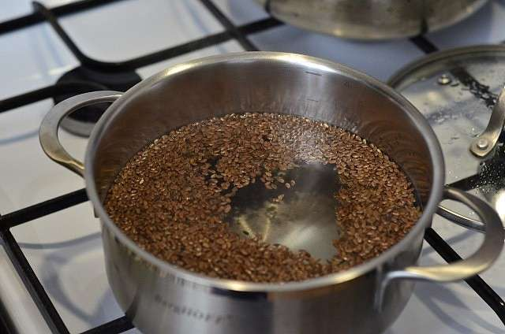
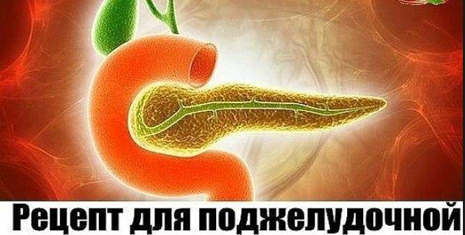

# Нойр булчирхайн өвчилөлд тустай үр

Энэ үр, нойр булчирхайн өвдөлтийг хоромхон зуур дарж, өвчилөлийг эдгээдэг. Нойр булчирхайн эрүүл мэндийг сахих энэхүү үрийг маалингын үр гэдэг бөгөөд хагас стакан буцламгай усанд, 1 хоолны халбагыг хийж, 5 минут орчим зөөлөн гал дээр буцалгаад, хэсэг тавьна. Хөрмөгц, хоолноос хагас цагийн өмнө уух хэрэгтэй. Бага зэрэг цэлцэгнэсэн, хальс нь хөвж байдаг ба бүгдийг нь хамт уудаг. Эхний удаа уухад л үр дүн нь мэдрэгддэг. Хэрэв өвдөлт өгдөг бол өдөрт 2-3 удаа хэрэглэнэ.
