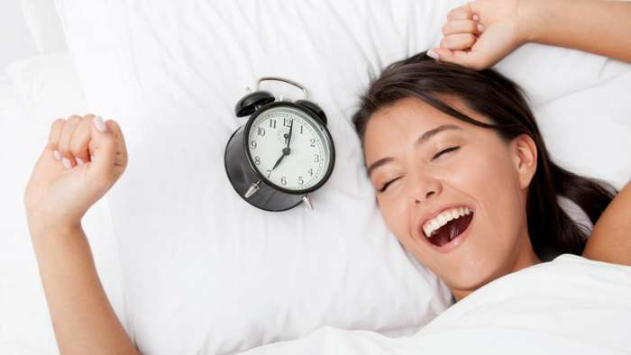
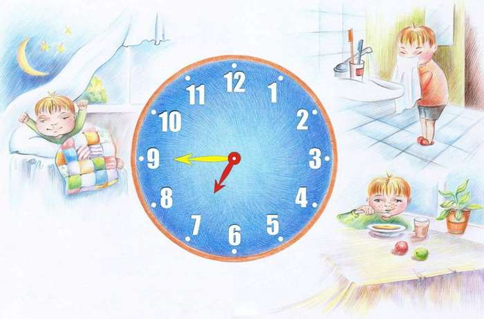

# Нойр эрүүл мэндэд хэрхэн нөлөөлдөг вэ?

Хүн унтаж нойрсоход хамгийн тохиромжтой хугацааг 7,5 цаг гэж үздэг ажээ. Нойр ихдэх буюу багадахад эрүүл мэнд, гоо сайхны хувьд ямар нөлөө үзүүлж болохыг урьдны хүмүүсийн мөрддөг байсан дараах зөвлөмжөөс харж болох юм.

#### 4 цаг унтвал өвчинд өртөмтгий болно

Өвчин болно. Гүн нойрсолтын үе алдагдаж толгой бие тавгүйтнэ. Өсөлтийн гормон болон дархлаажуулалт нь зөвхөн гүн нойрсолтын үед л бүрддэгээс бие өвчинд өртөмтгий болж, зүрхний ачаалал ихэсдэг. Эсийн өсөлт зогссоноор хүн илүү хурдтай хөгширч, нас барах эрсдэл өндөрсөнө.

#### 5 цаг унтдаг бол осолд орох эрсдэл 7 дахин нэмэгдэнэ

Жин нэмнэ. Туршилтанд оролцогчид маргааш нь ой санамжийн маш их асуудалтай болдог нь ажиглагджээ. Осолд орох эрсдэл 7 дахин ихэсдэг байна. Мөн энэ үед нойрсолт нь биеийн идэх дуршлын гормоныг 15%-иар өсгөдөг байна. Үр дагавар нь, хүчилтөрөгчийн солилцоо хэвийн бус явагдаж, их өлсөнө. Удаан хугацаагаар үргэлжилбэл таргалах магадлал улам өндөр болно.

#### 6 цаг унтвал сэтгэл тогтворгүйтнэ

Сэтгэл зүйн тогтворгүй байдал үүснэ. Шөнө зургаан цаг унтсан хүн маргааш нь сэргэсэн байдаг хэдий ч хурдан ядарч эхэлдэг байна. Удаан үргэлжилбэл сэтгэл зүйн хувьд тогтворгүй болдог аж. 6 өдөр дараалсан тохиолдолд энэ байдал нь огцом ихэсгэдэг гэнэ.\
Туршилтаар байнга 6 цаг унтдаг хүний мэдрэмж 2 өдөр дараалан огт унтаагүй хүнтэй адил их муу байдаг.

#### 8,5 цаг унтвал гунигт нэрвэгдэнэ

Гунигтай болно. Санал асуулгаар найман цагаас их нойрсогчид залхуурсан, гунигтай байдалд их өртөж, сэтгэл санаа, зан аашны хувьд тогтворгүй болдог гэсэн үр дүн гарчээ. Удаан нойрсогчдын бас нэг том асуудал нь нойр хулжих явдал болдог байна.

#### 9,5 цаг унтвал судас аюулд учирна

Зүрхэнд муугаар нөлөөлнө. 9 цагаас илүү нойрсдог хүний зүрх өвдөх эрсдэл нь 38%-иар ихэсдэг болохыг Бостонд 70,000 хүнийг хамруулсан судалгаагаар тогтоожээ. Судлаачдын таамаглаж байгаагаар удаан нойрсолт нь хүний биеийн цитокинд нөлөөлдөг бөгөөд энэ нь үрэвслийг идэвхижүүлдэг бөгөөд ингэснээр зүрх судасны системд ихээр аюул учруулдаг байна.

#### 10 цаг унтвал нас богиносно

Нас богиносно. “Удаан нойрсолт нь өмөн үү өвчний хүчин зүйл болдог” гэж Даниел Крипке анхааруулж байна. Түүний Америкт сая гаран иргэдэд хийсэн удаан хугацааны судалгаагаар 10-аас илүү цаг унтагчид нь ердийн долоон цаг унтагчдаас эрт нас барах эрсдэл нь мэдэгдэхүйц их байсан байна.
