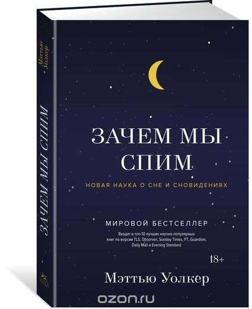

# Нойр оюун сэтгэхүйг эмчилж, сармагчинг ч хүн болгон хувиргах чадалтай

Нойроо хасч аливааг амжуулах гэж үзэх нь буруу гэж, Америкийн мэдрэпийн нэрд гарсан эмч, профессор Мэттью Уолкер хамгийн өндөр борлуулалттай номоор шалгарсан, “Яагаад бид унтдаг вэ?” хэмээх номондоо тодорхой бичжээ. Тэрээр, нойр гэх энэ зүйлийн үрээр хүн төрөлхтөн, оюун ухаант хүн болсон. Зүүд бол, зөвхөн хүний л тархи боловсруулж чадах хүмүүсийн бүтээлч чадвар юм гэж бичсэн байна.

Мөн жишээ болгож, нэгэн сонирхолтой туршилтынхаа тухай бичсэн бөгөөд уг туршилтдаа, тусгайлан бүтээсэн банкны системтэй холбосон сэрүүлэг ашиглан, унтаж байгаа хүний хажууд тавьжээ. Тэгэхдээ уг унтаж буй хүнд, сэрүүлэг дуугарах бүрт, түүний хамгийн дургүй улс төрийн намын дансруу 10$ шилжнэ гэж урьдчилан сануулсан байна. Тэр, хэдийгээр нойр дутуу байснаас нам унтахаас өөр аргагүй байдалд байсан ч, сэрүүлэг дуугарах бүрт сэрж байсан аж. Энэ туршилт, хүмүүс бодол санаанаасаа болж гүн нойрсолтод орж чаддаггүй болохыг харуулж байна гэсэн байна. Тиймээс, хүмүүст, нойрны тухай илүү ихийг мэддэг байх, мөн олон хүмүүсийн хэлж ярьдаг, амьдралынхаа 3/1 хувийг унтахад зориулдаг хэмээн шүүмжлэлтэй ханддаг асуудлыг өөрөөр харахыг сануулжээ. Зүүдлэх боломжтой дуг хийх түргэн хугацааны нойр авалт бүх сүүн тэжээлтэнд байдаг гэсэн судалгаа гарсан бөгөөд харин хүний хувьд энэ нь хамгийн их байдаг гэнэ. Тайван гүн нойрсох үеийн зүүд зүүдлэх чадвар тархины холбоосуудын нейронуудыг өсгөж, оюун санаа хөгжих, нийгмийн харилцаанд оролцох чадавхи буюу амьтнаас ялгарах боломжийг олгодог аж. Мөн Уолкер, зүүд бол бүтээлч санаануудын үүсэх, өсөх, биелэх орчин гээд, Менделеев үелэх системийн химийн элементүүдээ зүүдэндээ нээсэн, Томас Эдисон шөнийн харанхуйг гэрэлтүүлэх чийдэнг нээсэн ч, хүмүүсийн нойрыг хугаслах энэхүү гэрлээ мөн зүүдэндээ нээсэн гэх мэт жишээнүүдийг авчээ. Томас Эдисон зөөлөн сандал дээр суугаагаараа унтах дуртай байсан бөгөөд хөлийнхөө дэргэд хайруулын таваг тавьж, гартаа төмөр бөмбөлгүүд атгаж суугаад унтаж, зүүд зүүдлээд эхэлмэгц булчингууд нь суларч бөмбөлгүүд хайруулын таваг дээр унахад, чимээгээр нь сэрж зүүдэндээ харсан зүйлсээ бичиж авдаг байсан гэсэн яриаг мөн дурдсан байна. Зүүдэнд бидний сэтгэгдэл, бодол санаанууд хоорондоо холилдон бүтээлч санаанууд төрөх боломжтой. Үүнийг “Өдрийн бодол шөнийн зүүд” болтлоо ажиллах, зорих тохиолдолд хэрэгждэг гэжээ. Нойр дутуу байх нь ой санамжийг бууруулж, алцгеймерын өвчилөлд хүргэдэг. Маргарет Тэтчер, Роналд Рейган нар, нэг бус удаа, хоногт 4-5 цаг унтдаг хэмээн бараг бахархалтайгаар зарладаг байсан, энэ хүмүүс энэ өвчинөөр өвдсөн. Өнөөгийн ерөнхийлөгч Доналд Трамп мөн бараг очсон газар бүртээ ийм зүйл ярьж явах юм. Тиймээс, өнөөдөр ийм бодол санаатай яваа хүмүүс үүнийг анхаарч, амжилтын төлөөс тань ийм үр дагаварт хүрэхээс болгоомжлох хэрэгтэй гэж зөвлөжээ.
