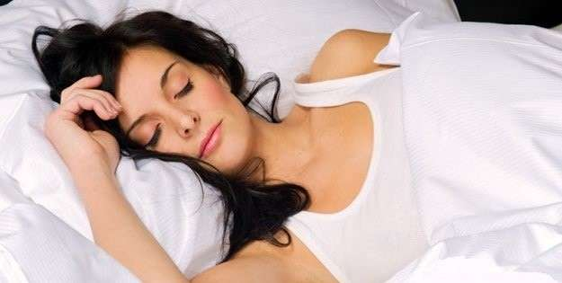
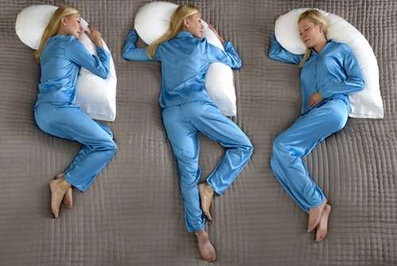

# Нойрсох үеийн зөв байрлал ба эрүүл мэнд

Нойр нь хүний бие организм , сэтгэхүйн эрүүл мэндийг дэмжих, амраах хамгийн чухал зүйл бөгөөд унтахдаа зөв байрлалаар хэвтэж сурах, хэвших нь эрүүл мэндэд ашигтай байдаг аж. Зөв байрлалтай унтаж сурснаар, арьсны эрүүл байдал, хоол боловсруулах системийн үйл ажиллагаа, дархлааг сайжруулж болдог байна.

Дээш харж унтах нь, амьсгалахад саад учруулж хурхирахад хүргэхээс гадна астма, амьсгалын замын өвчлөлтөй хүмүүсийг ийм байрлалаар унтахгүй байхыг зөвлөдөг. Ийм байрлалтай унтах үед цусан дах хүчил төрөгчийн хэмжээ багасч, амьсгалын замын өвчлөлд хүргэдэг.\
Баруун хажуугаараа унтах нь хоол боловсруулах системийн үйл ажиллагаанд муу, мөн бие организмын баруун талд илүү байрладаг тунгалагийн булчирхайнуудыг дарснаас биеэс хор гадагшлах явцыг сааруулж аливаа өвчлөлд хүргэдэг.\
Зүүн талаараа унтах байрлалыг зөв гэдэг. Энэ үед хоол боловсруулах эрхтэнүүд, ялангуяа ходоод, нойр булчирхайн ажиллагаа сайжирснаар тунгалагийн булчирхайн хор гадагшлуулах үйлчлэлийг дэмжиж өгдөг байна.\
Зүүн талаараа унтаж сурахын тулд, эхний үед суртлаа, орныхоо баруун талд шөнийн гэрэл тавих /хүн гэрлээс зайлсхийж буруу хардаг/, мөн баруун гар талдаа том дэр тавих зэргээр унтаарай.

Сайн унтаж амрах нь бидний ажиллах өндөр чадвар, өндөр дархлаа, урт наслалтын үндэс бөгөөд зөв унтах байрлалыг хэвшүүлэн эрүүл мэндээ дэмжих нь бидний эрүүл мэндийнхээ өмнө хүлээх үүрэг билээ.
