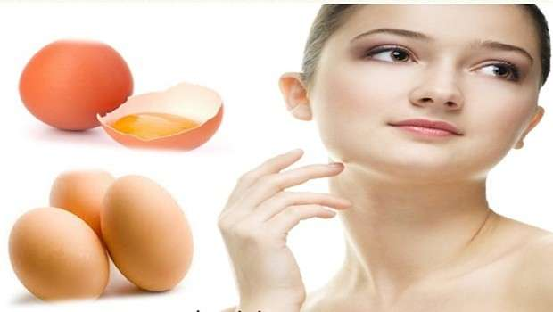
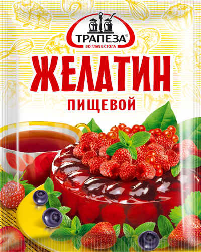
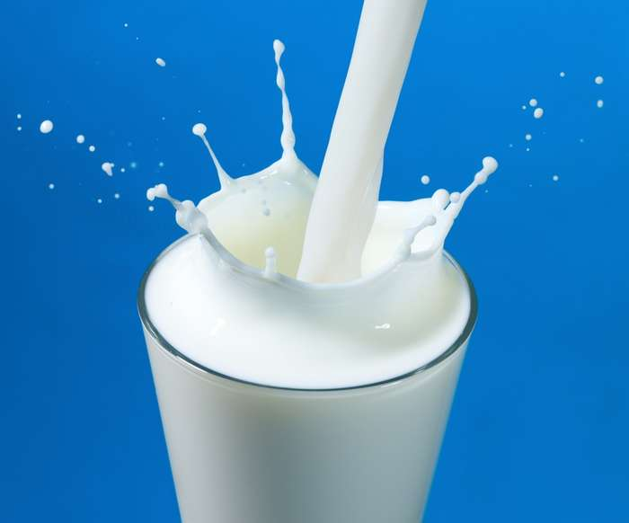

# Нүүр, хүзүүний арьсыг залуужуулах, коллагентай маска

Өөрийн гараар бэлтгэх энэ маска нь арьсны эд эсийг бүрэн сэргээх, хүчтэй үйлчилгээтэй. Суларч унжсан арьсыг чангалж, үрчлээ арилгадгаараа гайхагддаг. Энэхүү желатинтай маска, арьсны гүн давхаргыг коллагенаар дүүргэн, арьсны өнгөн үеийг тэгшилж өгдөг.

Орц:\
1 хоолны халбага желатин\
5 хоолны халбага сүү\
10 дусал А витамин\
10 дусал Е витамин\
1 өндөгний шар\
1 цайны халбага оливын тос\
Сүүгээ бага зэрэг халааж, 30 минутын өмнө хөөлгөж тавьсан желатин болон бусад орцуудыг нэмж сайтар хутгана. Буцалж буй устай саванд, хутгасан савтай нь дүрэх маягаар халаан, бүлээнээр нь, цэвэрхэн арьсанд түрхэнэ. 30 минутын дараа хүйтэн бүлээн усаар угаагаарай. Маска тавихаас өмнө, арьсаа гуужуулагч эсвэл скрабаар цэвэрлэсэн байвал илүү үр дүнтэй. Нэг өдөр алгасан, 10 удаа тавиад, та, гайхалтай үр дүнг нь үзэх болно. баярласан сэтгэлээ хуваалцаарай.

---

