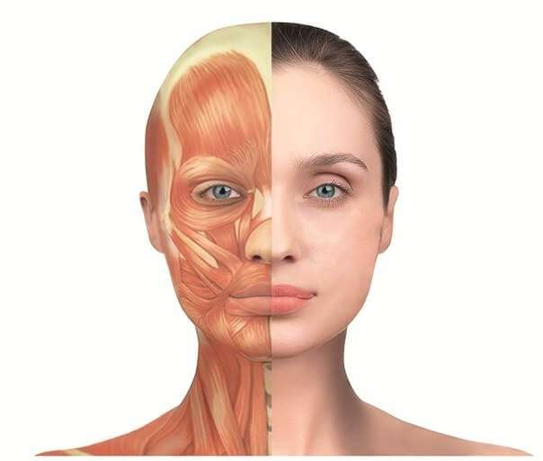
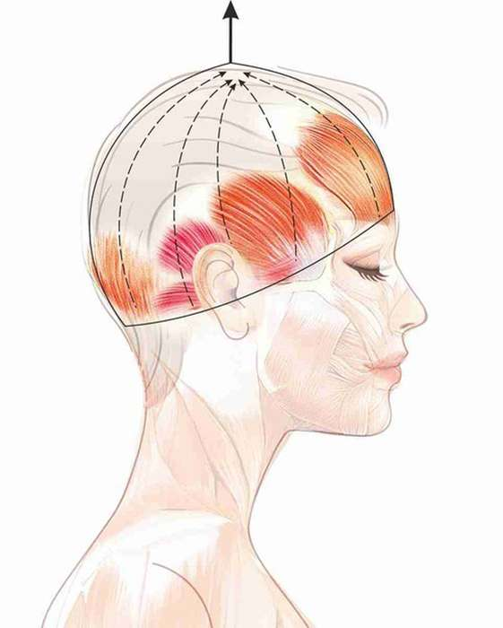
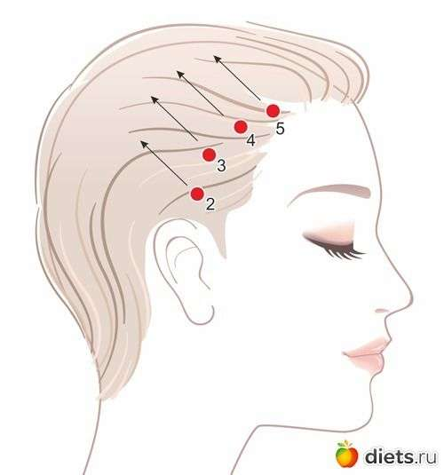

# Нүүрний арьсыг татах үр дүнтэй дасгал

Энэ дасгал нь, “дуулга” буюу Бенита Кантиниены дасгал гэж нэрлэддэг, ялангуяа 45 нас хүртэлх хүмүүс, зовхи, хацар, уруулын хоёр тал унжих, ерөнхий нүүрний арьс сулрах зэрэг таагүй асуудлуудаас бүрэн сэргийлж болдог үр дүнтэй нүүрний дасгал юм.

---

Суугаа болон зогсоо байрлалын алинд ч хийж болохоос гадна хэзээ ч, хаана ч хийж болдог давуу талтай. Ганцхан нуруу, толгойны байрлал маш цэх байх ёстойг шаарддаг. Эрүүний байршил сул, амаа жимийгээгүй, хэлний үзүүр үл ялиг дээш, дээд шүдний дээд талруу чиглэсэн байх ёстой бөгөөд дух, дагзны булчингуудыг дээш толгойн орой руу чиглэн дээш хөдөлж, толгойн арьс мөн дээш агшиж байна гэж төсөөлснөөр дасгалыг эхлүүлдэг. Энэ үед, чамархай дээш татагдахад араас нь чих хойшилж дээш татагдах ба дагзны булчингийн араас хүзүүний булчин мөн, татагдах нь мэдрэгддэг ба бариу нэхмэл малгай өмсчихсөн юм шиг мэдрэмж төрөх бөгөөд толгойн оройн цэг рүү бүх арьс татагдна. Ийм байдлаар 10-20 секунд болоод, булчингуудаа суллана. Дасгалыг хир эзэмшиснээс шалтгаалан 3-10 удаа давтан хийнэ. Үсээ толгойн орой дээр маш чанга боож уясан юм шиг мэдрэмжийг төрүүлэхийг хичээ. Мөн өөрийн болгож эзэмшихийн тулд, үсээ орой дээрээ чангаар боосон ч болно. Эхний үед толины өмнө хийвэл илүү үр дүнтэй гэдэг. Өдрөөс өдөрт, толгойн булчингууд, түүний байршилууд, мөн татагдах хөдөлгөөнүүдийг нь, мэдэрдэг болдог. Дахин сануулахад, энэ дасгалыг хийх үед, нүд, эрүү, уруул, хүзүүний булчинг чангалахыг хориглодог ба зөвхөн дээр дурдагдсан булчингууд ажиллах ёстой байдаг байна. Энэ дасгал нь, хацрын унжилт, давхар эрүүг арилгах, нүүрний хэлбэрийг засах, нүдний тойрог булчингуудыг чангалснаар дээд, доод зовхины унжилтыг шийдэх, духны үрчлээ тэнийлгэх, нүүрийг нэлэнхүйд нь татах үйлчилгээтэй бөгөөд хэрэгтэй үедээ энэхүү “дуулга”-аа өмсчихөөд гайхалтай харагдах боломж өгдөг бөгөөд тогтмол хийснээр гоо сайхны хагалгаа хийлгэх, өөр бусад өндөр өртөгтэй гоо сайхны үйлчилгээ хийлгэх шаардлагад хүрэх чинээний нүүрний арьсны асуудалд орохгүй байх үр дүнтэй юм.
