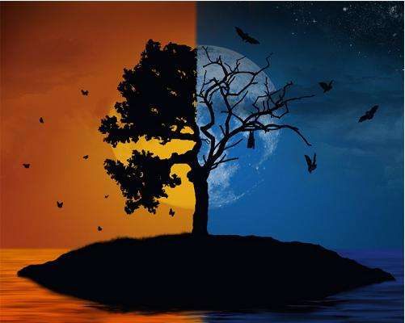

# Өдөөгч

Хүн төрөхөд, аз жаргалтай амьдрахад хэрэгтэй бүх зүйл өгөгддөг бөгөөд үүнийг амьдрал хэмээн нэрлэдэг. Энэхүү үнэлшгүй бэлэг болох амьдралаа, үр ашиггүй үрж аз жаргалаа, гуниг зовлонгоор солих эсэх нь зөвхөн биднээс өөрсдөөс хамаарч байдаг. Энэхүү сонголтоо зөв хийхийн тулд дараах зүйлийг уншиж сайтар тунгаан бодоорой.

Ертөнц бидэнд амьдралыг өгсөн, гэтэл бид цаг нөгцөөхийн тулд тоглоом эрж хайж цагийг алах юм. Ертөнц бидэнд гар, хөл өгсөн гэтэл бид ганцхан хуруугаа хөдөлгөн гар утасны товчлуур дарж суух юм. Ертөнц бидэнд бүхэл бүтэн дэлхийг өгсөн гэтэл бид, хөдөө гадаа, хөрш зэргэлдээ аймаг сум ч явж үзээгүй нэг дороо сууцгаах юм. Ертөнц бидэнд хэл өгсөн гэтэл бид, утсаар ярихаас ч залхууран мессеж бичилцээд сууцгаах юм. Ертөнц бидэнд нүд өгсөн гэтэл бид, одод анивалзсан шөнийн огторгуй, хязгааргүйд дуудсан хөх тэнгэрээ хааяа ч атугай харах завгүй, хөл доорхоо л харах юм. Ертөнц бидэнд бүхэл бүтэн гариг өгсөн гэтэл бид, навчин дороос бултайх жимсгэнийг ч олж харах боломжийг өөртөө өгч чадахгүй гундацгаах юм. Ертөнц бидэнд харамгүй өгсөн эдгээр зүйлийг үнэлэн баяртайгаар ашиглахын оронд, бид, эргэн тойронд болж буй бүх зүйлд гоморхоцгоон, төрөл төрөгсөд, засаг төр, улс төрчид, танил тал бүгд бидэнд өгөх, туслах албатай юм шиг гомдоллоцгоох юм. Ертөнц бидэнд бүгдийг өгсөн, ганцхан хичээж босоод гариг ертөнцөө харцгаая. Бидний өмнө мянган зам, түмэн харгуйг Ертөнц өгчээ. Харин бид анхны сонгосон тэр л жимээрээ мацаж явна. Бидний өмнө зуу зуун улс орон, мянга мянган хэл, сая саяараа өв соёл байна. Бид үүнийг үзэж харахыг ч оролдохгүй байна. Бидний зам, гэр, ажил, гэрийн ойролцоох баар, кафегаар л хязгаарлагдна. Ертөнц бидэнд, түмэн төрлийн амттанг амсуулах, идүүлэхээр амтлах, үнэрлэх мэдрэмж өгсөн гэтэл бид хичнээн ч жил нэгэн төрлийн хүнс хэрэглэнэ вэ? Бидэнд, өөр шинэ зүйлийг амсах хэрэглэх зориг зүрх ч унтарчээ. Бид, маргааш бүх зүйл өөрчлөгднө гэж найдлага тавьдаг. Гэтэл өөрчлөлтийг зөвхөн чамаас өөр хэн ч хийхгүй гэдгийг мэдэж ав.
