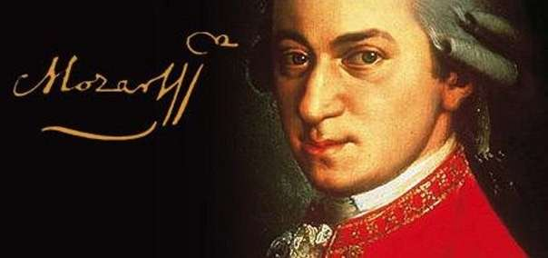

# Өдөр бүр Моцартыг сонсохын ашиг тус

60-д оны дундуур, Францын нэрт жүжигчин Жерар Депардье нэг өгүүлбэрийг ч бүрэн дуустал хэлж чаддаггүй хазгай хэлтэй залуу хөвгүүн байсан гэвэл итгэх хүн ховор биз ээ.

Түүнийг мэддэг, мөн сонирхон судалсан хүмүүс, түүний хэл ярианы гажгийг, гэр бүлийн өсч төрсөн орчин, хувийн азгүйтэл, өөрийгөө үнэлэхгүй байдал, суралцах үеийн хүндрэлүүдтэй нь холбон үзсэн байдаг. Түүнийг ганцхан зүйл бусдаас ялгаруулдаг байсан бөгөөд, энэ нь түүний жүжигчин болох жинхэнэ хүсэл нь байсан аж. Депардьегийн багш нь, түүнийг Парис руу, тухайн үеийнхээ нэртэй эмч, хөгжмийн эмчилгээ, тэр дундаа Моцартын хөгжмийн эрүүл мэндэд тустай чанар, эмчилгээг судлахад олон жилээ зориулсан Альфред Томатис руу явуулжээ. Томатис эмч, Депардьегийн хэл ярианы гажиг, хоолой нь тасрах, мөн ой тогтоолттой холбоотой асуудлуудын шалтгаан нь сэтгэл хөдлөлтэй нь холбоотой болохыг тогтоож, тусална гэдгээ амлан, өдөр бүр эмчилгээнд ирж, хэдэн долоо хоногийн турш өдөрт хоёр цаг Моцартыг сонсох эмчилгээ бичиж өгсөн байна. Гайхсан Депардье –“Моцартыг уу? Яагаад заавал Моцарт” гэж дахин дахин лавлан асууж байсан гэдэг. Хэдхэн долоо хоногийн дараа, түүний хэл яриа тод болж зүгширэн, хэдэн сарын дараа жүжигчиний сургуульдаа эргэн ирж, амжилттай төгссөн бөгөөд агуу, алдарт жүжигчин болсон билээ. Томатис эмч, судалгааныхаа явцад, Моцартын хөгжим өвчитнүүд болон үйлчилүүлэгчидийг тайвшруулж, тэдний орон зайн төсөөллийг сайжруулж, өөрийгөө илэрхийлэх чадварыг нь нэмэгдүүлдэг болохыг дараа дараагийн туршилтуудаар нотолсоор байв. Яагаад зөвхөн Моцарт, Бах, Бетховены хөгжмүүд яагаад болохгүй гэж? гэсэн асуултуудад, тэрээр, Моцартын хөгжим нь сэтгэл хөдлөлийг тэнцвэрийг зохицуулдаг, мөн бие мах бодыг хөдөлгөөнд урин дууддаггүй, хэт чанга биш, хэт сул биш, хурдан түргэн эсвэл хэт уянгалаг бус, энгийн, ердийн, нууцлаг аялгуунууд юм, Моцартын хөгжим, хүний сэтгэл санааны тэнцвэртэй байдлыг хангахад хамгийн их тохирдог, анагаах ухаан бүхий л системээрээ эрмэлздэг, бие мах бод, сэтгэл санааны зохилдлогоог сэргээдэг, аялгуу аязны жинхэнэ жор нь бүрдсэн “оюун санааны хоол” юм гэж дүгнэжээ. Түүнчилэн, Английн нэгэн сүмийн лам, Моцартын хөгжмийг сонсгосон үнээний сүү илт нэмэгдэж байлаа хэмээн тэмдэглэн үлдээсэн байдаг аж.

Моцартын оюуны чадварыг өсгөх эмчилгээний аяз

<iframe src="https://www.youtube.com/embed/SaMgU6HyNLo" width="640" height="360" allowfullscreen></iframe>

Моцартын хөгжим. Стресс тайлах хүчтэй үйлчилгээтэй гэж үздэг.

<iframe src="https://www.youtube.com/embed/33tvGLe7RXQ" width="640" height="360" allowfullscreen></iframe>
