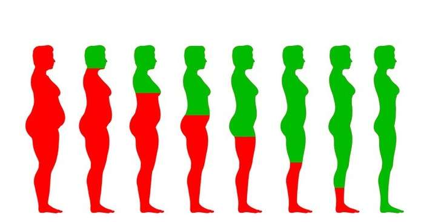
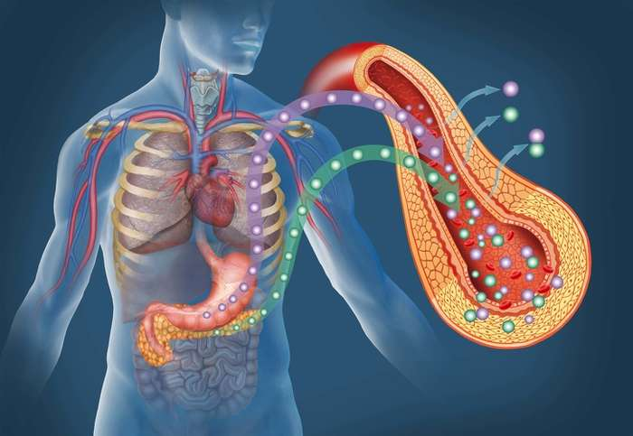

# Өдөр бүр явган алхахад бие организмд, дараах 10 өөрчилөлт гардаг

Анагаах ухааны эцэг, эртний грекийн их оточ Гиппократ, “Алхах нь, ямар ч эм тангаас хавьгүй илүү, хамгийн сайн эм юм” гэж хэлдэг байжээ. Эрүүл зөв хооллолт, мөн бүрэн сайн нойрсолттой алхалтыг хослуулж чадвал хэзээ ч өвддөггүй аж. Өдөрт ердөө 15-30 минут алхаж дадсанаар эрүүл мэнд сайжрахаас гадна мөн гадаад гоо үзэмж ч сайжирч байдаг бөгөөд алхалтын үр дүнд бие организмд гарах гайхалтай 10 өөрчилөлтүүдийг танилцуулж байна.

1. Тархины эндорфины түвшинг өсгөж, тархинд эерэгээр нөлөөлж, ой тогтоолт муудах, зөнөглөх, мөн алцгеймерийн өвчинөөс сэргийлэхээс гадна, сэтгэхүйг эрүүлжүүлж байдаг.\
2. Алхахтай нүд, хараа хамаагүй мэт санагдах ч, алхалт нүдний даралтыг бууруулж, харааг сайжруулна.\
3. Америкийн зүрх судасны ассоциаци, зүрх судасны өвчилөлөөс, алхалт бүрэн сэргийлна гэж үзэж байна. Цусны даралт буурах, холестериний түвшин багасах, цусны эргэлт сайжрах нөхцөлүүдийг алхалт бүрдүүлж өгдөг.\
4. Алхалт нь амьсгалын дасгал болж өгдөгөөс уушгийг дасгалжуулж, уушигны багтаамжийг өсгөн, уушигны өвчилөлийн зовиуруудыг дарна.\
5. Нойр булчирхайн үйл ажиллагааг гайхалтай сайжруулдаг. Итгэмээргүй ч, алхалт нь, гүйлтээс 6 дахин илүү чихрийн шижингээс хамгаалдаг болох нь нотлогджээ.\
6. Хоол боловсруулалт сайжрах нь ойлгомжтой. Өдөр бүрийн 30 минутын алхалт, хоол боловсруулах эрхтэнүүдийн үйл ажиллагааг сайжруулдгаас, өтгөн хаталтыг дарж, гэдсэн замын эрхтэнүүдийг хорт хавдраас бүрэн сэргийлдэг байна.\
7. Булчингийн уян хатан чанарыг сайжруулж, мөн жин хасахад гайхалтай нөлөөлнө. Илүүдэл жингүй хүмүүсийн хувьд, галбиржуулах гайхалтай үр дүнтэй. Харин хэт туранхай хүмүүсийг алхалт нь, булчинжуулж таргалуулах нөлөөтэй. Өдөрт 10 000 удаа алхах нь, өдөржин зааланд дасгал сургуулилалт хийхтэй тэнцдэг. Мөн алхалт бага ачаалалтай учираас, өвдөлт хөндүүрлэлт өгдөггүй тул, өдөр бүр хийх боломжтой байдаг.\
8. Яс, үе мөчийг гайхалтай бэхжүүлж өгдөг байна. Алхалт нь, үенүүдийн уян хатан чанарыг сайжруулж, ясны бүтцийг хамгаалж, хугаралт цууралтаас сэргийлнэ. Артрит өвчиний үед, өвдөлт, үрэвслийг дарахын тулд, өдөрт 30 минут удаан аажим алхалтаар алхаж байхыг Артрит эмчилгээний фондоос зөвлөсөөр байна.\
9. Нурууны өвдөлт дарагдна. Өвдөлттэй нурууны бэрхшээм хүнд дасгалаас, бага ачаалал өгдөг алхалт жинхэнэ аварч, дасгалаас илүү тус болдог. Алхах үед нуруу нугасны цусны эргэлт сайжирч, нурууны уян хатан чанар, зөв байрлал сэргэж өгдөг байна.\
10. Тайвшруулж, сэтгэхүйг эрүүлжүүлнэ. Алхалт, бодол санаагаа зохицуулахад тун тустай. Учираа олохгүй үедээ алхаад үзээрэй, ухаан санаа саруулсаж, бодол эерэгжин, өөрийн хүчийг үнэлэх, итгэх мэдрэмж төрөхөөс гадна,зөв тунгаах боломжтой болдог. Мөн сэтгэл санаа өөдрөг болно.\
Ашигтай, хялбар, байгалиасаа байвал зохих, өдөр тутам үүнгүйгээр амьдарч болдоггүй байсан, харин одоо биднээс улам холдсоор буй энэхүү алхалт хэмээх гайхамшигт хөдөлгөөнөө орхих гэж үү? Та бодоорой! Алхдаг, мөн алхаж үр дүнгээ бие дээрээ үзсэн, үзэж буй хүмүүс сэтгэгдэл туршлагаа хуваалцахыг хүсье.
