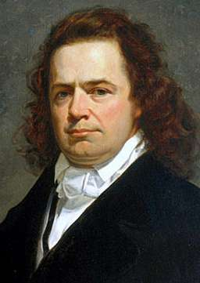

# Оёдлын машин ба зүүд

Элиас Хоу, оёдлын машин бүтээгчидийн нэг. Түүнээс өмнө, олон зохион бүтээгчид оёдолыг хурдан болгох талаар оролдоод бүтээгүй байсан бөгөөд харин Хоу, хамгийн гол технологийг зүүдэндээ үзэн хэрэгжүүлснээр патент авсан гэдэг.

Оёдлын машины ихэнх технологи нь бүтээгдчихээд, хамгийн жижиг оёх технологи дээр учраа олохгүй гацсан Элиас олон шөнийг нойргүй өнгөрүүлсэн бөгөөд нэг шөнө өөрийн эрхгүй дуг хийхдээ, олон зэрлэг хүмүүст баригдан, тэд түүнээс оёдлын машин хурдан хийхийг шаардаж байгаагаар зүүдэлж үхтлээ айсан Элиас, гэнэт тэдний жадны үзүүр хачин байгааг хараад сэрсэн байна. Сэрмэгцээ, уг жадны үзүүр үзүүртээ нүхтэй байсныг санаж, оёдлын машины зүүг нүхтэй болгож, оёдлын машин бүтсэн түүхтэй аж. Мөн үүнтэй адил түүх Менделеевт тохиолдож байсныг бид мэддэг. Хүн, маш их ачаалалтай, бүхнээ зориулан ажиллахад, ачаалж байгаа ажил нь, хүний тархины дотоод, нууц нөөцийг гаргаж ирдэгээс ийм зүйл болдог гэж үздэг байна. Ер нь, ямар ч нээлтүүд асар их хөдөлмөр зүтгэлийн үрээр бий болдог бөгөөд энэ үед, хүний хамгийн нууцлаг тайлагдаагүй хэсэг болох далд ухамсар, зүүдээр хүртэл дамжуулан тусалж байдаг ажээ.
