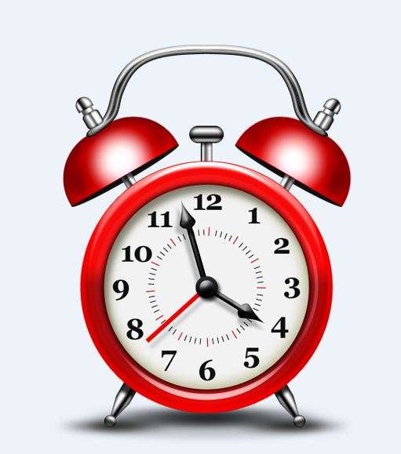

# “Өглөө” бол эрч хүч. Амжилтад хүрсэн хүмүүс яагаад 4:00-д босдог вэ?

Хэт идэвхитэй амьдралтай хүмүүсийн хувьд цаг хугацаа үргэлж давчуу байдаг. Тэд илүү их зүйлийг бүтээхийн тулд өглөөний цагийг ашигладаг байна.

Starbucks сүлжээний ерөнхийлөгч Мишель Гаас 15 жилийн турш, өдөр бүр өглөөний 4:30-д босч ажил хэргээ явуулдаг. Гретхен Рубен өглөө 6 цагт босч, гэр бүлийнхнээ сэрэхээс өмнө нэг цаг ажилладаг.

---

Тайм-менеджментийн шинжээч Лора Вандеркам өөрийн номондоо, бизнесийг амжилттай явуулахад, өглөө эрт босох, шалтгаануудыг гаргаж тавьсан юм.\
Анхаарал төвлөрүүлэлт сайн байдаг.\
Тархины идэвжил маш сайн байдаг тул ажил хэргүүд хурдан шийдвэрлэгддэг.\
Өглөөний эерэг энерги, өглөөд амжуулсан ажлууд, өдөрийг, өөдрөг, амжилттай болгодог.

Өглөө эрт, үүрээр босно гэдэг хүмүүст хэцүү байдаг. Өглөө эрт босох хэцүү байдгийн гол шалтгаан нь орой, оройтож унтдагт байдаг. Өглөө эрт босож сурахын тулд, өглөө хийх зүйлээ, орой нь, тодорхойлсон байх хэрэгтэй. Хэрэв та, 7:30-д босоод сурчихсан бол, огцом биш, аажмаар сэрүүлгээ ухраах маягаар эрт босч сураарай.
