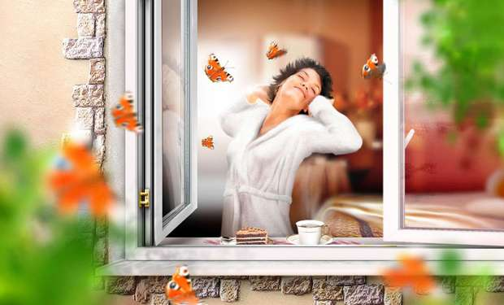

# Өглөө эрт, босоход саад болдог 12 шалтгаан

Эдгээр 12 шалтгаанаас болж хүн, өглөөд сэргэлэн цовоо, эрч хүчтэй сэрэх, босох асуудал хүндэрч, орой босдог зуршилтай болдог гэнэ. Мөн эрт босохын чухлыг хүн, өөрөө чухалд тооцож, эрт босох хэрэгцээ шаардлага гарч байдаг бол эдгээр шалтгаануудыг зайлшгүй уншиж ойлгох хэрэгтэй юм. Эртнээс, өглөө эрт босохыг чухалчилж, “эрт босвол нэгийг сонсно”, “ өглөө нь үдшээсээ цэцэн” гэх зэрэг цэцэн үгүүдээр илэрхийлж, дэмжин ирсэнийг мөн сануулах нь зүйтэй болов уу.

1. Хэт орой, үр тариа, чихэрлэг зүйлсийн агууламжтай хоол хүнс хэрэглэхэд, биен дэх хортой бодисууд ихэсч амарсан мэдрэмжгүй өглөөд сэрдэг бөгөөд бие хүндэрч, сульдсан байдаг. Мөн хоолны шингэлт бүрэн явагдаагүйгээс сэрэх, босох хэцүү байх ба тэр өдөртөө сэтгэл санаа хямрах асуудал дагуулдаг\
2. Хэрэв орой нь маргаашийн хийх ажлаа тодорхой төлөвлөөгүй бол, хэсэг хэвтэж болно гэсэн сэтгэлтэй 5-7 минут хэвтэхэд л амьдралын идэвхи илт буурах процесс явагдах ба оройтож босох зуршил болж хувирдаг бөгөөд ялангуяа хүний сэтгэлийн хүч, хатуужилт чанарт хамгийн их буруу нөлөөлдөг байна\
3. Хэт дулаан хөнжил, зөөлөн ор, халуун бүгчим өрөө, толгойгоо шургаж унтах зуршил, бохир ор дэрний хэрэгсэл хүний сэтгэлийн хүчирхэг чанарыг дарж залхууралд дасгадаг\
4. Оройн цагаар, гэр оронд болдог таагүй үйлдлүүд, хэрүүл маргаан хүний сэтгэхүйд муугаар нөлөөлдөг. Мөн адал явдал, аллага, аймшигийн кино үзэх, халдлага, хүчирхийлэл хямралаар дүүрэн мэдээ үзэх зэрэг нь хүнийг бүрэн амарч унтахад саад болж өглөө нь нойрмоглон сэрж чадахгүй байхад нөлөөлдөг\
5. Аз жаргал болон амьдралын утга учир, амьдралын үнэ цэнийн талаар ойлголт дутуу байх нь, өглөөд, зөөлөн дулаан ор шиг нь сайхан зүйл үгүй мэт сэтгэгдэл төрүүлж хүн, сэрж босохдоо зүдэрдэг болдог\
6. Орны байршил унтдаг газар тань, магадгүй энергийн муу цэгт байрласан байж болдог. Байршилаа сольж унтаж үзэн сайн газраа сонгох хэрэгтэй байдаг\
7. Ер нь зүүн тийш толгойгоо харуулж унтахыг сайн гэдэг ба бүр болохгүй тохиолдолд хойш харж унтах хэрэгтэй гэж зөвлөдөг. Үүнийг шашин, мухар сүсгээр биш шинжлэх ухааны судалгаагаар нотолсон байдаг аж. Мөн гэрт тань бурхан тахил байдаг бол түүн рүүгээ хөлөө жийж унтаж болохгүй гэдэг. Эдгээр зүйлс мөн бүрэн амарч, цовоо сэргэлэн сэрч босоход тань нөлөөлдөг\
8. Унтаж амардаг өрөөнд тань ил задгай хоол хүнс байж болохгүй. Хоол хүнсний үнэр ухамсрыг дарангуйлж бүрэн нойрсоход саад болсноор хүн, сэрэхэд хүнд болдог\
9. Хэрэв, бусад хүмүүс унтаж байх үед босох шаардлага гарвал аль болох бусдыг сэрээхгүй босч байх хэрэгтэй. Сэрээсэн тохиолдолд, тухайн хүний ундууцал танд дамжин, өглөө сэрэхэд, босоход хэцүү болдог гэнэ\
10. Хэрэв, өглөө хэн нэгэн ойр дотныхон тань, таныг буцаад хэвтүүлэх, унтуулах хүсэлт тавих байдал гаргадаг бол аль болох энэ хүсэлтийг хүлээж авахгүй, энэ хүсэлт гарахааргүй байдлыг аятайхан бий болгох хэрэгтэй. Үгүй бол, таны эрт босох хүсэл, зуршил тань амархан уусах магадлалтай байдаг тул болгоомжлох хэрэгтэй\
11. Сэрмэгцээ, аль болох түргэн босч душэнд орох, сэргэх үйлдэл хийж бай. Үгүй бол, босчихоод нойрмог, идэвхигүй байх нь, эрт боссоны үр дүнг устгана\
12. Унтахын өмнө, толгойндоо орж ирж байгаа бүх зүйлсийг уучилахыг хичээ. Ялангуяа, хэрүүл маргаан толгойноос салж өгөхгүй бодогдож нойрсоход тань саад болдог. Бодлууд саад болж нойр хульжаад байвал, хамгийн хайртай хүмүүстээ, бүр болж байвал бүх хүмүүст аз жаргалыг унтталаа хүсээрэй. Сайхан нойрсож бүрэн амрах болно.
