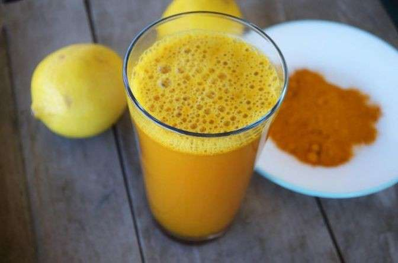

# Өглөөд, куркуматай бүлээн ус уух 10 шалтгаан

Куркума нь үрэвслийн эсрэг хүчтэй үйлчилдэг, антиоксидантуудаар баялаг залуужуулах үйлчилгээтэй хамгийн ашигтай ургамал, амтлагч юм. Олон төрлийн өвчнийг анагаах чадвартай бөгөөд эдгээр ашигтай давуу талууд нь куркумин хэмээх бодисны агууламжид нь байдаг байна. Энэ ургамлын эмчилгээний ашигтай чанарууд, 7000 гаруй шинжилгээ судалгааны ажлуудын дүгнэлт, нийтлэл, туршилтуудаар батлагдсан байдаг байна.Тиймээс куркуматай бүлээн усыг, эмчилгээний маш ашигтай унд гэж үздэг. Бэлтгэхэд хялбар, аягатай бүлээн усанд 1 цайны халбага нунтаг куркума хийж хутгаад уудаг. Энэ нь:

-артритын зовиуруудыг арилгана. Диклофенак-с хүчтэй үйлчлэлтэй.\
-чихрийн шижины 2-р үеийг зогсооно. Оберны Их Сургуулийн судлаачид үүнийг тогтоосон\
-аливаа өвчлөл үрэвслээс болж үүсдэг. Куркума бүх төрлийн үрэвслийг дарах чадвартай\
-цөсийг сайн ялгаруулж хоол сайн шингээдэг. \
-элгийг хордлогоос хамгаалж, элэгний эд эсийг нөхөн сэргээдэг\
-тархины зарим өвчнүүдийг анагааж, алцгеймерийн өвчин, ухаан муудах, зөнөглөхөөс сэргийлнэ\
-шүлтлэг чанартай учраас, бие организмд сайн нөлөөлж, хорт хавдар үүсэхээс сэргийлнэ. Хавдар хүчиллэг орчинд үүсдэг. \
-зүрх судасны системд сайн нөлөөлж, тромб үүсгэдэггүй\
-нас уртасгаж, хөгшрөлтөөс сэргийлнэ. Чөлөөт радикалуудыг дарж, үрэвслээс сэргийлэх чанар нь, хөгшрөлтийн гол хүчин зүйлүүдийг дарж өгч байна гэсэн үг аж\
-хорт хавдарын эсрэг үйлчлэлтэй. Хүчтэй антиоксидантуудынхаа тусламжтайгаар эд эсийг, тогтворгүй молекулууд гэмтээхээс хамгаалдаг. Өдөрт 1 цайны халбагыг, хоол хүнсэндээ нэмж хэрэглэдэг

Мөн арьсны төрөл бүрийн өвчний үед хэрэглэдэг. Тураах үйлчилгээ мөн үзүүлдэг. Куркума нь, маш олон төрлийн үйлчилгээтэй, олон төрлийн өвчнийг анагаахад ашиглаж болох, байгалийн бүтээгдэхүүн бөгөөд өдөр тутам хэрэглэж сурснаар бие организм тань танд талархах юм.
