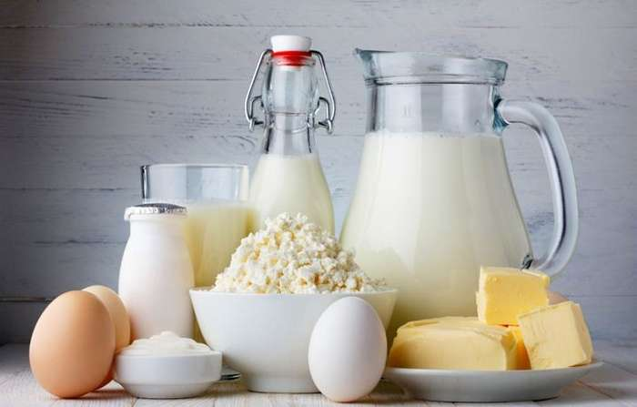
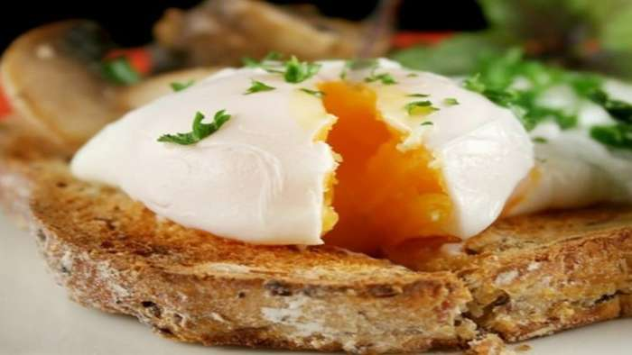
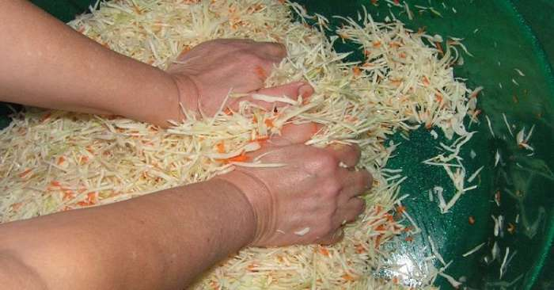
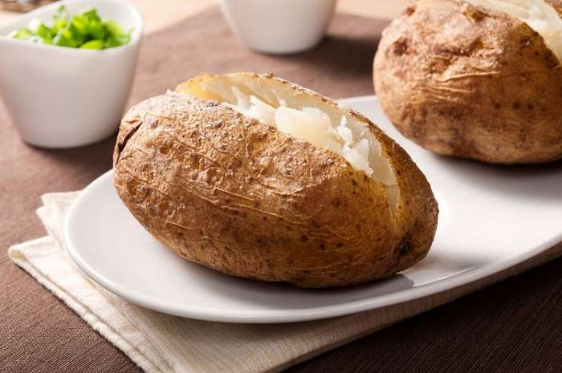
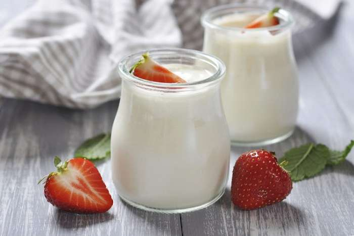
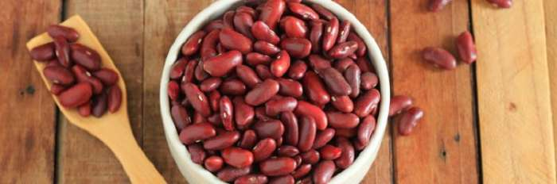
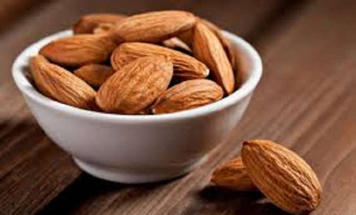
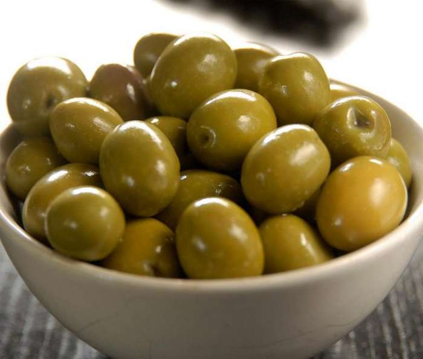
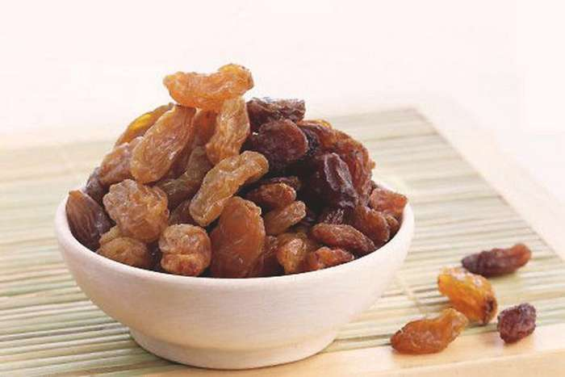

# Өөх шатаадаг хүнснүүд

Эдгээр хүнснүүд биеийн өөхөн давхаргыг жинхэнэ шатаадаг гэнэ. Эдгээрийг хэрэглэн, өлсөхгүйгээр, жин нэмэхээс айлгүйгээр турах сайхан боломжийг ашиглаарай.

**Өндөг.** Зөвхөн чанасан өндөг. Өндгөнд хүний бие организмд хэрэгтэй олон ашигт эрдэс амин дэмүүд байхаас гадна хоногийн хэрэгцээт уургийн 15%-г нөхөх чадвартай.

---

**Дарсан байцаа.** Дангаар нь, эсвэл хоолонд нэмж хэрэглэж болно. Дарсан байцааг боловсруулахад, энгийн байцаанаас хэд дахин илүү калори зарцуулагддаг бөгөөд организмд шинээр эд эс үүсэхэд нөлөөлдөг. Эслэг ихтэй учраас өтгөн хаталт, гэдэсний цэвэрлэгээнд маш сайн үр дүнтэй байдаг. Мөн антоциан-антиоксидантууд агуулдаг тул хөгшрөлтийг удаашруулах ба ялангуяа тархинд сайн нөлөөтэй гэдэг.

---

**Жигнэсэн төмс.** Маш бага калоритай учир, бүрэн шингэдэг. Пектины агуулга нь биеэс хортой бодисыг гадагшлуулах ба калийн өндөр агууламж нь булчингийн үйл ажиллагаанд сайнаар нөлөөлдөг. Түүнчлэн, жигнэсэн төмсний хальсыг эрэгтэйчүүдийн бэлгийн чадавхийг сайжруулахад хэрэглэдэг. Жигнэх боломжгүй тохиолдолд хальстай нь чанаж хэрэглэж болно.

---

**Йогурт.** 2%-с бага тослогтой йогурт. Йогурт нь, уураг, кальцийн агууламжтай ба гэдэсний бичил орчинг сайжруулдаг.

---

**Улаан шош.** Хялбар шингэцтэй ургамлын уураг, эрдэс амин дэмээр баялаг байдаг. хүнсний эслэгйн өндөр агууламжтай тул жин хасахад нөлөөлдөг.

---

**Миндаль самар.** Жин хасахад, бага багаар олон удаа идэхийг зөвлөдөг. Тэгвэл энэхүү миндаль самрыг жимс жимсгэнэтэй хольж идэхэд өег байхаас гадна мөн эслэгээр баялаг хүнсэнд ордог.

---

**Олив.** Ходоодны үйл ажиллагааг сайжруулдаг. Өдөрт, 10 ширхэг олив эсвэл нэг халбага оливын тос хэрэглэхэд, өөх тос давсны шингэлтийг сайжруулж, биеэс хор гадагшлуулдаг.

---

**Үзэм.** Энэ хатаасан жимсийг жин хасахад гайхалтай тусалдаг гэж үздэг. Үзэмний шүүс, үзэмний чанамал ер нь ямар ч хэлбэрээр хэрэглэхэд тустай.
