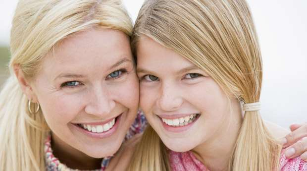

# Охиддоо эртнээс ярьж хэлж, ойлгуулж амжих ёстой 20 зүйлс

Амьдрал бол хүүхэлдэйн кино, уянгын кино, ном зохиолд гардаг шиг, тийм ч сайхнаар дүүрсэн зүйл биш гэдгийг, мөн олон асуудлуудтай тулгардаг болохыг, хамгийн гол нь түүнийг давж сурах хэрэгтэй болдгийг охиддоо эртхэн ярьж ойлгуулах нь ирээдүйд нь хэрэгтэй юм. Гэнэн тунгалаг, балчирхан сэтгэхүйг нь амьдралд зугуухан бэлтгэж өгснөөр олон алдаанаас сэрэмжилж болох юм.

-Аз жаргал, зөвхөн хангалуун амьдрал, мөнгө, хүрсэн амжилт, эд баялагт байдаггүй. Харин ямар ч тохиолдолд аз жаргалтай байж сурах хэрэгтэйг ойлгуулах\
-Эрэгтэй хүмүүстэй болгоомжтой байх, сайхан инээмсэглэлийн цаана хүйтэн тооцоо мөн юу ч нуугдаж байж болохыг сануулж байх\
-Хайр дурлал бүр аз жаргал дагуулдаггүй болох талаар, мөн урам хугарахгүй байхыг, тухайн харилцаанаас сургамж авах, мөн азгүй дурлал бол даваад өнгөрөх ёстой харилцаа болох талаар ярьж өгч байх, бодолд нь суулгах\
-Ямар ч эрэгтэй хүн түүнийг цохих, гар хүрэх доромж хандах, дорд үзэх эрхгүй. Охин тань өөрийгөө хайрлах эрүүл бус харилцаанаас зайлсхийх чадвартай байх ёстой. \
- Анх танилцсан хүндээ, итгэхээ юуны түрүүнд тавихгүй байх. Итгэл асар үнэтэй зүйл болох, зөн совингоо сонсож сурахын чухлыг ойлгуулах, мөн өөрийгөө хуурагдах боломжоос зайлсхийх чадвартай болгох\
-Найз нөхдөө зөв сонгож сурахыг. Зовлон жаргалын алинд ч хамт байж чаддаг найз нөхөд бол бурханы бэлэг гэдгийг ойлгуулах\
-Хүчирхэг эмэгтэйчүүд уйлдаг. Бүр зад уйлдаг нь сэтгэл санаагаа хөнгөрүүлэх, сэтгэл хөдлөлөө тайлахтай холбоотой байдаг. Тиймээс уйлахаас ичихгүй байхыг, өөрийгөө байгаагаар нь хүлээж авч сурахыг, сэтгэл санааны эрүүл байдал хамгаас чухал болохыг ойлгуулах\
-Гадаад үзэмж гол зүйл биш, харин дотоод гоо сайхан нас явсан ч, эмэгтэй хүнийг дотроос нь гэрэлтүүлдэг гайхамшигт чадвартай болохыг ойлгуулах\
-Олныг дагаж намирах шаардлагагүй, аливааг хийхээсээ өмнө дараа нь болох, өөрт нь үлдэх зүйлийг урьдчилан харж сурах хэрэгтэйн чухлыг аль болох жишээн дээр ярьж өгч байх\
-Өөртөө болон бусдад хүндэтгэлтэй хандаж байх, үүний хамгийн эхний алхам бол өөрийгөө, өөрийнхөө бие, гадаад төрхөө хайрлаж сурах, өөрийгөө голохгүй байх, мөн зан чанарын онцлогоо мэдрэх юм гэдгийг бүрэн ойлгуулах\
-Бусдын сэтгэгдэл, хэлж ярьж буйд хэт ач холбогдол өгөхгүй байх, ихэвчилэн өөрийгөө үнэлэх чадваргүй атаархагчид таагүй зүйлс хэлж байдаг болохыг, мөн өөрийн хүчинд, мөн өөртөө итгэх итгэл л амжилтын түлхүүр болж өгдөг талаар байнга ярьж өгч байх\
-Бүх хүн үнэн ярьдаггүй. Худал хуурмагийг ялгаж сургах\
-Өөрийнхөө тухай олон нийтийн хэрэгслээр цацахгүй байх. Өөрийн гэсэн нууц байх ёстойг, тэгээд ч энэ нь, атаархал төрүүлэхээс хэтрэхгүй зүйл болохыг ойлгуулах\
-Аз жаргалтай байсан ч нэг л зүйл дутуу санагдаад байх нь бий. Үүнээс болгоомжилж, байгаа бүх зүйлдээ талархаж сургах\
-Амьдралын чухал зүйлсээ тодорхойлж, бичиж, түүнийгээ мөрдөх. Зорилготой амьдрахын чухлыг ойлгуулах\
-Хэнээс ч хамааралгүй байж занш. Хэнээр ч өөрийгөө бүү хянуул. Хүний амьдрал зөвхөн өөрийнх нь гарт байдаг гэж сургах\
-Харин хийсэн сайн үйлс, сайн зүйлс нууц үлдэх нь дээр байдаг. Зарлан тунхаглах нь уг зүйлийг үнэгүй болгоно гэдгийг ойлгуулах\
-Гомдол цухалдлаа бүү дотроо хадгал. Тайлмагц амьдрал хөнгөрдөг болохыг сурга\
-Амьдрал, ахуйн таагүй зүйлс, асуудлуудаас шалтгаалахгүйгээр хайраа хадгалж хамгаалж байх. Бүхнийг хайрлахын чухлыг ойлгуулах\
-Өнгөрсөн зүйлс өнгөрсөндөө үлддэг учраас зөвхөн урагшаа харж амьдрах хэрэгтэйг байнга сануулж байх хэрэгтэй.
