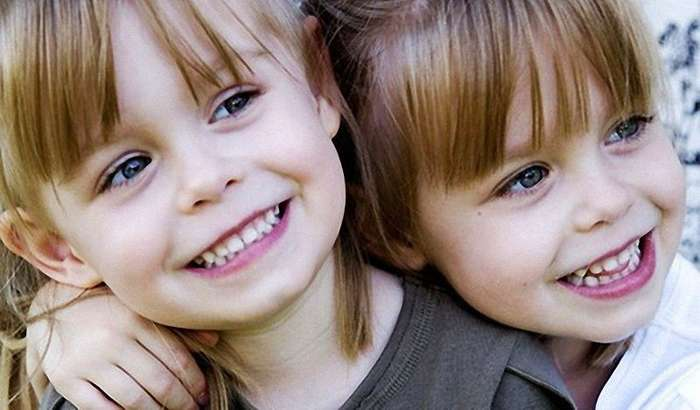
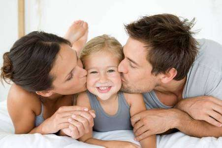

# Охидыг хүмүүжүүлэх нь

Хөвгүүдийг өсгөж хүмүүжүүлэх хялбар байдаг гэж ярьцгаадаг. Хөвгүүдийг төрснөөс нь эхлээд бүх зүйлийг зааж өгч, сургаж болдог. Тэд яг л “хоосон” цагаан цаас шиг байдаг. Харин охид төрөхдөө л “дүүрэн”, үйлчлэл, халамж, хайр гэсэн зарчмууд төрөлхөөсөө суучихсан төрдөг байна

Тиймээс, хүмүүжүүлэхдээ алдаа гаргахгүй байхыг эрхэмлэхгүй бол, заяагдмал үнэт зүйлсийг нь үгүй хийх асуудалтай тулгардаг. Охид бол үлгэрийн хааны гүнж, тэдэнтэй гүнж мэт харьцаж, гоёж гангалуулж, магтан шагширч, эрхлүүлж, өөртөө итгэх итгэлийг нь хөгжүүлэх хэрэгтэй. Тэднийг, бага насанд нь гүнж мэт байлгах нь ирээдүйн амьдралынх нь суурийг тавьж байна гэсэн үг. Сургуульд сурах үед нь, дүнгээр нь бус чадвараар нь үнэлж байгаарай. Химээр 3, хөдөлмөрийн хичээлээр 5 авсан бол ижил хэмжээнд хүлээж авч баярла. Өөрийн үнэлэмж, дур сонирхлыг нь бүү устгаарай. Амьдралд нь хэрэг болох бодит зүйлст сургахаа харин мартав. Бие, сэтгэлийн ариун байдлыг сургах, мөн ойлгоход нь туслах нь, таны хамгийн хариуцлагатай ажил. Охиндоо энэ сэдвээр бага нялхаас нь ярьж өгч байх хэрэгтэй. Үлгэр таалагддаггүй хүүхэд байдаггүй. Үлгэрийн гүнж, ганц л ханхүүтэй, ханхүү нь, ан ав, аян дайнд явж үргэлж хамт байдаггүй ч, насаараа үнэнч ариунаар амьдардаг. Анхны, иймэрхүү үлгэрүүдээр, энэхүү бие сэтгэлийн ариун байдал өгөгддөг. Мөн охидод, аавынх нь нэр хүндийг өргөснөөр, эрэгтэй хүнийг хүлээж авах хүмүүжлийн асар том нөлөө үзүүлдэг. Эмэгтэйчүүд, хүүхэддээ ААВ болох хүнийг өөрсдөө сонгодог. Тиймээс, түүний өмнөөс мөн хариуцлага үүрэх хэрэгтэй болдог ба, мөн аав нар ч тэр, нэр хүндээ үр хүүхдийнхээ өмнө унагахгүй байхыг туйлаас хичээх нь хүмүүжлийн гол цөм болдог гэдгийг зүрхнийхээ угт ойлгох хэрэгтэй. Аавгүй өсч байгаа хүүхдүүдэд, тэрхүү, хэзээд л байсан аавынх нь талаар сайхан сэтгэгдэл төрөхүйц зүйлсийг ярьж өгч байгаарай. Охид маш эмзэг байдаг. Ард нь, хүмүүс инээлдэх сонсогдоход, эмэгтэйчүүдийн 90-100% нь өөр дээрээ тусгаж авдаг болох нь судалгаагаар нотлогдсон байдаг. Шүүмжлэлээр битгий булаарай, та, өөрөө бага байснаа мартаж болохгүй. Магтаж урамшуулан, аливаа таагүй зүйлсээс хамгаалах, муу-сайн, муухай-сайхны ялгааг ойлгуулах нь бидний ариун үүрэг юм.

Үр хүүхэддээ үлгэр жишээ байхуйц амьдарч, хүүхэд маань, дэлхийн хамгийн сайн аавыг биширдэг, аз жаргалтай ээжийг харж өсөхөд, тэдний зүрх сэтгэл тэр л гэгээн амьдралруу эрмэлзэн тэмүүлдэг болдог. Энэ бол хамгийн үр дүнтэй, юугаар ч орлуулшгүй хүмүүжлийн арга юм.
