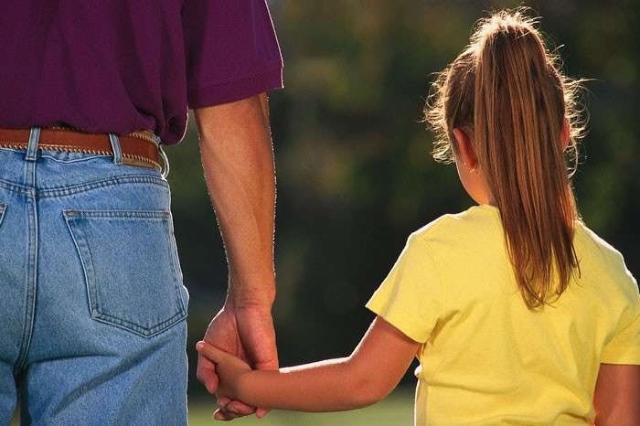
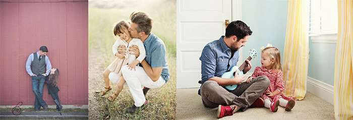

# Охидын хувь заяа ба аавын хайр

Охидод өгөх аавын хүмүүжил нь, охидын өсөж том болох үеийн төлөвшил, цаашдын амьдрал, мөн ирээдүйд амьдралын ханиа сонгох, хүний гэргий болох, эрэгтэй хүмүүстэй харьцах зэрэгт маш чухал байдаг. Дээр дурдагдсан хүчин зүйлүүд нь, эмэгтэй хүний хувь тавиланд нөлөөлөх хамгийн гол хүчин зүйлс юм.

Охидын сэтгэхүйд эцэг хүн, хамгийн анхны эр хүний дүр төрх болон үлддэг. Энэ бол асар их хариуцлага үүргээ эцэг хүн ухамсарлах ёстойг юуны түрүүнд харуулдаг. Ухаалгаар хайрлах эцгийн хайр, гэр бүлийн эв найртай орчин, охидод энэ л амьдралын төсөөллийг бий болгон хувь заяанд нь нөлөөлдөг бөгөөд эхийн хайраас арай л өөр, бага зэрэг биеэ барьсан, сэтгэлийн хөдөлгөөн багатай ч гэмээр эцгийн хайрыг хүүхдүүд бие сэтгэлээрээ мэдрэн хүлээж авч байдаг. Охид аавынхаа хувьд, хамгийн хөөрхөн, хамгийн хайртай, хамгийн хамгийн... гүнж, төгс эмэгтэйн бүрдэл мэт байдаг. Эцгийн хайр, охидод, хамгаалалттайгаа мэдрэх, аюулаас айхгүй байх, өөртөө итгэлтэй болох, өөрийгөө үнэлэх, эмэгтэйлэг байх, сэтгэл татах чадвар, үгүйлэгдэх, хэрэгтэйгээ мэдрэх зэрэг олон мэдрэмжүүдийг өгч суулгаж, мөн хайртай, ухаалаг эцгийн дэргэд өсч буй охид, амьдралд эрэгтэй хүний хайрыг хүлээн авах, эрэгтэй хүнийг хайрлах хүндлэх, хамтын амьдралын чухлыг ойлгох ойлголттой болдог. Хүүхдүүдийн хувьд аав хүн, бүхэл бүтэн ертөнц бөгөөд байгаагаар нь хайрласан, хэзээ ч хамгаалахад бэлэн, айдас болгоомжлолгүй тэрхүү ертөнцөөс, томчуулын амьдрал руу, айдасгүй, бүх зүйл сайхан болно гэсэн бодол тээн, хаана ч,хэзээ ч түшиг тулгуур байдаг гэсэн бүрэн итгэлтэй хөл тавьдаг. Энэхүү эерэг сэтгэхүйн төлөвшил, охидын амьдралд, насан туршид нь үйлчилдэг. Мөн бас нэг гол зүйл бол, эцэг хүний хүүхдийнхээ ээжид нь хандах хандлага, охидын, ирээдүйд эрэгтэй хүнтэй харьцах харилцаанд шууд нөлөөлдөг. Анхаарал халамж, хайраар дүүрсэн гэр бүлд өсч байгаа охид, мөн түүнийгээ л авах хувьтай байдаг байна. Хүн мэддэг зүйлээ л хүлээж чаддагийн адил, тэд, амьдралаас тэрхүү мэддэг амьдралаа авдаг гэж үүнийг тайлбарладаг. Эцгийн хайранд умбаж өссөн охид, хэзээ ч байгаагаараа байж чаддаг, хэн нэгэнд таалагдах гэж зовдоггүй, өөрийгөө өрөвдөж гомдоллодоггүй хувь хүн болж өсдөг.
