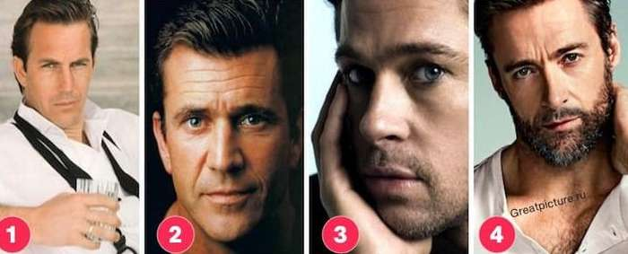
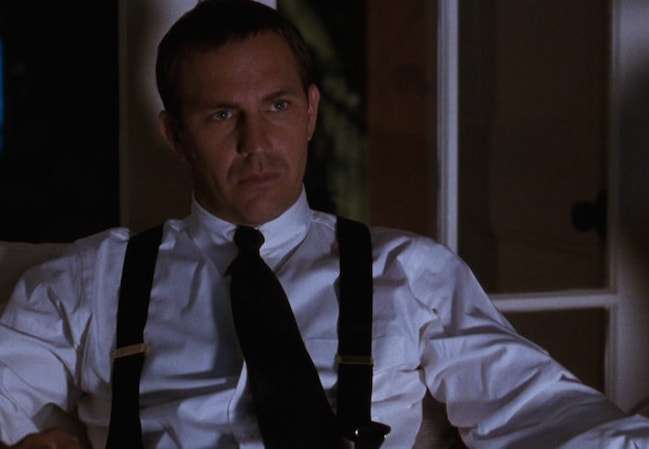
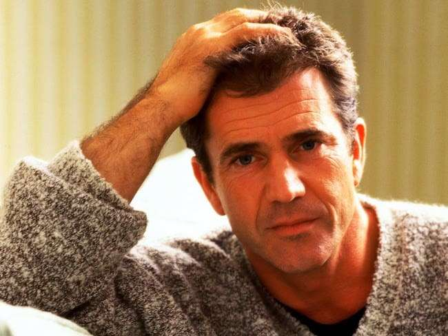
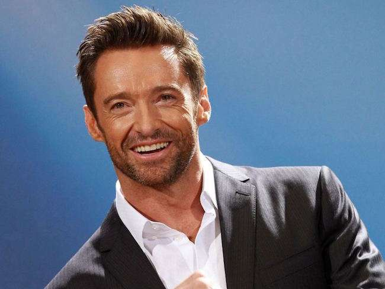

# Олны танил, алдартай эдгээр жүжигчидээс сонго. Хариулт нь гайхалтай

Бидэнд зарим хүн таалагдаж, зарим нь таалагддаггүй. Энэ талаар тэр бүр ухаж бодох ч үгүй явцгаадаг маань нууцгүй билээ. Гэтэл, бидний ухамсарын гүн дэх, далд ухамсар маань үүнд нөлөөлж байдаг гэнэ. Энэхүү далд ухамсар маань, хүний зан чанар, бие мах бодын өгөдлүүд, онцгойлон ялгарах ааш аяг зэргийг ялган салгаж сэтгэлийн тааламж, хөөрөлд автуулах увидсыг агуулдаг аж. Ямар төрлийн хүмүүс танд таалагддагийг ул суурьтай мэдэх, мөн дараах алдартай, танил жүжигчидээс хэн нь таатай сэтгэгдэл төрүүлж, таалагддагийг сонгон далд ухамсарынхаа нууцтай танилцах боломжийг олгоё.

#### 1. Кевин Костнер

Таны хувьд, шударга үнэнч, чин үнэн сэтгэлтэй, сэтгэл зүрхийг дээдэлдэг хүн төгс эр хүн. Ухаалаг, сонирхолтой яриа өрнүүлдэг эр хүнийг та, үнэлж сайхан эр хүнд тооцдог. Мөн нөмөр нөөлөг, итгэлцэлийг туйлаас хүсдэг. Та, өөрийгөө хайр сэтгэлдээ тэр чигт нь зориулах чадвартай үнэнч хүн юм. Гэхдээ, та, тэр бүр өөрийгөө бүрэн илэрхийлж чаддаггүйгээс, гайхалтай сайхан зан чанаруудаа гаргах нь ховор ч, харин хайртай хүн тань мэдэрч байдаг нь гол зүйл. Тан шиг эмэгтэйчүүд, эрэгтэй хүнийг, хүссэндээ хүрсэн ч зогсохооргүй урам жигүүр хайрлаж байдаг.

---

#### 2. Мел Гибсон

Энэ төрлийн эрчүүд таалагддаг эмэгтэйчүүд, өөртөө итгэлтэй чөлөөт сэтгэхүйтэй байдаг. Энэ зан чанарууд азгүй эсвэл таагүй холбоо харилцаан дээр суурилан үүссэн байх нь элбэг ч амьдралыг өөрчлөх эрч хүч тэвчээрийг олж авсанаараа нэг төрлийн аз болсон байдаг. Эдгээр эрчүүд царайлаг, хошин шогийн мэдрэмжтэй, хүчирхэг бусдыг татах, хүлээн зөвшөөрүүлэх увидастай байдаг. Ийм л эр хүн таны хувьд төгс эр хүн бөгөөд адал явдлаар дүүрэн амьдарлыг хүлээдэг. Гэхдээ, та, эсрэг хүйснийхнээрээ бурханчлан шүтүүлэх дуртай ийм эр хүн хайр дурлалын харьцаанд үнэнч байх асуудал нь эргэлзээтэй гэдгийг мэдэж байдаг. Гэсэн ч та сэтгэлээр унах хэрэггүй, ийм эрчүүд зөвхөн тан шиг эмэгтэйг эрж хайж, олж аван гараасаа алддаггүй гэдгийг хэлэх нь зүйтэй. Ийм эрчүүд тан шиг эмэгтэйн дэргэд жинхэнэ эр хүн болж төлөвшдөг гэж хэлж болно.

---

#### 3. Бред Питт

Тиймээ, яриагүй сайхан эр хүн. Та ч мөн бас л адилхан. Та, сайхан царайлаг, хүчирхэг, жинхэнэ эр хүнд татагддаг. Та, тачаангуй, үнэн сэтгэлтэй. Сэтгэл хөдлөл, сэтгэлийн хөөрлөөр хайрлаж дурлаж алдаа гаргах магадлалтай. Гэхдээ энэ бүхнээ ухамсарлачихсан, маш сонирхолтой, сэтгэлийн өгөөж дүүрэн эмэгтэй. Та, өөрийнхөө үнэ цэнг мэддэг, мөн өөрийгөө хайр дурлалдаа зориулж чаддагаараа эрчүүдийг сөхрүүлэх чадвартай. Танд олон найзууд тань атаархдаг ч үүнийгээ нуухыг оролдож байдаг. Та бол, хүмүүсийн ярьдагаар, “Саяд нэг тохиох” хүн!

---

#### 4. Хью Джекман

Өөртөө итгэлтэй, буурь суурьтай, бодолтой ийм эрчүүд олонхи эмэгтэйчүүдэд таалагддаг. Тэд хүмүүжилтэй, хүндлэлгүй харьцааг тэвчиж чаддаггүй, мөн хайртай хүн, хань ижлээ хязгааргүй үнэлдэг сайхан чанартай байдаг. Хэрэв ийм эр хүн танд дурласан бол, та түүний хувьд давтагдашгүй ганц нь гэдгээ мэдэх хэрэгтэй. Харин, та бол, маш мэдрэг эмзэгхэн, хайрандаа уусчихдаг хүн юм. Гэхдээ, хамгийн гол нь, “толгойгоо гээчихдэггүй” сайн талтай.
