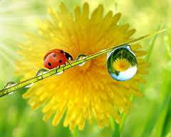

# Олон хүнийг аз жаргалтай болгосон захиас

Энэ захиас сошиал ертөнцөөр дамжин, олон олон хүнийг аз жаргалтай болгосон гэнэ. Санал нийлнэ гэдэгт итгэлтэй байна.

Бид том болцгоож, гэрлэцгээн, үр хүүхэдтэй болж сайхан байцгаана, гэж өөрсдийгөө итгүүлдэг бөгөөд дараа нь хүүхдүүд маань бага нялх байхад амьдралд дарагдан багахан сэтгэлээр унах боловч хүүхдүүд маань томорч, бүх зүйлс сайхан болно доо гэсэн бодол тээн амьдардаг. Хүүхдүүдийнхээ өсвөр насны үед хэсэгхэн бачимдацгаана. Мөн гэр бүлийн хүний маань ажил үйлс нь бүтэлтэй байж сайхан машин авчихвал, сайхан болно гэж боддог. Мөн амралтаа авцгаагаад сайхан байна, бүр тэтгэвэрт гараад амрахаар мөн сайхан байна гэх мэт бодлуудыг тээн явцгаадаг. Гэтэл амьдралын жинхэнэ үнэн: аз жаргалыг, мөн аз жаргалтай байхын тулд сайхан цаг хугацаа, сайхан зүйлийг хүлээх биш харин одоо, одоо цагт байгаа энэ бүхэн, энэ цаг үеэс чинь илүү аз жаргал үгүй юм гэж тунхаглаж байна. Таны амьдрал аливаа дуудлагуудаар дүүрэн байдаг бөгөөд тиймээс бүх зүйлсийг байгаагаар нь хүлээж авч, юунаас ч шалтгаалахгүй аз жаргалтай байхаар шийдэх хэрэгтэй. Бид урт удаан хугацааны турш, амьдрал одоо л эхэлнэ, одоо эхэлж байна гэж бодож явдаг. Мөн амьдралд маань үргэлж саад бэрхшээл тохиолдож, давахаас өөр аргагүй хатуу ширүүн сорилтууд тохиолдсоор л байдаг. Хийж дуусгаагүй ажилаа дуусгах, цаг хугацаагаа нэгэнд зориулах, төлбөрийн тооцоогоо хийх, тэгээд дараа нь болно доо гэх. Эцсийн эцэст, бид, энэхүү саад бэрхшээлүүд амьдрал өөрөө байсныг ойлгодог бөгөөд энэ ойлголт, аз жаргалд хүрэх ямар ч тусгайлсан зам байхгүй гэдгийг харуулдаг. Аз жаргал бол зам юм. Тиймээс, хором бүрийг эрхэмлэн эдэл. Зун, намар, өвөл, хавар болохыг, сургуулиа төгсөх, ажилд орох, гэрлэх, өндөр цалинтай болох, үр хүүхдийн тусламж, их мөнгөтэй болох, шинэ машинтай болох, өрөө төлөх, тавдах өдрийн орой, өглөө болох, үхэх, төрөх зэргийг, алийг нь ч битгий хүлээ. Хангалттай. Амьдралын аз жаргал авчирах мөчүүдээ бүү хүлээлт болго. Аз жаргалтай байхаар бүрэн шийд. Аз жаргал бол зам, түүнээс очих газар, хүрэх цэг биш. Одоо цагаас өөр аз жаргалтай байх, цаг хугацаа байхгүй. Амьдар, бас энэхүү хормоо эрхэмлэн эдэл. Одоо та, бодож байгаад эдгээр асуултад хариулаарай. 1. дэлхийн хамгийн баян 5 хүнийг нэрлэнэ үү? 2. сүүлийн дэлхийн миссийн тэмцээнийг тэргүүлсэн 5 бүсгүйг нэрлэнэ үү? 3. хамгийн сүүлийн нобелийн шагналтан 5 хүнийг нэрлэнэ үү? 4. хамгийн сүүлийн Оскарын шагналтан 5 хүнийг нэрлэнэ үү? Тэр бүр хариулж чадаагүй л болов уу. Гэхдээ бүү сандар, үүнийг тэр бүр хэн ч санадаггүй юм. Алга ташилт намдаж, гавьяа шагнал тоосонд дарагдан ялагчидын нэр мартагддаг. Харин одоо дараах асуултуудад хариулаарай. 1. таны боловсролд хувь нэмрээ оруулсан 3 багшийн нэрийг нэрлэнэ үү?. 2. хүнд хэцүү үед чинь тусалж байсан 3 найзыгаа нэрлэнэ үү? 3. Танд, онцгой мэдрэмж төрүүлж байсан хэдэн хүнийхээ нэрийг санаж байна уу? 4. хамт цагийг өнгөрүүлэхэд аятайхан байдаг 5 хүнээ нэрлэнэ үү? Хариулахад хамаагүй амар байгаа биз? Хамгийн их мөнгөтэй биш, агуу зүйлийг хийж ялагч болоогүй “хамгийн сайн”-д багтдаггүй боловч энэ хүмүүс, таны амьдралд хамгийн ойр байдаг. Эдгээр хүмүүс, танд санаа тавьна, таныг үнэлнэ, юу ч болсон ойр дөт байж байдаг. Хоромхон ч атугай та, бодоорой. Амьдрал бол маш богино юм. Халуун дулаанаар гараа атгалц. Та, мөн тэдэнд, хэдийгээр та нар “алдар гавьяагүй” ч хамгийн түрүүнд дурсагдах хүмүүсийн маань нэг байлаа гэж заавал ч үгүй дуулгаарай. Сиэтлийн олимпийн 100 метрийн гүйлтийн замын гараан дээр 9 тамирчин зогсож байлаа. Тэд бие, сэтгэцийн эмгэгтэй тахир татуу хүмүүс. Гарааны дохио өгөгдөн зарим нь гүйж эхлэв. Яагаад зарим нь гүйгээгүй вэ, тэд ялахыг биш оролцохыг л чин сэтгэлээсээ хүссэн юм. Тэд замынхаа гуравны нэгд орох үед нэг хүү бүдэрч унаад, уйлж эхлэв. Үүнийг сонссон үлдсэн 8 оролцогч, гүйлтээ удаашруулан бие биенээ харснаа зогсоцгоож буцаж өнөө хүү дээр ирцгээв. Дауны өвчтэй нэг охин хүүгийн хажууд сууж тэврээд “одоо чамд дээр байгаа биз” гэж асуугаад, түүнийг бүгдээрээ босгон есүүлээ хамтдаа мөрөө нийлүүлэн бариа руу алхаж билээ. Үзэгчид, бүгд босоцгоон удтал алга ташиж байсан юм. Үүнийг үзсэн хүмүүс одоо хүртэл энэ тухай ярьдаг. Яагаад юм бол? Яагаад гэвэл, бидний дотор, сэтгэлийн маань угт, өөрийн ялалтаас илүү бүр том, амьдралын маш чухал зүйл байдаг, энэ нь бусдыг ялахад, ялалтад хүрэхэд туслах юм. Энэ үедээ өөрийн гүйлтийг удаашруулсан ч болно гэдгийг бид, мэддэг. Хэрэв та, үүнийг уншаад бусадтай хуваалцвал, бид өөрсдийн зүрх сэтгэлийг, мөн хэн нэгний зүрх сэтгэлийг ч өөрчилж болох юм. Лаа асаж байхад түүнээс өөр лаа асаасан ч, юу ч алдахгүй гэрэлтүүлсээр л байдаг...Дуу хоолой, зүрх сэтгэлээ нэгтгэн энэ ертөнцөө, хувь тавилан, амьдралаа сайн, хамгийн сайхан болгоцгооё. Аз жаргал байна. Байгаа. Бид жаргалтай байна.
