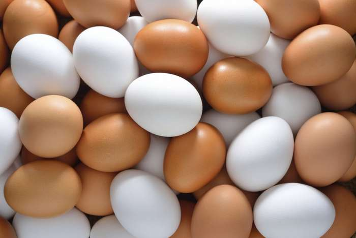
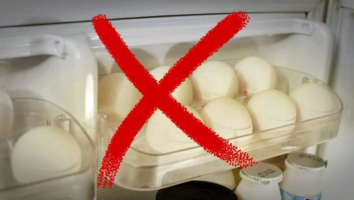
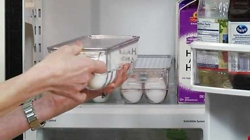

# Өндөгийг хэрхэн зөв хадгалж, хэрэглэх болон шинэ эсэхийг шалгах арга

Тахианы өндөг нь, өдөр тутам хэрэглэгддэг, гол хүнснүүдийн нэг юм.

Өндөгийг ихэвчлэн хөргөгчний хаалгандах, зориулалтын тавиурт хадгалдаг нь буруу гэнэ. Энэ тавиур хамгийн дээр, хөлдөөгчний дэргэд байдаг тул хагас хөлдөлтийн байдалд орохоос гадна, хаалгыг онгойлгох бүрт дулаан агаарт цохиулах маягаар таагүй үйлчлэлд орж, муудах процесс явагдах эрсдэлтэй байдаг байна.

---

Зөв хадгалахын тулд, зориулалтын контейнерт, мохоо талаар нь дээш харуулан өрж, контейнероо таглаж, хөргөгчний тавиурт хадгална. Мөн, хичнээн зөв хадгалсанч, өндөгийг, 6 долоо хоногоос дээш хадгалж, хэрэглэж болохгүй.

Өндөг худалдан авахдаа, бид шинэ эсэхийг нь худалдагчийн үгэнд итгэн авдаг. Тиймээс, шинэ эсэхийг нь гэртээ шалган, хэрэглэхийг зөвлөж байна. Бүлээвтэр устай саванд өндөгөө хийхэд, савны ёроолруу живж байвал шинэ гэсэн үг, харин хөвж байвал хуучирсан өндөг байх нь.
