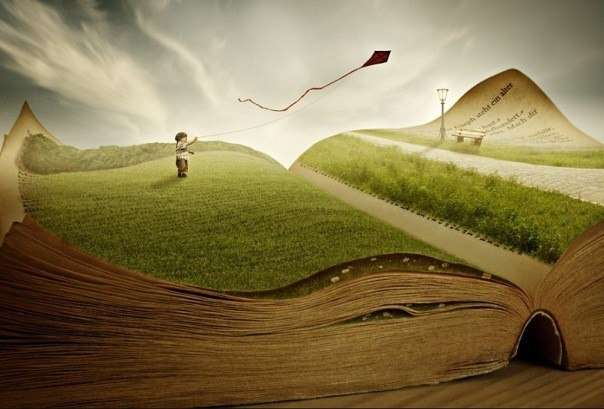

# Өнөөдөр, хоёр маргаашаас үнэтэй

Нэгэн еврей цэцэн хүнээс, таныг энэ хорвоо дээр чухам юу их гайхшруулдаг вэ? гэж асуужээ.

Тэр, -“Хүмүүс, эхлээд мөнгөтэй болохын тулд эрүүл мэндээ үл хйахран, байдгаараа зүтгэх юм. Тэгээд дараа нь мөнгөтэй болж түүнийгээ эрүүл мэндээ эмчлэхэд зарцуулдаг. Энэ маш гайхалтай санагддаг. Тэгээд бас, ирээдүйнхээ төлөө үргэлж санаа зовж, өнөөдрийн байгаа зүйлээсээ сэтгэл ханамж авч чаддаггүй атлаа, зөвхөн ирээдүйд ямар байхаа төсөөлөн түүнээсээ айж, болгоомжилж, аливааг хураах гэж үхэлдэн явах юм. Үүний үр дүнд, тэд, өнөөдөр ч биш, ирээдүйд ч биш амьдарч, хэзээ ч үхэхгүй юм шиг амьдарснаа, үхэхдээ амьдраагүйдээ харамсдаг нь гайхмаар!” гэж хариулжээ. Нээрээ, энэхүү амьдрал маань, зугтах мэт хурдан өнгөрдөг. Өчигдөр, хэзээ ч ирэхгүй өнгөрөн одсон. Өнөөдөр, хором хормоор өнгөрч байна. Маргааш байгаа ч, яг одоо байгаа өнөөдрөө, үр дүнтэй, жаргалтай, сэтгэл хангалуун өнгөрөөхийг хичээх хэрэгтэй бус уу? Өнөөдөрөө, амьдралын маань хамгийн сайхан өдөр гэж хүлээн авч, өнөөдөр маань сайхан харьцаа, саруул ухаан, баяр баясгалан, хайр энэрлээр дүүрэн байг! Маргаашид зориулан, өнөөдрөө үрэхгүй, өнөөдрөө сайхан болговол яасан юм?
