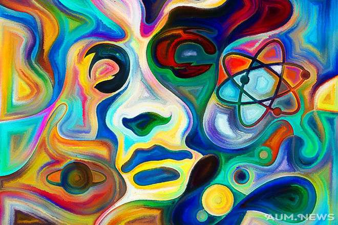

# Өнөөдрийн бодол ирээдүйг бүтээдэг

Джон Кехо – зохиолч, сэтгэл зүйч, хувь хүний сэтгэлгээний өсөлтийн дасгалжуулагч, филантроп. Тэрээр, -“Миний далд ухамсар намайг амжилтад хүргэдэг хамгийн үнэнч хамтран зүтгэгч юм. Шинэ амьдралыг эхлэх анхны алхам гайхмаар хялбар байдаг юм шүү. Өөрийнхөө бодлыг хянаж зөвөөр чиглүүлэхэд л хангалттай” гэж нотолдог. Түүний энэ үзэл, хүний бодол дахь олон давтамжит бодол санаа нь бодлыг бодит болгох үйлдэлд түлхдэг гэж тайлбарладаг бөгөөд бодлын тусламжтай мөрөөдлөө биелүүлэх, бодлоо бодит болгох дараах зөвлөгөөг санал болгодог байна.

-Гадаад орчин, нөхцөл байдлыг зөвхөн дотоод ертөнцөө өөрчилснөөр сайжруулж болдог. Бодол санаа, итгэл үнэмшлээ өөрчилөхгүйгээр байгаа байдлаа өөрчилөх боломжгүй.\
-Таны толгойд буй бодлууд болон суурьшчихсан бодол, таны амьдралд асар ихээр нөлөөлж байдаг. \
-Бодож буй зүйлээ ухамсарла. Хяна. Өнөөдрийн бодлууд ирээдүйг тань бүтээдэг. \
-Бусдад хандах харилцаагаа өөрчилөхөд, тэд ч мөн танд өөрөөр хандаж эхэлдэг. \
-Өсөж дэвжихийг хүсвэл, бодлуудаа нэн түрүүнд өөрчил. Амжилттай хүмүүсийн бодол үргэлж амжилтад чиглэсэн эрчимтэй байдаг. Мөн, баян хүмүүсийн бодол үргэлж эд баялаг дунд л эргэлдэж байдаг. Энэ нь тэрхүү бодлуудын эрчим амьдралд үйлчилж буйг харуулдаг. \
-Зорилго мөрөөдлөө яг одоо болж буй мэтээр төсөөлж бай. Үргэлж. Энэ нь бодлоо ухамсартаа бодитоор суулгах арга юм. Нэг ч өдөр өнжилгүй, өдөрт нэгээс доошгүй удаа бодол төсөөлөл дотроо, зорилгоо биелүүлэх арга замууд болон биелсэний дараах сэтгэл ханамж, таатай өөрчилөлтүүдээ төсөөлөн харж, сэтгэл зүрхээрээ мэдэрч сур. Давтах нь сурахын эхлэл. \
-Хүрэхийг хүсч буй зүйлээ /шалгалтаа амжилттай өгөх, тушаал дэвших, хэн нэгэнтэй танилцах, их мөнгө олох, сугалаанд хожих г.м/ тодорхой харж, төсөөл. Бод, шийд. Үргэлжлүүлэн биеэ суллаж хэдхэн минут, хийж буй бүхнээ орхин, 5-10 минут бодолдоо хүсч буй зүйлээ биелснээр төсөөлж биелэх үеийн баяр, сэтгэл ханамжтай байдлаа бие сэтгэлээрээ мэдрэхийг хичээ. Олон давтамжит бодол, тухайн зүйлд төвлөрөх, түүнийг чиглүүлэх асар их хүчийг агуулдаг. \
-Амьдрал бол бодлын тусгал юм. \
-Зөвхөн сайн сайхан зүйлс, амжилт, аз жаргал, эрүүл энх, элбэг хангалуун байдлыг бодолдоо тээж бай. Айдас, түгшүүрт бодлоос бүрэн сал. Сөрөг бодлууд маш хүчтэй байдаг тул дотоод ухамсарт нуугдсан байдаг. Гарч ирэх бүрт үлдэн хөөж, зөвхөн сайхан зүйлийг ирээдүйгээсээ хүлээж амьдар. \
-Ус ямар ч сав суулганд хийсэн түүний хэмжээ, хэлбэрт орж байдаг. Түүнтэй адил таны далд ухамсар бодлын тань хэмжээ хэлбэрээр амьдралыг чинь бүтээдэг. \
-Олон санаанаас нэг сайн санаа төрдөг. Төрөл бүрийн санааг бодолдоо тээж амьдар, харин нэг зүйлд туйлширахаас болгоомжилж байх хэрэгтэй. Нэг зүйлд туйлширах нь, аливаад уян хатан хандах, хөрвөх чадварыг сулруулдаг эрсдэл дагуулдаг. Ганц хувилбар бол бүтээлч хандлага биш. Амьдрал тоо томшгүй олон боломж, гарц гаргалгаагаар дүүрэн байдаг. \
-Шийдвэр гаргахын өмнө, биеэ суллаад, хэд хэдэн удаа гүнзгий амьсгалж, тайван байдалд итгэлтэйгээр арван удаа “Би үргэлж зөв шийдвэр гаргадаг” гэж давтан хэлэх. Үгийн хүчээ мэдэрч, хамгийн сүүлчийн давталт дээрээ шийдвэрээ гарга. Хамгийн түрүүнд орж ирсэн бодол нь, далд ухамсрын хариулт буюу шийдвэр тань юм. \
-Өдөр бүр, хэдхэн хором эрүүл мэндийнхээ талаар бодож, эд эрхтэн бүрээ бодлоороо илбэж, хайр илгээж бай. Бие, эрхтэнээ гайхалтай ид шидтэй анагаагч механизм гэж хүлээж ав. Маш сайн үр дүнтэй байдаг. \
-Ямар ч санаа бодол, ухамсарт тань суурилахын өмнө соёолох үе шатыг дамжин өнгөрөх цаг хугацааг шаарддаг. Шинэ итгэл үнэмшил, эрмэлзэл тархинд тань суухад, өдөр тутмын 30-90 удаагийн 5-10 минутын үргэлжлэлтэй бодлын давтамж хэрэгтэй байдаг байна. Ингэж чаддаг хүнийг бодолдоо бүхнийг шийдчихсэн, ажилдаа уусчихсан хүн гэдэг. Ийм хүмүүс амжилттай байхгүй гээд яах билээ? \
-Бүх зүйл боломжуудыг агуулан оршдог. Та, өөртөө шаардлагатай энергээ цэнэглэх буюу үйл хөдлөлөө бодлоороо цэнэглэхэд л хангалттай, зорилго тань бодитоор биелэлээ олдог байна. \
-Хүний ирээдүй өөрийнх нь дотор нь оршдог бөгөөд тэр нь хором бүрт хамт байдгийг ойлгох нь хамгийн чухал юм. \
“Санаа сайн бол заяа зөв”. Эцэг өвгөдөөс маань дамжин ирсэн энэхүү зүйр цэцэн үг юутай мэргэн, юутай үнэн. Дээр дурдагдсан бүх зүйлийг дөрөвхөн үгээр илэрхийлэн мөрдөж, заяагаа засч ирсэн сайхан уламжлалтай Монгол түмний нэг нь гэдгээрээ бахархаж, зөв бодлоор, зөв сайхан ирээдүйгээ бүтээх боломжийг ойлгон хэрэгжүүлэх нь зүйтэй юм.
