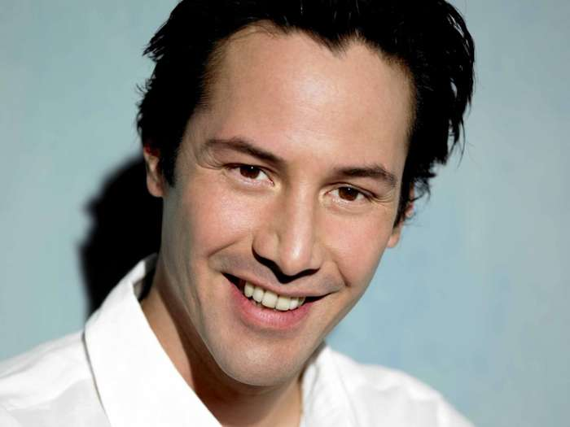

# Өнөөдрөөр амьдарч эхлэх нь

Холливудын “од”, жүжигчин Киану Ривз дараах зүйлийг бичиж, сэтгэлээ хуваалцсаныг толилуулъя.

Киану Ривз: Миний ард байгаа хүмүүсийг харж байна уу? Тэд, ажил руугаа ч юмуу хаашаа ч юм, юуг ч, анзаарах, анхаарах сэхээгүй гүйцгээж байна.

Заримдаа, бид, амьдрал ахуй, ажил төрөлдөө дарагдан, ганц минут ч амсхийн, амьдралын сайхныг мэдрэх, үнэлэх завгүй явцгаан нэг төрлийн оюун сэтгэхүй, зүрх сэтгэлээ хойш тавьсан амьдралын зомби болж хувирч буй мэт санагддаг. Харцаа дээш өргөн орчиноо анхаараач, чихнээсээ чихэвчээ салган, зөрөн өнгөрөх хүмүүсийг анзааран, харцаараа ч атугай мэндчилэн, хэн нэгэн тусламж хэрэгтэй хүнийг дотноор тэврэн, халуун дулаан үг хайрлаач. Өдөр бүрийг хорвоогийн сүүлчийн өдөр мэт хайрлан, бүхнийг хайрлан өнгөрүүлээч. Бүхний мэдэж байгаачлан, би, хэдэн жилийн өмнө хамгийн хүнд хэлбэрийн, гүн сэтгэл гутралын өвчинд өртөж байлаа. Энэ үедээ би, хэнд ч гомдоллосонгүй, харин түүнийг давж гарах өөрийн аргыг эрж хайсаар, намайг аз жаргалгүй байлгадаг хүн бол, би өөрөө юм гэдгийг ягштал ойлгосон бөгөөд бидний амьдарч буй өдөр бүр үнэлшгүй зүйл гэдгийг би, сэтгэлийнхээ гүнд ойлгосон юм. Үүнийг бүү анхаарахгүй орхиорой гэж хичээнгүйлэн гуйнам. Маргааш болно гэх нь баталгаагүй. Тиймээс, өнөөдрөөрөө амьдарч эхлээрэй. Хүн, хорвоогийн хамгийн сүүлийн өдрөө бүхнийг хайрлан, хамгийн сайхан сэтгэгдлийг үлдээхийг хүсч байдаг. Энэ л зүйл бидэнд дутагддаг, мөн энэ л зүйл хүн төрлөхтөнийг жаргалтай болгоно гэдэгтэй санал нийлнэ гэдэгт найднам...
