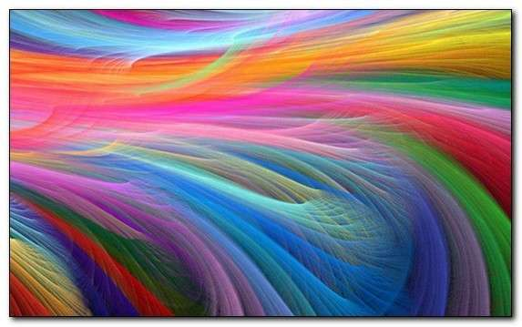
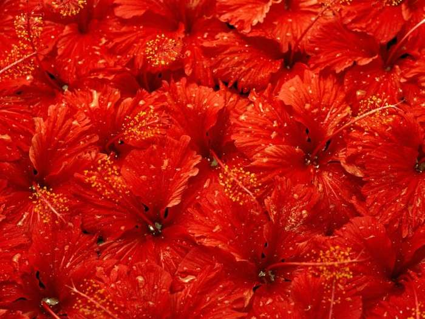
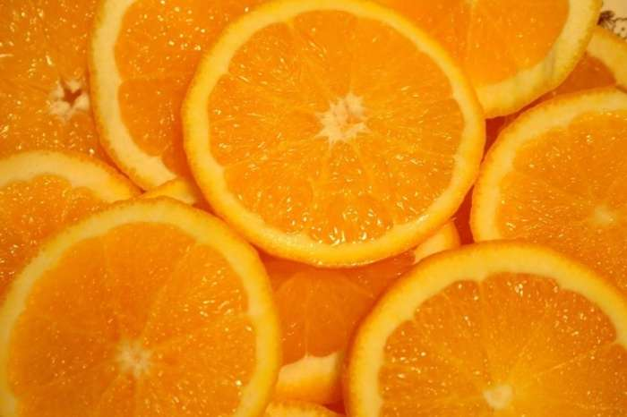
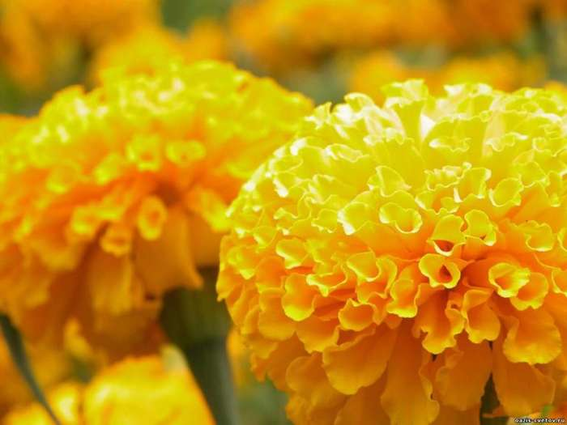
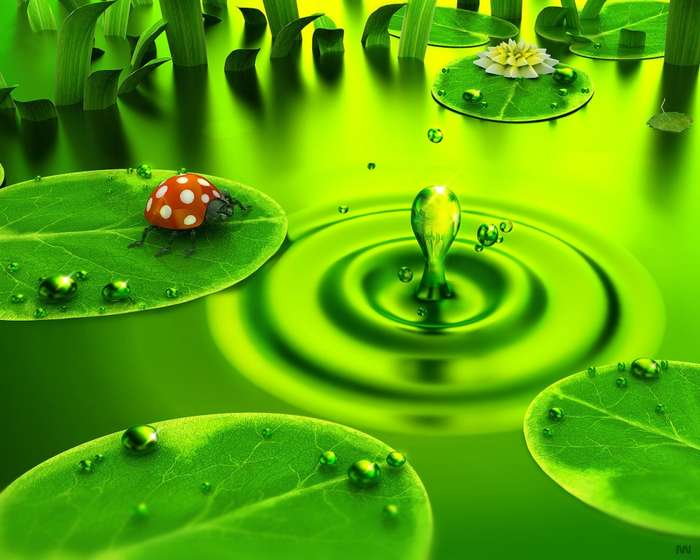
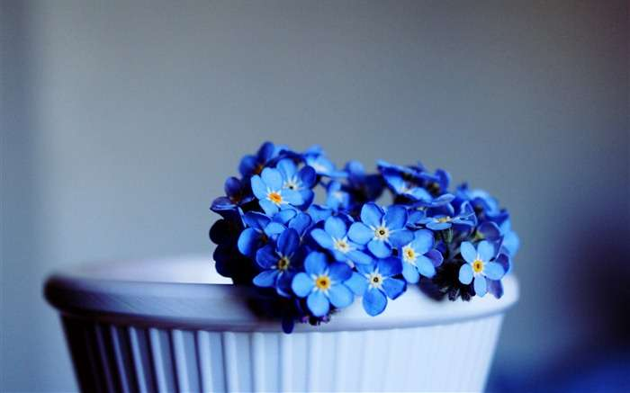
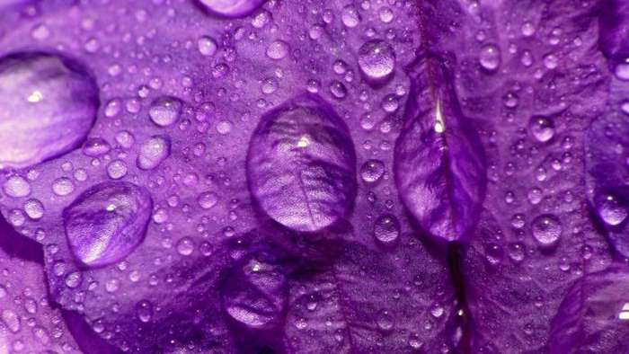
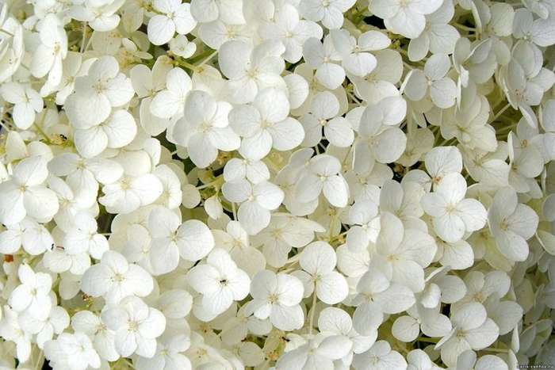
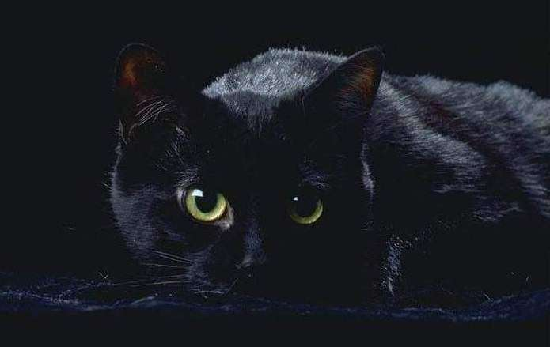

# Өнгөний нөлөө

Орчин үед, өнгө, хүнд хэрхэн нөлөөлдөг талаар тоо томшгүй судалгаа хийгдэж, нэгэн төрлийн эмчилгээний арга болтлоо хөгжөөд байгаа юм. Өнгө нь хүнд, эерэг ба эсрэгээр нөлөөлөх чадвартай бөгөөд хүний сэтгэхүйд хүчтэй нөлөөлдөг гэнэ. Ер нь бид ч үүнийг мэддэг. Бороо уйлагнасан, саарал өдрүүдэд, сэтгэл санаа уруудуу, гуниг төрөөд байдаг. Харин нарлаг, сайхан өдөр сэтгэл санаа хичнээн өөдрөг байдаг билээ? Тиймээс өнгөөр эмчилдэг эмчилгээ, анагаах болон сэтгэл зүйн салбарт, амжилттай хөгжиж байгаа аж. Өнгөнүүдийн хүнд тусах нөлөөг танилцуулъя:

#### Улаан

Тод өнгө. Улаан өнгө, хүний эрчимийг дээшлүүлж, хөдөлмөрийн бүтээмжийг нэмэгдүүлдэг. Мөн эерэг сэтгэлийн хөдлөлийг дагуулах бөгөөд сонгол хийх үеийн эргэлзээг дарж зөв сонголт хийхэд тусалдаг. “Унтаа” байдлаас гаргах ба тархийг бүрэн ажиллуулах чадалтай. Улаан өнгийг харах үед, адреналин ялгарч, цусны эргэлт хурдассанаар тархинд шинээр цус юүлэгдэн, цусан хангамж сайжирдаг.

---

#### Улбар шар

Бизнесийн өнгө гэдэг. мөн албан тушаал ахих, өсөхөд тустай. Зөөлөн, дулаан ханасан энэхүү өнгө, албан тушаалын өндөрлөгт хүргэнэ. Улаан өнгө өөрийгөө хамгаалах, хурдан хөдлөх байдалд хүргэж байдаг бол, улбар шар нь, хүний үндсэн инстинктийг сэргээн, асуудлуудыг шийдэх төгс боломжоор хангадаг гэнэ. Эргэн тойрноо улбар шар зүйлсээр хүрээлснээр, олон чадавхи сэргэж, өөрийгөө үнэлэх үнэлэмж өсдөг байна. Хоол боловсруулах эрхтэний үйл ажиллагааг сайжруулдаг.

---

#### Шар

Энэ өнгө хүнийг тайвшруулж сулладаг. Оюуны чадавхийг дээшлүүлж, анхаарал төвлөрүүлэлт, ой санамжийн дасгал болдог бөгөөд бие организмд амьдралын эрч хүчийг өгдөг. Хувь хүний оюун ухаан, сэтгэлгээг өсгөдөг. Хоол хүнсний ашигт хэсгүүдийн шингэлтэд сайнаар нөлөөлдөг. Энэ өнгөний тусламжтай бие организмын, кальци шингээх чадвар нэмэгддэг.

---

#### Ногоон

Шинэчилж, тайшрал, эвлэрлийн өнгө. Урт хугацаатай зорилго тавьж, зүтгэх үед энэ өнгө тустай. гадаад хэл судлах, эсвэл өдөр бүрийн дасгал сургуулилтын үед, энэ өнгөөр хүрээлүүлэх сайн. Хувийн зохион байгуулалтыг сайжруулдаг. Зүрх судасны өвчлөийн үед сөрөг бодлуудаас салган, мэдрэлийн системийг бэхжүүлдэг. Сэтгэл санааг өргөж өгдөг.

---

#### Хөх

Тайвшруулж, уур уцаар, сөрөг сэтгэл хөдлөлийг дардаг. Аливааг сэтгэл хөдлөлөөрөө шийддэг хүмүүст маш хэрэгтэй өнгө. Анхаарал төвлөрүүлэхэд тустай мөн амгалан тайван болгодог. Хөх өнгө хир бараан байна төдий чинээ мэдрэлийн системийг дарангуйлдаг бөгөөд сэтгэл гутралын өвчтэй хүмүүст хориглодог. Мөн хүнийг хуурмаг байдалд даллан, бодит амьдралаас тасархай мөрөөдөл, уран зөгнөлийн ертөнцөд оруулах сөрөг нөлөөтэй.

---

#### Нил ягаан

Энэ өнгийг, нууцлаг тансаг байдлыг илэрхийлдэг гэж үздэг. Улаан, хөх өнгүүдийн холимог учраас, эдгээр өнгүүдийн нөлөөллийг хослуулсан байдаг. сандралыг дарж, мэдлэг, итгэл өгдөг гэж үздэг. Эерэг өнгө.

---

#### Цагаан

Цэвэр ариун, хязгааргүйг билэгддэг. Өөртөө итгэлтэй, хүссэн зүйлдээ хүрдэг хүмүүсийн өнгө гэдэг. Энэ өнгө бол эхлэлийн эхэн, бусад өнгүүдийн өлгий өнгө юм.

---

#### Хар

Сэтгэл гутрал, сэтгэлийн дарамт, сөрөг сэтгэл хөдлөлийн дагуул өнгө. Өөртөө үл итгэх, сэтгэл хангалуун бус байдлыг өсгөх магадлалтай. Үүний зэрэгцээ, үнэн мөнийг мэдрэх, нууцлаг зүйлсийг тайлах чадвар өгч байдаг. Хүн, өөрийн бодолдоо умбах үед, энэ өнгө зонхилох нь сэтгэл гутралд хүргэх боловч мөн бусад сэтгэл хөдлөлүүдээс салж амрах боломж өгч байдаг байна.

Ийм маягаар өнгүүд, хүнд нөлөөлдөг бөгөөд зөв хэрэглэж ашиглах нь, амьдралд тустай болох нь нотлогдоод байгаа ажээ.
