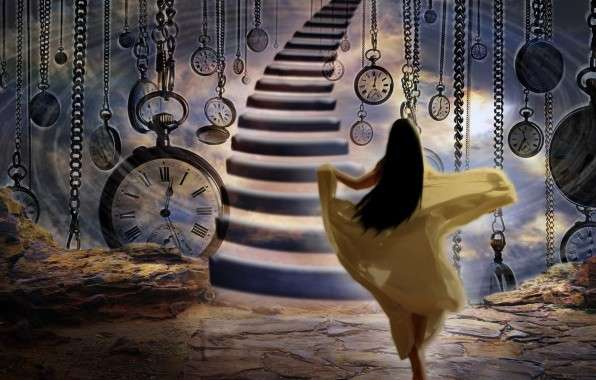

# Өнгөрсөн, ирээдүй ба одоо цагийн ялгаа

-Амьдралд үргэлж хар цагаан зурвасууд ээлжилж байдаг уу? 

-Ихэнхи хүмүүсийн хувьд тийм байдаг. Гэхдээ зарим цөөн хэсэг хүмүүс, нэгэн өөр зүйлийг мэдэрч, түүндээ анхаарч байдгаас, хар цагаан тэдний хувьд, ээлжилдэггүй. 

-Яаж тэр өөр зүйлийг мэдрэх вэ? 

-Их амархан, хэрэв чи, сэтгэл санаагаар унасан байдаг бол чи, өнгөрсөнд амьдарч байна, хэрэв, сэтгэл чинь түгшүүртэй байдаг бол чи, ирээдүйгээр амьдарч байна. Харин, сэтгэл чинь тайван амгалан, нэг л хөнгөн мэдрэмжтэй байдаг бол чи, одоо цагт амьдарч байна гэсэн үг.

–Чи аль цагт амьдарч байна?

