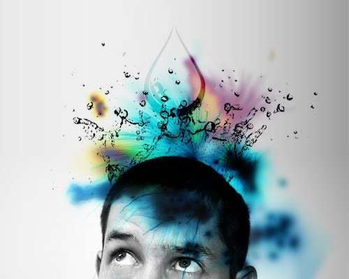
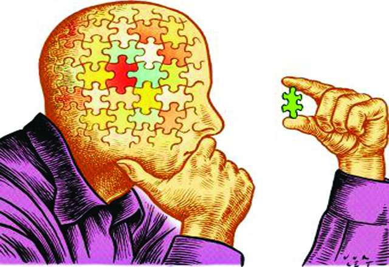

# Өнгөцхөн дүгнэлтийн алдаа

Нэгэн гэр бүлийн эхнэр нөхөр хоёр, амьтан тэжээхээр шийдэж, бяцхан овчаркны гөлөг худалдан авчээ. Тэд гөлгөө хүүхэд шигээ хайрладаг байв. Нохой нь ч тэр, тэдэнд хайртай, үнэнч, ухаантай болж өссөн бөгөөд олон зүйл дээр тэднийг хамгаалж, хайрыг нь татдаг байлаа. Тэр цагаас хойш долоон жил өнгөрч, тэдний удаанаар хүсэн хүлээсэн хүүхэд нь төрөв. Аз жаргалтай хос, хамаг анхаарлаа хүүхэддээ тавин нохойгоо анхаарахаа больсноор, нохой нь өөрийгөө хэрэггүй болсоноо мэдрэн, үе үе, хүүхдээс нь тэднийг харамлах байдалтай зан гаргана. Нэг өдөр, гэрийнхээ гадна задгай гал дээр зоог бэлтгэхээр шийдэж, хүүхдээ өрөөнд нь унтуулж орхичихоод гадаа хоол ундаа бэлтгэж байв. Гэтэл, тэд нэгэн аймшигт зүйл харсан бөгөөд ам нь тэр чигтээ цус болсон нохой нь дотроос гарч иржээ. Нөхөр нь, хүүхдийн өрөө рүү орсон ч үгүй, шууд үүдэнд байсан бууг шүүрэн авч гаднаа сүүлээ хөдөлгөн, магтаал хүлээх мэт зогсох нохойгоо буудчихаад айж сандран хүүхэд дээрээ ортол, хүүхэд нь тайван унтаж байсан бөгөөд харин, хүүхдийнх нь орны дэргэд толгой нь тасарсан том могой хэвтэж байжээ. Хөөрхий нохойгоо буруугаар бодож, цааш харуулсан эр, харамсан гашуудаж, өнгөцхөн дүгнэлтийн горыг амссанаа ойлгосон гэдэг.

