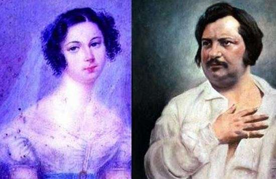
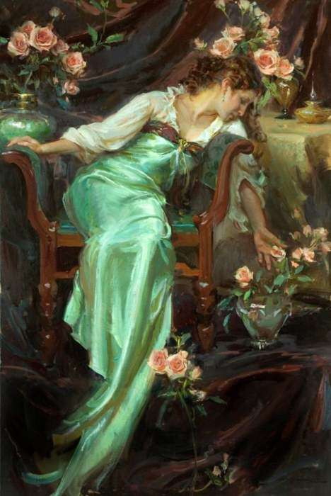

# Оноре де Бальзак - эмэгтэйчүүдийн нэвтэрхий толь

Францын алдарт зохиолч Оноре де Бальзак насан туршдаа кофег дээдэлж ирсэн бөгөөд өдөрт 50 аяга кофе хэрэглэхийн зэрэгцээ, 30 наснаас дээш эмэгтэйчүүдийг мөн дээдлэн, бишрэн шүтэж үнэлдэг байсан гэдэг. Тиймээс ч 30-с дээш насны эмэгтэйчүүдийг “Бальзакийн насныхны гоо үзэсгэлэнт эмэгтэйчүүд” гэдэг хэлц үг хүртэл гарсан байдаг. Тиймээс тэр үеийн гоо үзэсгэлэнт язгууртан эмэгтэйчүүдийн сэтгэл зүрхийг эзэмдэн уярааж явсан, эмэгтэйчүүдийн сэтгэл зүйч гэж хүртэл нэрлэгдэж явсан алдарт зохиолчийн, эмэгтэйчүүдийн тухай хэлсэн үгстэй танилцацгаая.

• Өөрийн гэргийгээ нууц амраг мэт болгож чадахгүй бол, тэр эр хүн дорой. Нэг эмэгтэй дээр бүх эмэгтэйчүүдийг нийлүүлэн нэгтгэж сурах хэрэгтэй.\
• Эмэгтэй хүн өөрийн алхаагаар юуг ч харж амжих боломж олгохгүй, зөвхөн өөрийгөө харуулж чаддаг авъяастай\
• Нөхрөө шоолон инээж буй эмэгтэйд, нөхрөө хайрлах сэтгэл дахин төрөхгүй\
• Эмэгтэй хүн нөхрийнхөө царайг, далайчин далай тэнгисийн аягийг мэддэгийн адил маш тодорхой мэдэж байдаг\
• Эхнэрээ харддаг хүн, эхнэрийнхээ байдалд эргэлзэж байгаа бус харин өөрийн үнэлэмждээ эргэлзэж байна гэсэн үг\
• Хүн, хэн нэгэн эмэгтэйд, залуу нас эсвэл нас намба, хөөрхөн сайхан эсвэл царай муутай, ухаантай эсвэл ухаангүй зэргээс болж дурладаггүй. Ямар нэг зүйлийнх нь төлөө биш зүгээр л өөрийн эрхгүй хайрлахыг дурлал гэдэг\
• Эмэгтэй хүнийг удирдаж чадаж байгаа хүн, улс орныг ч удирдаж чадна\
• Эмэгтэй хүний, зөвхөн хамгийн сүүлчийн дурлалыг л, эрэгтэй хүний анхны хайртай зүйрлэж болох юм\
• Эрэгтэй хүн хожигдвол алддаг. Эмэгтэй хүн юу ч алдахгүй байхад л хожиж байдаг\
• Эмэгтэй хүн, өөр эмэгтэй хүний эр хүнийг ялах дуртай байдаг. \
• Нууц амраг нь болохгүйгээр хэн ч эмэгтэй хүний найз болж чадахгүй\
• Эрэгтэй хүн, ганц эмэгтэйтэй удаанаар аз жаргалтай амьдарч чадахгүй гэж үзэх нь утгагүй. Энэ нь сайн хөгжимчин нэг хийлээр биш нижгээд хийлээр тоглох аргагүйтэй адил зүйл. \
• Эмэгтэй хүнд бүтэшгүй зүйлийг болгож болох үндэслэлээр, мэдээж зүйлийг үгүйсгэхдээ зөн совинтой холбон тайлбарлах хэрэгтэй болдог\
• Бүр хамгийн, хамгийн сэтгэл хөдлөсөн үедээ ч эмэгтэй хүн, заавал нэг зүйлийг хэлэхгүй дутуу орхидог нь гайхалтай\
• Эмэгтэй хүн, түүнийг бүх асуудлаас салгах эрэгтэй хүнд л өмчлөгдөх ёстой.
