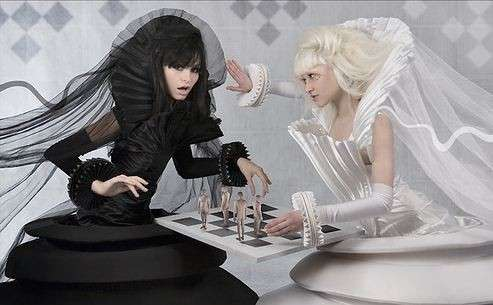
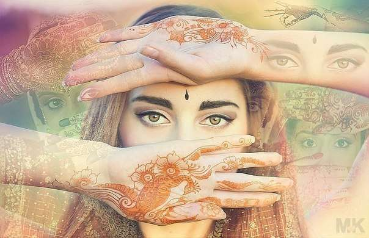

# Өөрөө ч мэдэхгүй, өөрийгөө муухай харагдуулдаг шалтгаанууд

Гоё сайхан, үзэсгэлэнтэй байх нь, зөвхөн гадаад үзэмжтэй холбоотой байдаггүй мөн зан ааш, дотоод сэтгэлтэй ихээхэн холбоотой байдаг байна. Гоё сайхан байх хүсэл эрмэлзлэл маань дараах зүйлсийг мартахад хүргэдэг гэнэ. Та, анхааралтай уншаарай.

-Хүнд зан. Амьдралын бүх зүйлсээс зөвхөн мууг нь олж хардаг зан. Энэ зан, эргэн тойрондоо “ гоё сайхан” энерги цацахгүй нь магад.\
-Ичимхий бүрэг байх. Ичиж зовсноороо, бусдын анхаарлыг улам илүү татаж, таны өөртөө таалагдагддаггүй зүйл чинь улам товойн харагддаг.\
-Өөртөө хэт анхаарах. Энэ зан бусдад таатай байдаггүй. Туйлшрал, их зан гэж хүлээж авдаг. Хичнээн хөөрхөн сайхан байсан ч, бороонд үс нь норчихвол бухимдаж, үглээд байгаа хүн сайхан байх уу...\
-Бүхнийг хяналтандаа байлгах сонирхол. Гадаад үзэмж, хичнээн гоё байсан ч, хэн ч сайхнаар хүлээж авдаггүй.\
-Бүдүүлэг зан. Энэ бол бүхэнд ойлгомжтой.\
-Шударга биш байх. Таны, сайхан царайны төлөө, худал хуурмагийг чинь өршөөж болох ч, харин үйлдэл тань мартагддаггүй...

Дотоод, гадаад гоо үзэсгэлэнгээ хослуулсан, дотроосоо гэрэлтсэн, сайхан царай зүс, бие хаа л, ёстой, хорвоогийн, жинхэнэ “чимэг” болно буйзаа.
