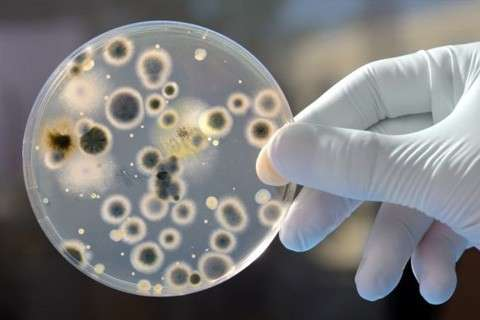
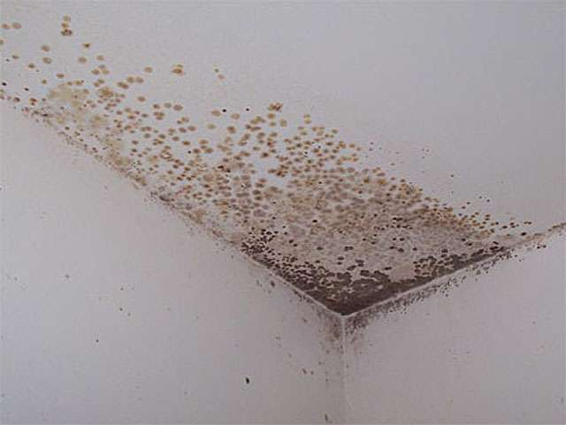

# Өрөө тасалгааны хөгц мөөгөнцрөөс салах гэрийн арга

Чийглэг, агаарын солилцоо сайнгүй өрөө тасалгааны өнцөг буланд, хөгц мөөгөнцөр үүсдэг. Ихэвчлэн ванн, 00-д . Бид өнгө үзэмж талаас харахаас биш эрүүл мэндэд нөхөшгүй уршиг учруулдаг болохыг мэддэггүй. Тиймээс энэхүү хөгц мөөгөнцрийг өөрсдөдөө хоргүй химийн бус аргаар устгах, гэртээ бэлтгэх хуучны хялбар аргыг танилцуулъя.

Энэ арга бусад, хөгц мөөгөнцрийн эсрэг бодисуудтай харьцуулахад ямар ч хоргүй, элдэв үнэргүй эрүүл мэндэд сөрөг нөлөөгүй. Харин мөөгөнцөр хөгцийг нэгмөсөн дардаг. Хадгалах хугацаа хязгааргүй. Тэр хэсгийн ханандаа түрхээд хэсэг хугацааны дараа үр дүнг нь хараад гайхах болно.\
Орц:\
2 цайны халбага цайны модны эфирийн тос /халдваргүйжүүлэх/\
2 аяга ус\
1 цайны халбага спирт\
Ус шүршигчид / халуун үед сэрүүцэхэд хэрэглэдэг/, бүгдийг нь хийгээд хольж сэгсрээд мөөгөнцөртэй газраа шүршнэ.\
Мөн уксус дээрх маягаар шүршиж болно хөгц мөөгөнцрийг 82% устгадаг.
