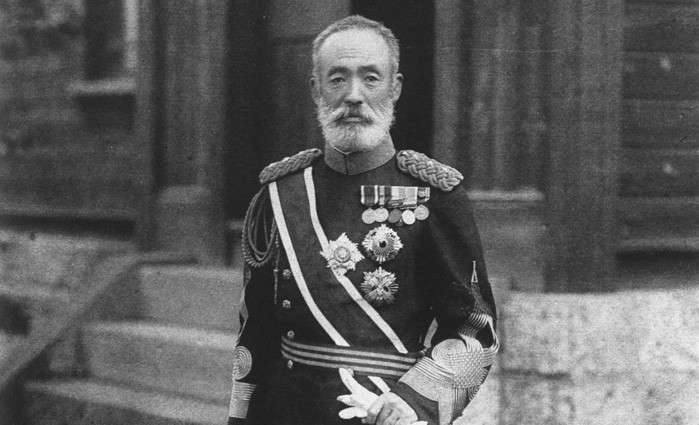

# Өөрчилөгдөхийг хүсвэл япончуудаас үлгэр ав

Япончууд аливааг өөрчилөхийг хүсвэл, өөрөөсөө эхэлдэг гэнэ. Японы компани хүнд байдалд орвол, ажилтануудынхаа цалинг биш, харин захирал нь өөрийнхөө цалинг хасдаг аж. Бүр илүү хүнд байдалд орсон тохиолдолд,, захирал нь хамгийн түрүүнд сайн дураараа огцордог бөгөөд орон тооны цомхотгол энгийн ажилтан ажилчидаас эхэлдэггүй. Тэд, муу цэрэг гэж байдаггүй, зөвхөн муу генералууд байдаг гэж эртнээс үзэж ирсэнээс, маш хариуцлагатай байдаг. Тиймээс, өөрчилөлтийг зөвхөн хувийн хариуцлагатай холбон үздэг аж. Хөгжил цэцэглэлтийн нууц нь үүнд нь оршдог биз ээ. Манайх ийм болтол арай хол байна даа...
