# Ордууд хэрхэн өтөлдөг тухай зугаатай зурхай

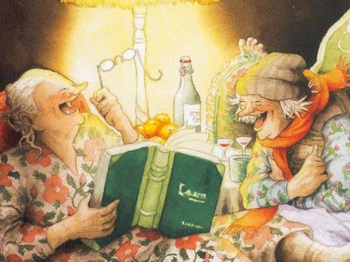

Хүмүүс, орд тус бүрийн ялгаатай зан чанараараа янз бүрээр өтөлдөг гэнэ. Зарим ордын хүмүүс нас явах тусам, ялдамхан гэрийн эмээ өвөө болдог бол, нөгөө хэсэг нь хөгшрөлттэйгээ гоо сайхны бүтээгдэхүүнээс авахуулаад мэс ажилбарын тусламжтай цуцалтгүй тэмцэж, харин нэг хэсэг нь, хөгшрөлттэйгээ эвлэрч чадахгүй богино банзлаасаа салахгүй залуу хувцаслаж, өөр нэг хэсэг нь өндөр насалж өтөлтлөө хөгшрөхгүй явах нь ч бий.

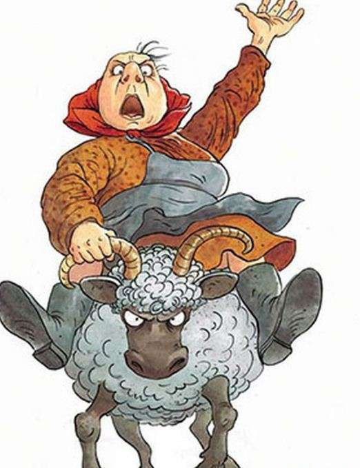

#### Хонины ордынхон

Хонинууд насаа анзаарахгүй байхыг хичээж, хүмүүсийг ахаа, эгчээ гэж дуудсаар явдаг. Тэд маргааш юу болохыг огт бодохгүй, тухайн хормоор амьдардаг тул, залуу цагийн эрч хүчээ өтөлж хөгширтлөө хадгалдаг. 60 нас хүрч байж багахан ухаа намба суух ч, залуу цагийн эрч хүч, хурдаа хасахгүй байсаар өтөлнө.

---

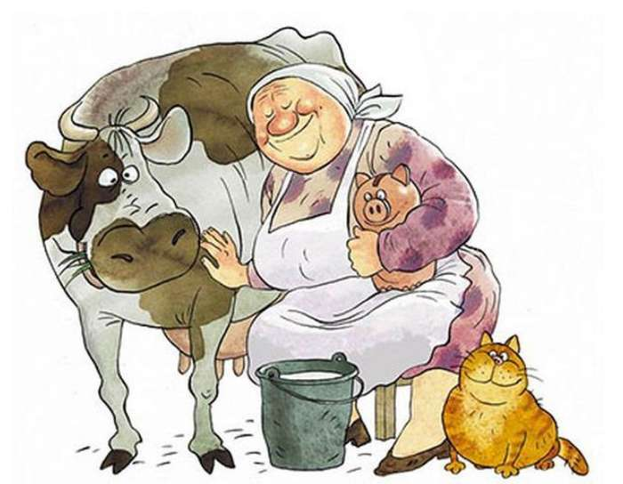

#### Үхэр

Үхрийнхэн сайхан хооллох дуртай, нас ахих тусам амттан, тансаг зүйлд дурлан ихэнхидээ илүүдэл жинтэй болдог. Нас нэмэгдэхийн хирээр, зөрүүд үхрүүд уян ялдам зангаа улам гээх магадлалтай. Тэд, сэтгэл зүй, бие мах бодын гайхалтай тэсвэртэй чанартай тул урт удаан амьдарч, маш өндөр насалдаг.

---

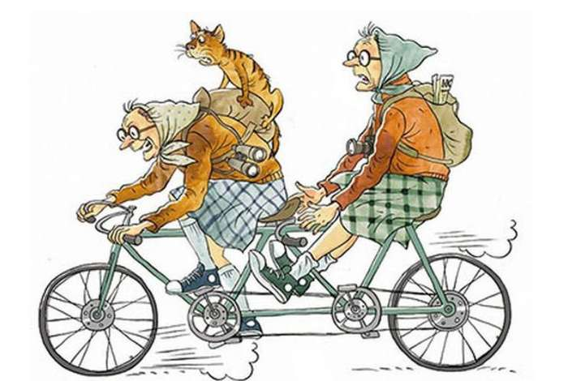

#### Ихэр

Ихрийнхэн залуу насандаа өмнөө тавьсан зорилгоо хэзээ ч орхихгүй, аажмаар урагшилсаар, нас нь явсан ч зогсохгүй. Тэднийг ажилаасаа эрт ирэх, зөөлөн буйдан дээр тухлан хэвтэхийг энэ насанд нь харахгүй л болов уу. Тэдний ажил алба, албан тушаалын өсөлт, тэтгэвэрт гарсан ч үргэлжилсээр байдаг.

---

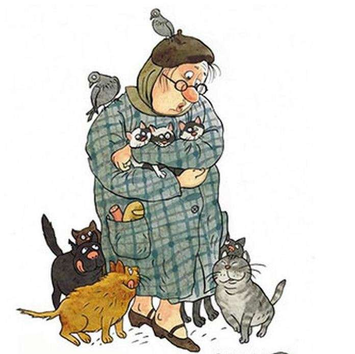

#### Мэлхий

Мэлхийнхэн хоёр янзаар өтөлдөг. Эхний хэсэг нь хэзээ ч хөгшрөхгүй хүүхэд зангаараа байсаар дуусна. Харин нөгөө хэсэг нь эргэн тойрондоо халамжийг Тереза эх шиг түгээж өгнө. Тэд өөрсдийн буурал насаа бүх хүн хүндлээсэй гэж хүссэн, онцгой сайхан “сонгодог” төрхтэй, ач зээ нарынхаа хүсэмжлэн хайрладаг эмээ өвөө болж өтөлдөг.

---

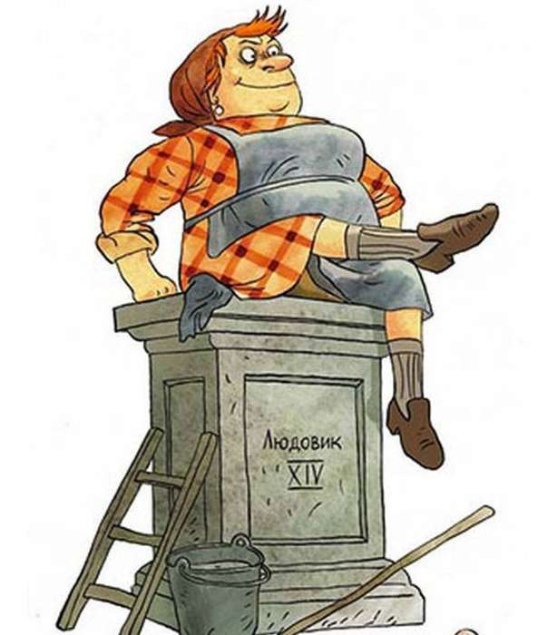

#### Арслан

Арслангийнхны төрөлхийн хүлцэнгүй зан, нас нь явах тусам улам хүчтэй илэрч, аядуу тайван эрхэмсэг болж хувирдаг. Тэд, бусдаар хүндлүүлэх, бүр бишрэн шүтүүлэх, нэр төртэй байхыг хэт эрхэмлэсэн үлгэр жишээ эмээ өвөө болно. Тиймээс, амьдралынхаа гол зорилгуудыг биелүүлж эртхэн амрахын тулд өнөөдөр бужигнуулсаар яваа.

---

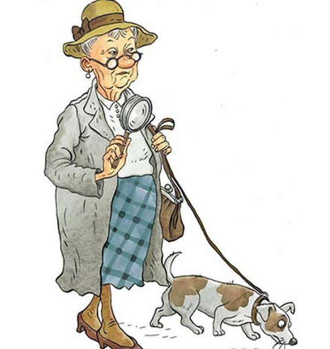

#### Охин

Олонхи охиныхон, нас нь явахын хирээр аливааг сөргөөр хүлээж авах нь ихэсч, хэт шүмжлэмтгий болох нь бий. Тэд маш сайхан дүр төрхтэй, эрүүл бие мах бодтой, байнгын тархи сэтгэхүйгээ хөгжүүлж байдаг, жоохон хатуухан ч ухаалаг, джентельмен, хатагтай нар болон хөгширдөг.

---

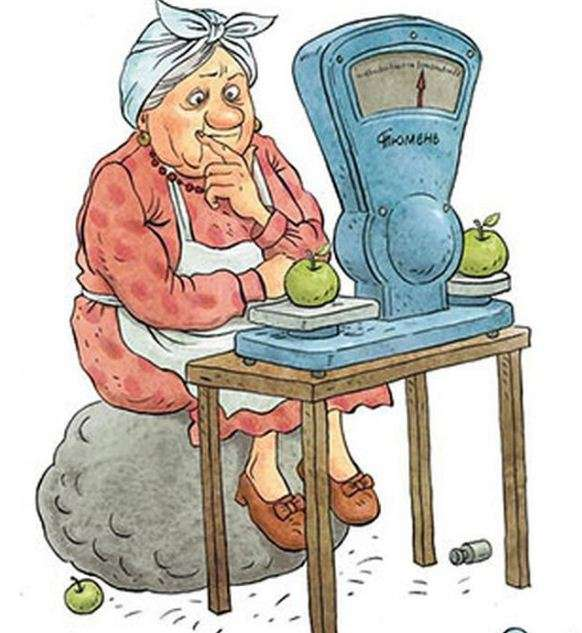

#### Жинлүүр

Энэ ордынхон, гадаад үзэмждээ ихээхэн санаа тавьдаг учираас, таргалахгүй үрчлээтэхгүйн тулд бүхий л арга хэмжээ авч байдаг хөгшчүүл болдог. Энэ нь ч маш үр дүнтэй байдгаас, 80 насандаа ч, тэд эргэн тойрныхноо дөч ч хүрээгүй шүү гэж итгүүлэх оролдлого хийсээр байдаг залуу төрхтэй эмээ өвөө болно.

---

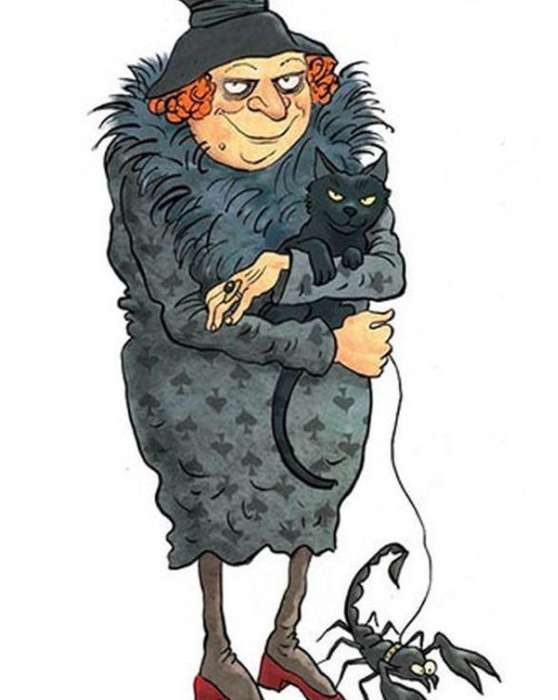

#### Хилэнц

Хилэнцийнхэн хөгшрөхдөө, эрхэмсэг, жинтэй болж, өөрийнхөө талаар болон амьдаралын турш хуримтлагдсан туршлагаа гүн ухаанлагаар бодох дуртай болдог. Тэр нь ч үнэн байдаг. Гэвч харамсалтай нь, өөрийн үзэл бодол, зорилгодоо хэт туйлширдаг, үнэрхүү түвэгтэй зантай болох нь бий.

---

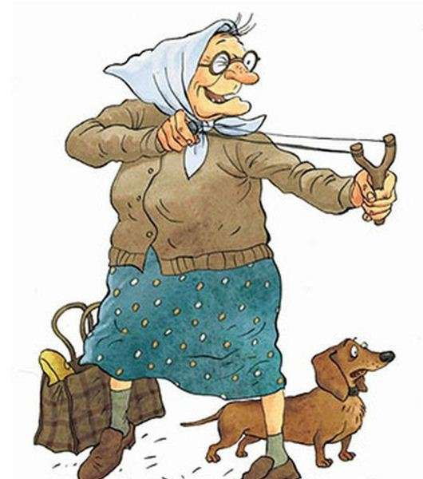

#### Нум

Нумынхан хөгшрөлтийн талаар бодох ч дургүй, бүр тэмцэлдэж байдаг. Энэ нь бүр салшгүй бодол нь болж, бусдаар залуу харагдаж байна гэж магтуулах дуртай болдог. Энэ нь ч үнэн, үнэхээр наснаасаа залуу харагдаж өтөлж өндөр настай болсон ч, өөрийгөө тэр бүр арчилаад байхгүй ч, тачаангуй дур булаам төрхөө хадгалсаар байдаг нь гайхалтай.

---

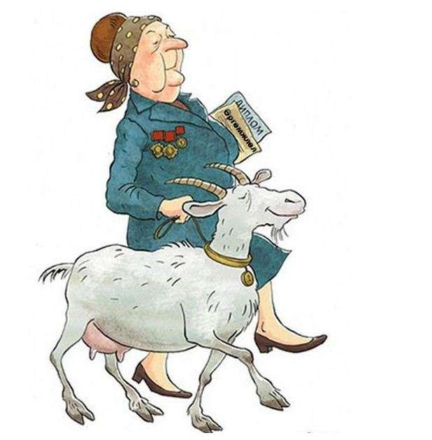

#### Матар

Энэ ордынхныг Санчир гариг эрхшээж байдгаас, цаг хугацаатай ихээхэн уялдаатай байдаг. Гайхалтай нь, тэдний цаг эргэж урсаж байдаг гэнэ. Матарууд төрөхдөө, насандаа байшгүй ухаалаг, хариуцлагатай, чухал “бяцхан хөгшид” төрдөг бөгөөд нас нэмэгдэх тусам харин байдал төрх нь залуужиж, сэтгэхүй нь хүүхдэрхүү гэнэн цайлган болж байдгаас хөгжилтэй, цагаахан өвөө эмээ нар болон өтөлдөг.

---

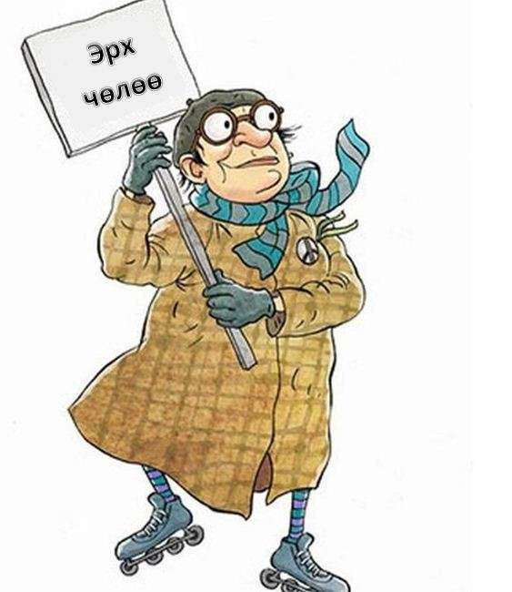

#### Хумх

Хумхууд мөн хүүхэд насандаа ухаалаг, том хүн шиг намбалаг, ноцтой төрхтэй байдаг. Нас нь явах тусам, эргэн тойрныхон нь түүний тухай юу бодох нь хамаагүй гэсэн багахан хэлтгий бодолтой, бусдыг ойшоохоо больж, өөрийн дураар амьдрахыг эрхэмлэж эхэлдэг. 80 настайдаа ч тэр, юу толгойнд нь орно түүнийгээ хийсээр явна.

---

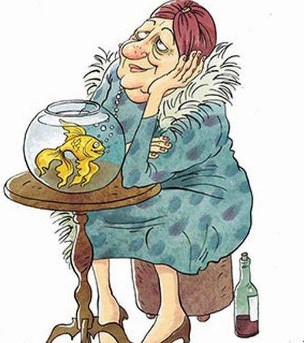

#### Загас

Загаснууд хөгшрөхөөс үхтлээ айдаг. Энэ нь бие мах бодын хөгшрөлтөөс айх айдас биш харин, өнгөрч буй хугацаанд юу хийв, хийх зүйлээ хийж чадахгүй, амжихгүй байхвий гэсэн айдас байдгаас, амьдралаа үе шатлан дүгнэх, хураасан цуглуулснаа тооцох, тайлан тооцоо нэгтгэх гэсэн асуудлуудад байнга цаг гаргаж байдаг хөгшчүүл болдог. Эдгээр зүйлд тэд, хэр бага санаа тавина төдий чинээ аз жаргалтай урт насална. Санаа зовинол шиг амьдралыг дарангуйлдаг, богиносгодог зүйл үгүй гэдгийг ойлгочихвол, халамжтай, ойлголт дүүрэн эмээ өвөө нар болон өтөлдөг.
