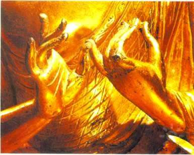

# Ордуудын эерэг сөрөг талууд товчхон

#### Хонь

**Эерэг:** Хаврын сайхан хүмүүс. Хүчирхэг. Сэтгэлийн хөдөлгөөнтэй. Бодолгүй үйлдэл хийх нь бий.\
**Сөрөг:** Түргэн зантай. Хартай. Уур хилэнтэй.

#### Үхэр

**Эерэг:** Зорилгодоо үнэнч. Хүссэндээ хүрэх чадвартай. Нягт.\
**Сөрөг:** Зөрүүд. Хартай. Дарангуйлагч байх магдлалтай. Эмзэг. Шүүмжлэмтгий.

#### Ихэр

**Эерэг:** Эрүүлээр сэтгэдэг. Хөгжилтэй. Сэтгэл хөдлөлөөр дүүрэн, амьдралаар бялхаж байдаг. Нийтэч, хүмүүсийг татаж чаддаг. Эрч хүчтэй. Шинэ санаагаар дүүрэн\
**Сөрөг:** Сэтгэл санаа нь байнга өөрчилөгдөж байдаг. Шинэ орчин, харьцаагаар дутагддаг. Танил тал, найз нөхөд, ойр дотныхныхоо сэтгэгдэл, сэтгэл санаанаас хэт хамааралтай. Мөнхийн эрэл хайгуулд зүдэрдэг

#### Мэлхий

**Эерэг:** Сэтгэл хөдлөл, болон сэтгэлийн хариу үйлдэлээр дүүрэн сайн хүн. Нийтэч. Итгэлтэй, найдвартай үнэнч найз нөхөр. Байгаллаг, төрмөл байдлыг эрхэмлэдэг\
**Сөрөг:** Хэт сэтгэлийн хөөрөлтэй. Сэтгэл санаа нь өөрчилөгдөмтгий. Архи дарсанд дурлах магадлалтай. Шүүжлэлийг хүлээн авахдаа муу. Интернетээс хамааралтай.

#### Арслан

**Эерэг:** Хаан мэт. Зорилготой. Үнэнч. Өгөөмөр. Зоримог.Тусч\
**Сөрөг:** Ихэрхүү, Зөрүүд. Алдар нэрд дуртай. Дутагдалтай талыг нь хэлсэн хүнд хонзогнодог

#### Охин

**Эерэг:** нямбай, сэтгэлийн хөдөлгөөнөө барьж чаддаг, оюунлаг, ажигч, алдаагаа шинжилж чаддаг, төрлөхийн сэтгэл татам, бусдыг сонсох, ойлгох, зөвлөгөө өгөх чадвартай\
**Сөрөг:** Хайр дурлалыг эрж хайж байж харилцаа тогтооно. Заримдаа хэт нямбай, үүнээсээ болж бусдын дургүй хүргэнэ. Амьдралд үргэлж гомдоллодог. Үндэслэлтэй, үндэслэлгүй гомдож ханадаггүй. Хартай, цуврал киноны гол баатартай хардахаас ч сийхгүй.

#### Жинлүүр

**Эерэг.** Тайван эрүүлээр сэтгэдэг. Шударга. Амьгүй зүйлээр билэгдэгдсэн ганц орд. Нийтэч. Хариуцлагатай. Зорьсондоо хүрдэг. Дотоод сэтгэл, гадаад байдлын зохилдлогоо сайн. Шинэ санаагаар үргэлж дүүрэн байдаг.\
**Сөрөг:** Сэтгэл санаа нь тогтвортой бус. Хүсч буйгаа мэдэхгүй байдалд орох нь бий. Бусдын сэтгэл санаанаас хамааралтай. Олон зүйл дээр хүүхэд зан гаргах нь анзаарагддаг. Найз нөхөд, ойр дотныхныхоо тусламж дэмжлэгээр дутагддаг

#### Хилэнц

**Эерэг:** Идэвхитэй, Ашиг хонжоо гаргаж чаддаг. Эхэлснээ дуусгадаг. Хариуцлагатай, зорилготой. Орондоо сайн. Үнэнч, итгэлтэй найз нөхөр. Нууцгай, нуугдмал. Өөрийн бодолдоо үнэнч\
**Сөрөг:** Маш хартай. Өмчирхүү. Хувиа хичээгч. Сэтгэлийн тэнхээ сул. Хонзогнодог

#### Нум

**Эерэг:** Маш хөгжилтэй. Дур булаам. Зоригтой. Боломжгүй зүйл түүний хувьд байхгүй. Алдар нэртэй суут таван хүн тутмын нэг нь нумын ордных байдаг. Эсрэг хүйстнийхээ анхаарлыг татдаг. Эмэгтэй бол сайхан галбирлаг биетэй байдаг. Эрэгтэй нь өндөр нуруутай. Сайхан сэтгэлтэй. Хүмүүст туслах дуртай. Гайхалтай хөгжсөн ой санамжтай. Түүнийг хуурч мэхлэх аргагүй. Мэдрэмтгий. Бусад ордуудаас хамгийн илүү азтай орд.\
**Сөрөг:** Хүмүүс таныг тэнэг гэж бодох нь бий. Уйдахдаа уурладаг. Гэр бүлтэй болох гэж яардаггүй. Сайхан идэх дуртай. Хэт шулуун зантай. Эрх чөлөөг хэт эрхэмлэдэг. Гомдолоо мартдаггүй. Нарийн биш, салан палан. Найдваргүй. Бүдүүлэг зан гаргах нь бий. Багахан хувиа хичээмтгий

#### Матар

**Эерэг:** Зорилгодоо үнэнч. Зорилгодоо хүрэхийн тулд дөргүй бух шиг зүтгэдэг. Хүссэн болгондоо хүрэх чадвартай. Хүсч буй зүйлээ маш тодорхой мэддэг. Тэсвэртэй. Уснаас хуурай гарах чадвартай. Үнэнч. Марзан, тэдэнтэй байхад уйдахгүй. Лидер. Зорилгодоо хүрэхийн тулд бүх хүчээ дайчилдаг\
**Сөрөг:** Олонхи хүмүүс түүнийг ууртай гэж боддог. Хүмүүс түүнийг ойлгоход хүнд. Тэвчихэд хялбар бус. Сэтгэлийн тэнхээ сул. Бусдыг болон өөрийгөө ч шоолж голох хандлага гаргадаг. Хонзонтой. Амиа боддог. Эрх мэдэл, албан тушаалд тэмүүлж байдаг. Хүссэндээ хүрэхгүй бол, сэтгэлээр унаж, эргэн тойрондох бүхнийг үзэн ядах байдал гаргадаг

#### Хумх

**Эерэг:** Суут хүн. Хүмүүсийг гарамгай танина. Сайхан сэтгэлтэй. Олон найз нөхөдтэй. Хүмүүсээр хайрлуулдаг. Хошин шогийн мэдрэмжтэй. Та, магад гайхалтай зураач эсвэл яруу найрагч. Гоо үзэсгэлэнтэй. Эрх чөлөөтэй өөрийн хүссэнээ л хийдэг.\
**Сөрөг:** Түүнийг хэн ч ойлгодоггүй. Ухаалаг, тиймээс хүмүүс тусламж зөвлөгөө хүсч байдаг. “Үгүй” гэж хэлж чаддаггүй. Маш мэдрэг, бүх зүйлд хариу үйлдэл хийдэг. Олонхи хүмүүс түүнийг хачин хүн гэж цоллодог. Сайныг хүсч аливааг хийдэг учираас, хүмүүс түүнд гомдохыг огт ойлгодоггүй. Гэрлэхгүй, учир нь өөрийн эрх чөлөөг хэт дээдэлдэг. Түүний хүзүүн дээр суух амархан. Тэр, бүх хүмүүс сайн гэж итгэдэг, тиймээс гудамжны зодоончийг ч сайнаар хүлээн авдаг

#### Загас

**Эерэг:** Авъяаслаг. Сайхан сэтгэлтэй, өгөөмөр. Шинэ санаа, нөхцөл байдлыг сайн хүлээн авдаг. Бусдыг ойлгох, зовлон хуваалцах чадвартай. Өөрийн ашиг сонирхолыг хойш тавьж, бусдын төлөө зүтгэдэг. Буян, өглөг хийдэг.\
**Сөрөг:** Мартамхай. Бусад хүнд өөрийгөө ойлгуулж чаддаггүй. Маш нарийн мэдрэмж, сэтгэхүйтэй, сайхан сэтгэлтэйн улмаас олон зүйлийг алдаж, эд хөрөнгөө гээдэг. Тогтворгүй, итгэмтгий. Хов жив ярьдаг. Амархан төөрөгдүүлж болно. Сэтгэл хөдлөлөө барьдаг. Сул дорой, идэвхиэр дутмаг.
