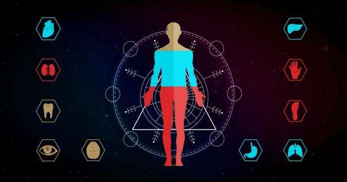
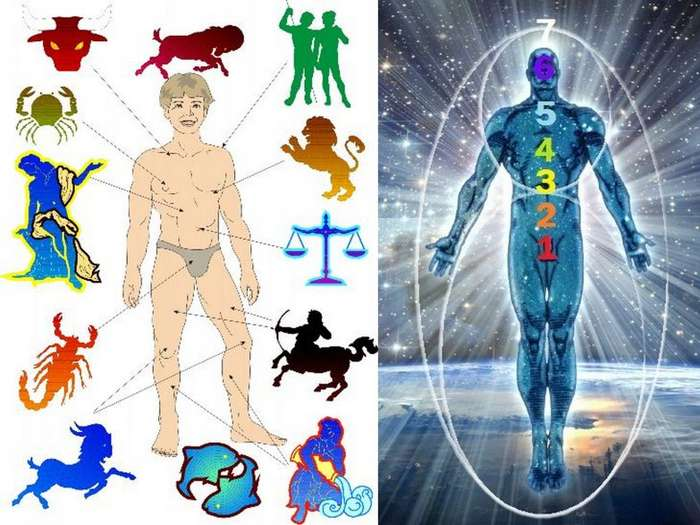

# Ордуудын эрүүл мэндийн зурхай /анхаарах,  сэргийлэх ёстой өвчилөл болон эдгээх аргууд/

Хүмүүсийн эрүүл мэндийг эрт дээр үеэс, төрсөн ордуудтай нь холбож судалж ирсэн бөгөөд орд тус бүр энергийн түвшинд, хүний эд эрхтэний үйл ажиллагаанд нөлөөлж, зохицуулж байдгийг тогтоосон байдаг. Ордуудын байрлал, хүний бие мах бод, сэтгэл санаанд нөлөөлж буйг болон хэрхэн үйлчилж байгаа дээр тулгуурлан эмчилэх, анагаах, мөн өвчилөлийн шалтгааныг тодруулах зэрэгт ордын зурхайн аргыг ашигладаг байжээ. Хэдийгээр эдгээр арга, одоо цагт мартагдаж хуучирсан ч гэлээ, эдгээр нөлөөллүүдийг мэдэх нь ач холбогдолтой гэж үздэг болжээ. Энэхүү зурхай, бие организмын энергээ алдахгүй байх, тэнцвэрийг хадгалах, зарим өвчилөлүүдээс сэргийлэх, учир шалтгааныг тодруулах зэрэгт тустай байх юм.

# Хонь

Энэ ордын нөлөөлөлд толгой, үс, нүүрний хэсэг оршино. Энэ ордын хүмүүс, бусад ордоос ихээхэн ялгаатай бөгөөд энерги нь, байнгын гол үүрэг гүйцэтгэх, манлайлах эрмэлзлэл, хүндэтгүүлэх хүсэл, хатуу шийдэмгий зан дээр нь төвлөрч байдаг. Ууртай, зөрүүд, эрэлхэг зан энэ ордын зан чанарын онцлог. Энэ ордын хүмүүс, энергийн алдагдлаас үүссэн, байнгын толгой өвдөх, салхинд цохиулах, халуурах, мөн арьсны өвчин, тууралт, үсний асуудал зэрэгт өртөмтгий байдаг. Эдгээр хүмүүсийн сэтгэл санааны өвчилөл өөрийгөө үнэлэхгүй байхаас үүднэ. Эдгээрээс сэргийлэх, эмчилэхийн тулд, Хонины ордынхон, үйлдэл, үйл хөдлөлөө чөлөөтэй байлгах, өөрийн дураар амьдрах, асуудлаас зугтахгүй байх, өөрийн үзэл бодлыг бусдад тулгаж өөрийнхөөрөө байлгах хүлээлтээсээ салах, ирээдүйгээ тодорхой төлөвлөж сурах, бусдын санаа бодлыг сонсч байх хэрэгтэй болдог.

# Үхэр

Үхрийн ордны энерги, хүзүү, хоолой, залгиур, бамбай булчирхай, цээжний дээд хэсэгт төвлөрдөг. Энэ ордынхон их бодит, зорилготой, тууштай, тогтвортой, сэтгэлийн хөдөлгөөн багатай хүмүүс. Аюулгүй байдлаа анхаардаг. Энергийн тэнцвэр алдагдалт нь, хүзүү хөших, толгой өвдөх, хоолой хорсох, сөөх, цээж, нурууны дээд хэсгээр өвдөх байдлаар илэрч байдаг. Мөн сэтгэл санаанд, байнга мухардалд орсон мэт мэдрэмж төрөх, аливааг гээж алдахаас айх, өөртөө итгэх итгэлээ алдах зэрэг байдлууд илэрнэ. Энергийн тэнцвэр алдагдсанаас үүдэлтэй эдгээр өвчилөлөөс салахын тулд эрчимтэй үйл хөдлөл, үйлдэл бүхий амьдарлаар амьдрах хэрэгтэй бөгөөд үүний үр дүнд, тэд, өөрийн амьдарлаа хүссэнээрээ зохион байгуулж, тэдэнд хамгийн хэрэгтэй өөртөө итгэх итгэлээ олж авснаар эрүүл саруул амьдардаг. Цэнхэр өнгийн талстат чулуу зүүх, дуу дуулах энергийг нь идэвхижүүлэх, нөхөхөд тустай байдаг.

# Ихэр

Энэ орд, тухайн ордынхны мэдрэлийн систем, бодлын процессод нөлөөлж байдгаас бодлоо цэгцэлж чадахгүй байх, мартамтгай болох байдалд өртөх магадлалтай. Тиймээс энэ ордынхон сэтгэл зүйгээ хайрлах, бодлын дараалалдаа анхаарах, аливааг олон талаас харж сурах хэрэгтэй байдаг. Тэд хөдөлгөөнтэй, нийтэч. Энэ ордынхон дунд, гэрээ хэлэлцээр гайхалтай сайн байгуулдаг авъяаслаг менеджерүүд, зохиолчид, уран илгэгчид нар олноороо байдаг. Тэдний хувьд, сэтгэлийн хөдөлгөөнөө хянах, тогтвортой байлгах нэн чухал. Эдгээр эмгэгүүдийг зөвхөн бясалгал анагаадаг бөгөөд салахгүй байгаа бодлуудаас салгаж, тайвшруулж, бодлыг цэгцэлж өгдөг. Ихэрийн ордынхны ямар ч өвчин, өвчилөл бясалгалаар эдгэдэг байна.

# Мэлхий

Мэлхийн ордынхон, сэтгэлийн хөдөлгөөнөө хянахад анхаарч, мөн нээлттэй байх, тууштай байх, бусдын нөлөөнд автагдахаас сэргийлэх нь эрүүл саруул байхад нь тустай. Бусдыг ойлгох, бусдад туслахад хэзээд бэлэн байдаг чанараараа онцгойрч байдаг хүмүүс. Амьдралд сэтгэл хангалуун бус болох, биеэ барьж чадахгүй байх, мэдрэлийн ядаргааны шинжүүд илрэх, уцаартай болох, ганцаараа байхыг эрмэлзэх зэрэг нь эрүүл мэнддээ анхаарах болсныг сануулна. Мөн эдгээр нь, хоолой сэрвэлзэх, хий ханиалгах, цээж хэсгээр өвдөх, илүүдэл жинтэй болох зэргээр бие мах бод дээр илэрдэг. Эрүүл агаарт байнга гарч байх, амьсгалын дасгал хийж сурах нь эдгээр эмгэгүүдээс салгана. Мөн нийгмийн ашиг тустай ажиллагаанд оролцох, тусламж туслалцаа хийх үйлсэд зүтгэх зэрэг үйлдэл, оюун санааг нь эрүүлжүүлдэг байна. Эдгээр нь, угаас хүнлэг мэлхийнүүдэд таашаал өгч, эерэг үр нөлөө үзүүлдэг аж.

# Арслан

Ордын зурхай арслангуудыг, зүрх болон нурууныхаа дээд хэсэгт анхаарахыг сануулдаг. Өөрөө өөртөө үнэнч арслангуудын энерги, өөртөө итгэх гуйвшгүй итгэл болон зүрхэнд нь үйлчилдэг байна. Хэрэв, тэд, зорьсондоо хүрэхгүй байх, эсвэл бодсоноо биелүүлж чадахгүй бол, дарамтад орж, өөрийн үнэлэмж нь унаж, итгэлээ алдан, айдас түгшүүрт автдагаас зүрхэнд нь асуудал үүсдэг. Бүтээлч үйлдэл, үйл ажиллагаа тэдний сэтгэл хөдлөлийг тэнцвэржүүлэх үйлчилэл үзүүлнэ, мөн уран зураг, яруу найраг, хөгжим, театр, урлаг эрүүл мэндэд нь, гайхалтай үр дүнтэй нөлөөлөхөөс гадна бусдыг халамжлах, анхаарах үйлдлүүд эдгэрэлтэд хүргэнэ. Мөн йогоор хичээллэх нь зүрхэнд хуралдсан зогсонги энергийг тараах сайн үйлчилэлтэй байдаг байна.

# Охин

Энэ ордын энерги ходоод, гэдсэн замын эрхтэнүүдэд төвлөрдөг. Охиныхон их бодит, бүтээлч хүмүүс бөгөөд санасандаа хүрэхийн тулд туйлбартай зүтгэдэг. Задлан шинжлэх гойд авъяастай, бүхлийг нарийвчилан салгаж харж чаддаг, эдгээр ордынхны энергийн тэнцвэрийн алдагдал, хоол боловсруулах эрхтэний эмгэг байдлаар илэрч байдаг. Сэтгэл санаанд нь, бодлоосоо салж чадахаа болих, зөрүүд болох, хэт нэг зүйлд төвлөрөх зэрэг шинжүүдээр илэрнэ. Зурхайд заагдсан эмчилгээ нь, азгүйтэл, бүтэлгүйтлээ хэт зүрхэндээ хүндээр тусган хүлээж авахгүй байх, оюун санаагаа тайван байлгах, хар муу бодлоос салахад чиглүүлдэг. Бүтээлч ажил, биеийн тамирын дасгал, бясалгал энергээ нөхөх, тэнцвэржүүлэх, сэргээхэд тустай. Энергийн тэнцвэр сэргээгдсэнээр, бүхий л өвчин, өвчилөл анагаагддаг болохыг санаж байх хэрэгтэй.

# Жинлүүр

Энэ ордынхон, бөөр, давсаг, бэлхүүс нурууны өвчинд өртөмтгий байдаг. Тэд эргэн тойрныхонтойгоо зохиролд орших гүн эрмэлзэлтэй, тэгш эрх, харилцан ойлголцолыг эрхэмлэдэг хүмүүс юм. Тэдний энергийн тэнцвэрийн алдагдал, өөрийгөө бусдаас тусгаарлах оролдлого болон хэт эмзэг, бусдын сэтгэгдлээс хамааралтай болох байдлаар илэрдэг. Бие мах бодын хувьд, шээсэн замын өвчилөлүүд, нурууны доод хэсгийн өвдөлт, өвчилөлүүдээр илэрнэ. Орчинтойгоо зохилдлогоонд хүрэх, буулт хийж сурах, бусдад санаа тавих, өөрийн үнэлэмжээ өсгөх зэрэг нь эдгэрэлд хүргэнэ. Йог, бясалгал нэн тустай.

# Хилэнц

Бэлэг эрхтэний системийн эрүүл байдалд анхаарахыг ордын зурхай сануулдаг. Хилэнцүүд, байнгын өөрийгөө хөгжүүлэх, боловсрох эрмэлзлэлтэй, зорилготой, алдаан дээрээ суралцдаг, тогтвортой байдалд дуртай хүмүүс. Амьдралд нь тохиолдсон огцом өөрчилөлтөөс болж энергийн тэнцвэрээ алдсан байдал олноор бүртгэгдсэн байдаг. Сэтгэл гутралд орох, шээсний замын эрхтэн, бэлгийн системийн өвчилөлд хүрэх зэргээр илэрдэг. Энергээ сэргээснээр эдгээр өвчилөлүүд нь эдгэрэлд хүрдэг болохыг ойлгох хэрэгтэй байдаг. Амьдралын нөхцөлөө өөрчилөх, сөрөг сэтгэл хөдлөлөө засах маягаар энерги, эрүүл мэндээ сэргээх бүрэн боломжтой бөгөөд бясалгал, агаар салхинд байнга гарах нь эерэг энерги хуралдуулснаар эрүүлжихэд хүргэдэг болохыг ойлгох хэрэгтэйг сануулдаг.

# Нум

Эрүүл мэндийн ордуудын зурхай, нумуудад, элэгний төрөл бүрийн эмгэг болон тааз аарцагны үе хэсгийн өвчилөлөөс сэргийлэхийг анхааруулдаг. Нумууд маш хүчтэй энергитэй, сониуч, шинэ шинэлэг мэдлэг олж авах хүслээр дүүрэн, түргэн зантай, хурдан уурладаг, дараа нь гэмшиж явдаг, адал явдалд шунан дурладаг зантай байдаг. Элэг, үе мөч, ясны өөрчилөлтүүд болон түгшүүрт автагдамтгай болох, тайван бус болох, үйл хөдлөл нь зогсонги болох, идэвхигүй болох байдлууд нь эрүүл мэнддээ анхаарах болсныг сануулж, ордод нь тохирсон эмчилгээ болох, амьдралын идэвхитэй хэв маягийг мөрдөх, түгшүүрээ дарах, аялах, бясалгал хийх зэргээр эрүүлжих боломжийг заадаг. Мөн шинэ орчин, шинэ мэдлэгээр мэдлэгийн хүрээгээ тэлэх, шинэ ажил үйлс эхлүүлэх, биеийн тамирын дасгал сургуулилалт хийх нь, энергийг нь тэнцвэржүүлж өгснөөр өвчинөөс салгаж илааршуулдаг байна.

# Матар

Матрын орд шүдний эрүүл байдал, яс, өвдөгний үенд нөлөөлдөг гэнэ. Зорилго бүхий, зохион байгуулалттай, бодит сэтгэхүйтэй матрууд, ямар ч байдлаас гарах чадвартай, мөн өөрт хэрэгтэй тустай юуг ч хийхэд бэлэн байдгаараа ялгарч байдаг. Энергийн тэнцвэрийн алдагдал нь шүд, өвдөгний үеийн өвдөлт зэргээр илэрч байдаг. Тэд маш хөдөлмөрч, өөртөө маш өндөр шаардлага тавьдаг учираас хэтрүүлэн ажиллаж аажмаар ядаргаанд орж байдаг. Энергээ хамгаалах, тэнцвэрийг нь алдагдуулахгүйн тулд, тэд, тодорхой хугацаанд амарч, завсарлага авч байх, тайван аядуу байх, зорилгоо нягтлан харах хэрэгтэй байдаг. Мөн ажил, амралтаа зохицуулах, шинэ сонирхолтой ажил төрөл эхлүүлэх, эрхлэх, йог, бясалгалаар хичээллэх нь матруудын хувьд, бүх өвчин эмгэгийг нь эмчилэх, анагаах үр дүнтэй болохыг мартаж болохгүйг сануулдаг.

# Хумх

Энэ ордынхныг, мэдрэлийн систем, шилбэ, шагайн үенүүддээ анхаарахыг сануулдаг байна. Энэ хүмүүс аливааг турших, шинэ зүйл эхлүүлэх, онцгой санаануудыг хэрэгжүүлэх дуртай, бусдыг ойлгодог, сайхан сэтгэлтэй хүмүүс байдаг. Энергийн тэнцвэрийн алдагдал нь, мэдрэлийн системийн ядаргаанаас болж, сэтгэл гутрал, хямрал, тайван бус болох, учираа олохоо болих зэрэг сэтгэл санааны өвчилөлд өртөх, мөн хөлийн шагай хавийн өвдөлтөөр илэрнэ. Ижил үзэл бодолтой, санаа нэгтэй хүмүүсээр өөрийгөө хүрээлүүлэх, зорилгоо тодорхой болгох, санаагаа хэрэгжүүлэх зэрэг үр дүн бүхий үйлдлүүд энергийг нь сэргээж өвчилөлөөс салгадаг. Мөн, бусдад хэрэгтэй байгаагаа мэдрэх болон шинэ сэргэг санаанууд эрж хайх, эрэлхийлэх үйлдлүүд хийх нь, хумхуудад урам зориг өгснөөр эрүүлжиж байдаг байна.

# Загас

Бүх ордуудын хүмүүст эмзэг, ордоос нь шалтгаалсан өвчилөлд өртөмтгий эрхтэн, биеийн хэсгүүд байдгийн адил, загасанд ч мөн анхаарах хэрэгтэй эрхтэн бий. Хөлийн ул нь маш эмзэг, мөн боргоцой буюу эпифиз биедээ нэн анхаарах шаардлагатай байдаг. Тэд, уран зураг, хөгжим, урлагийн авъяастай, дээд ёс суртахууны төлөөлөл болохоор заяагдсан хүмүүс юм. Тухайн ордынхоо зан чанар, онцлогоос хазайж, сөрөг тал руу хэлтийсэн үйлдэл, тохиолдол хийх бүртээ өвчин, өвчилөлд хүрч байдаг. Энергийн тэнцвэр нь алдагдсан тохиолдолд, мартамхай болох, хувийн сахилга батгүй болох, хийсэн үйлдлийнхээ төлөө хариуцлага хүлээхээс зайлсхийх зуршилтай болох, ёс суртахуунгүй болох байдлууд илэрч байдаг. Энергээ сэргээхийн тулд, бясалгал хийх, бүтээлч ажил үйлс эрхлэх хэрэгтэй. Эдгээр нь, дотоод энергийг сэргээж нөхөн сэтгэл санаа өргөж өгдөг тул нэн тустай.
