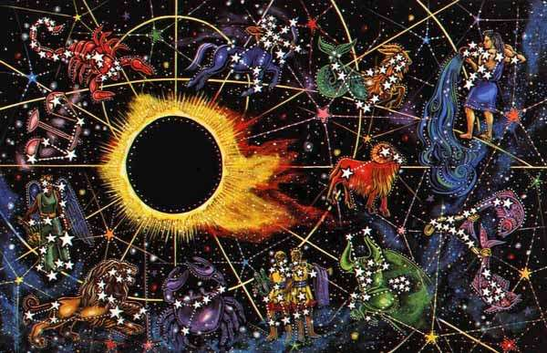
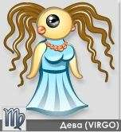

# Ордуудын “хошин” зурхай

Та өөрийнхөө хамгийн сайхан өдрийг төсөөлдөө. Ордууд тус бүрийг, нэг сайхан өдрийг хүслээрээ өнгөрүүл гэвэл, дараах байдлаар байх гэнэ.Хошигнол үнэний хувьтай гэдэг. Хичээвэл, энэ өдрийн бүх нөхцөл бодит болох, үндэс суурь таны зан чанарт байдаг байна. Орд тус бүрийн ертөнцийг үзэх үзэл, онцлогуудад тулгуурлан энэхүү инээд нэмэх, хошин, төгс өдрийг тодорхойлсон ажээ.

#### Хонь

Бүх хонинуудын мөрөөдөл, уулын оргил дээр майханд сэрж дуртай махаа түүдэг дээр шарж идэн, байгалийн сайхантай нэгдэж, болдог бол эрт балрын хүн болж, гартаа жад барин эхээс төрсөн биеэрээ харайлгаж арслан заан агнах байсан даа.

---

#### Үхэр

Хэрэв та болдог бол, тансаг дарвуулт завин дээр гавана янжуур зуучихсан гардах хундагатай үнэт коньякаа шимэнхэн сууна. Төгс тансаг орчинд, сая саяар үнэлэгдэх хувцас өмсчихөөд, Феррари хөлөглөн сэтгүүлчдээс бултсан шиг явна даа.

---

#### Ихэр

Ихэрүүд сайхан өдрөө зураглаж чадахгүй, учир нь тоолж баршгүй олон зүйл хүснэ. Сонгохын аргагүй. Ер нь тэд ирээдүйд очихыг хүсч, цаг хугацааны машин, бүхнийг чадагч болох зэргийг нэг дор эзэмшихийг сонгоно. Тэд ганцаарлыг тэвчдэггүй тул бүх л хүсэл нь хамтын хүсэл учраас ганцаараа тэр бүхнийг сонгож чадахгүй нь аргагүй шүү дээ.

---

#### Мэлхий

Мэлхийнүүд, жинхэнэ эрх чөлөөг эрхэмлэгчид, тиймээс энэ нэг өдрийг шувуу болон нисч хязгааргүй хөх тэнгэрээр элин хальж өнгөрөөнө. Эрх чөлөөгөө мэдрэхийг эрх чөлөөнөөс илүү үздэг тэд далавчтай болохыг хүсч нэг өдрийг ч атугай ямар ч хязгаарлалтгүй өнгрөөх нь тэдний төгс сайхан өдөр.

---

#### Арслан

Арслан, оройн 4 цагт сэрнэ. Ордны зарц сэм орж ирэн цонхны хөшгийг чимээгүй нээхийг хүлээн хэвтнэ. Босч цонхоор харахад Францын эрэг хавийн зун цаг. Арслан ажилд явахгүй. Ордны зарц амттангууд бүхий кофетой цар барин гүн хүндэтгэлтэйгээр орж ирнэ. Дараа нь 2 цаг орчим орондоо хөрвөөж байгаад дуртай зүйлээ хийх юм. Хэрэв гадагш гарах бол алтадмал Роллс-Ройсс /зарцгүй! Бүх зүйл нь автомат/ хөлөглөнө. Энэ өдөр түүнтэй нэг ч хүн байхгүй, гэхдээ нөхөр эсвэл эхнэр нь байж магадгүй.

---

#### Охин

Тэд, дэлхий сүйрсэн үед очно. Дурын машинаа унаж, харсан зүгтээ давхина. Эргэн тойронд нэг ч хүнгүй, ганцхан хайртай хүн нь хамт. Дэлгүүрүүд нээлттэй юу хүссэнээ аваад л. Өө! бас нэг хувилбар бий. Тэд шөнө, нууцлаг зүйлд дуртай учраас шөнийн хотоор давхиж, “сайхан өдөр”-г “дуртай шөнө” болгох байсан

---

#### Жинлүүр

Жинлүүрийнхэн хэн ч саад болохгүй байхад дуртай учир, энэ өдрийг, уншиж, кино үзэж, хөгжим сонсон, хайрлаж дурлалцаж яг л франц кино шиг өнгөрүүлнэ. Хайртай шүтдэг хөгжимчид жүжигчидтэйгээ уулзаж амжна. Ер нь бүх л томчуудтай ярьж хөөрөн тэдэн шиг болох туршлага хуримтлуулна даа.

---

#### Хилэнц

Хилэнцийнхэн- өшөө авагчид. Энэ өдөр, зурагтын өмнө, түүний кинондох дайснууд болон гомдоогчид нь хэрхэн зовохыг үзсэн шиг ээ сууж өнгөрүүлнэ. Энэ өдөр нь түүнд нэг төрлийн аятайхан, бас эерэг мэдрэмж өгдөг. Гол нь, хилэнцийнхний үйлдлээс хүмүүст муу зүйл болохгүй л бол болоо гэдэг. Тэд төлөөс, шударга ёсыг хүсдэгээс ийм чөлөөтэй, зурагттай өдрийг мөрөөддөг.

---

#### Нум

Нум, машинд суун найзуудтайгаа эсвэл ганцаараа аялалд гараад өгнө. Галт тэрэг, онгоцоор ч байж магадгүй. Хамгийн гол нь аялал бөгөөд шинэ улс орон, шинэ соёл зан заншилтай танилцах нь л чухал. Тэр эдгээрийг нэг дор бүгдийг таньж мэдэхийг мөн эрх чөлөөтэй мөнгөнд санаа зовохгүй байхыг хүснэ. Гэхдээ ер нь мөнгөнд санаа зовдог.

---

#### Матар

Матар, улс орны гүн хүндэтгэлт хүн болно, тиймээс энэ өдөр бол тэр ерөнхийлөгч. Түүний ажлын кабинетад, хүмүүс орж ирээд мэхийн, гарыг нь үнсэж, зөвлөгөө авах бөгөөд дараа нь тэр, бүхэнд хайрлан хүндлэгдсэн үг хэлж, алга ташилт, зураг авалтын гэрэл гялбаан дунд зурагтаар гарна. Ер нь тэр бол ерөнхийлөгч. Тэгээд л болоо.

---

#### Хумх

Хумх эверестэд гарч, шүхрээр бууж, акулууд дунд хамгаалалтыг тортой шумбана. Тэд бүх л сэтгэл хөдлөл, нервээ хөдөлгөх зүйлсийг үзэхийг хүснэ. Тэд экстрим, хөдөлгөөн д зориулагдсан хүмүүс. Тиймээс тэдний энэ өдөр шүхрээр харайх, “галзуу хулгана” маягийн осолтой тоглоомууд дээр өнгөрнө. Залхахгүй дахин дахин л үсэрнэ дээ.

---

#### Загас

Загаснууд бүх өдрийн турш хамт байх хайртай хүнийхээ тэвэрт сэрэхийг хүснэ. Арай хэтрүүлсэн байж магадгүй л дээ, гэхдээ яалтай билээ. Тэд яг кино шиг дурлалыг хүсдэг. Тэдний төгс сайхан өдөр бол, сайхан төгсгөлтэй сэтгэл догдлуулсан романтик инээдмийн кино шиг л байх болно.
