# Ордуудын мөрөөдлийн байшин

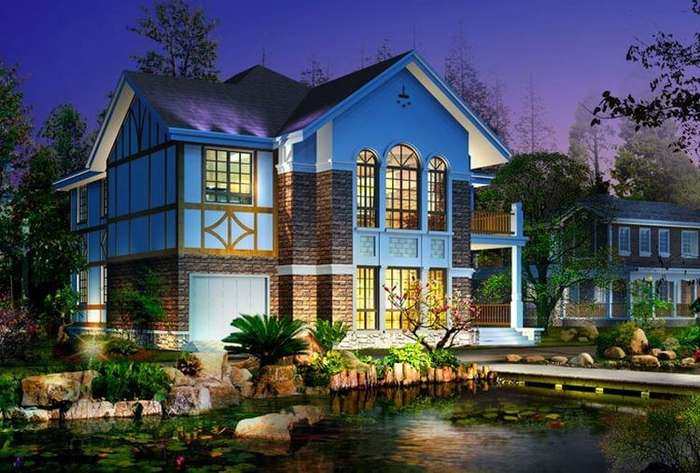

Тав тухтай, тохилог, таалагддаг, сэтгэлдээ таарсан мөрөөдлийн байшинд амьдрахыг бүх хүн хүсч мөрөөддөг. Харсан зүйл бодолд бууж, бодол нь үйлдэлд түлхэж, үйлдэл нь бодит болгох увидастай байдгийг сануулахын ялдамд, мөрөөдлийг тань ойртуулж, мөн биелүүлэхэд өдөөх, ордуудын таашаал, таалал, зан ааш, хүсэл сонирхлыг тооцон илэрхийлсэн байшингуудыг орд тус бүрээр үзүүлсэн сонирхолтой мэдээллийг толилуулж байна. Хүн бүрийн зан чанартай холбоотой, ямархуу газар орон, орчинд, төрөл бүрийн байшин сууц сонгодогоос үүдэлтэй, бат бэх чулуун хананы цаана аюулгүйг мэдрэн ая тухтай суух, эсвэл үзэмж гоёмсог модон байшинд тавлаг тохилог амьдрахыг эрхэмлэх зэрэг хүмүүсийн хязгааргүй хүслүүдийг орд тус бүрээр тооцож, тухайн хүний зан чанарын тусгал болсон байшин, орчинг энэхүү ордын зурхай харуулахыг зорьсон нь лавтай.

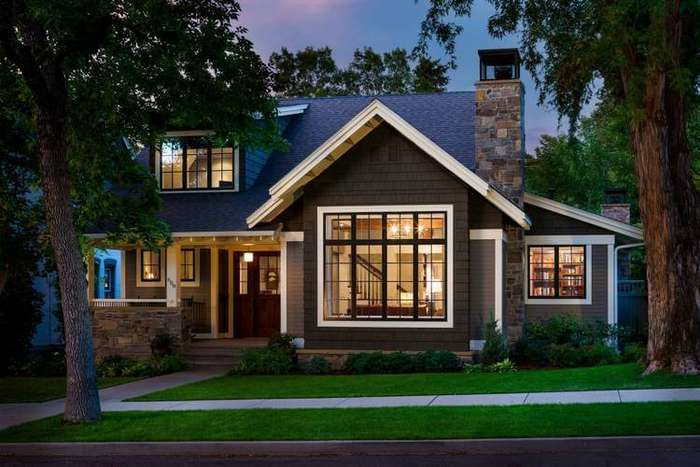

Хонь\
Адал явдалд дуртай, цус нь буцалсан хоньнууд, бүх боломжоор хангагдсан, томоохон хот суурингийн нэгээхэн хэсэгт, хамгийн сүүлийн үеийн загвараар тоноглогдсон хувийн байшин, хаусанд жаргалыг эдлэх мөрөөдөл тээдэг. Энэ ордынхон хэдийгээр хөнгөн хуумгай зантай мэт боловч, хамгийн их гэрсэг, гэр орны дулаан уур амьсгал, тав тухад дуртай байдаг байна.

---

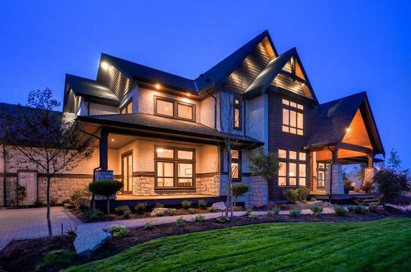

Үхэр\
Энэ ордынхон, түм түчигнэж, бум бужигнасан орчиноос алс байх дуртай. Тиймээс хотын захад томоос тос газартай загварлаг байшин барьдаг. Тэндээ, гэр бүл, хайртай дотныхондоо халамж хайраа хүртээн, эдлэн газрынхаа шимийг хүртэн, дуртай зүйлээ эрхлэхийн зэрэгцээ орчин тойрныхоо байгалийн үзэсгэлэнд бишрэн уусч амьдрахыг жаргалд тооцдог, мөрөөдлөө биелүүлэх чадвартай хүмүүс.

---

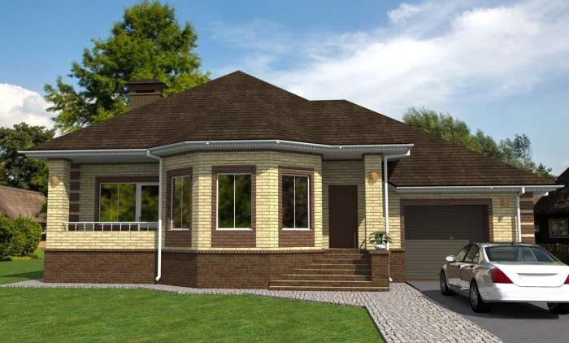

Ихэр\
Амьдрах газраа амархан сольж, аливаа зүйлд шимтэн дурлаж уягддаггүй ихрийнхэн, амьдрах орчин нь гэгээтэй, саруулхан, чамин л бол байшин барилгынхаа хийц загварт төдийлөн ач холбогдол өгдөггүй бөгөөд агаар ихтэй газрыг эрэлхийлж, аялан явахыг эрхэмлэдэг. Арга ч үгүй биз агаар ихтэй газар аян замд л байдаг шүү дээ.

---

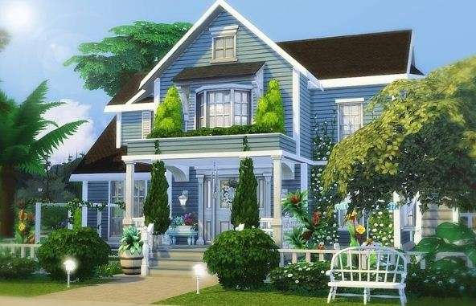

Мэлхий\
Мэлхийнүүд сонгодог загварын, нарийн хийц маягтай байшинд дуртай. Тэд өөрийн гэр орноо бага ч атугай музей санагдуулам байлгахыг хүсдэг. Тэдний байшин цутгамал, сийлмэл гоёл чимэг бүхий урлагийн бүтээл мэт, мөн чанартай тансаг тавилга, загварлаг дотоод засалтай, ханаар нь алтадмал, мөнгөлөг хүрээ бүхий хайртай дотныхныхоо зураг хөргийг өлгөсөн тансаг орчиныг бүтээдэг, жаргалтай хүмүүс.

---

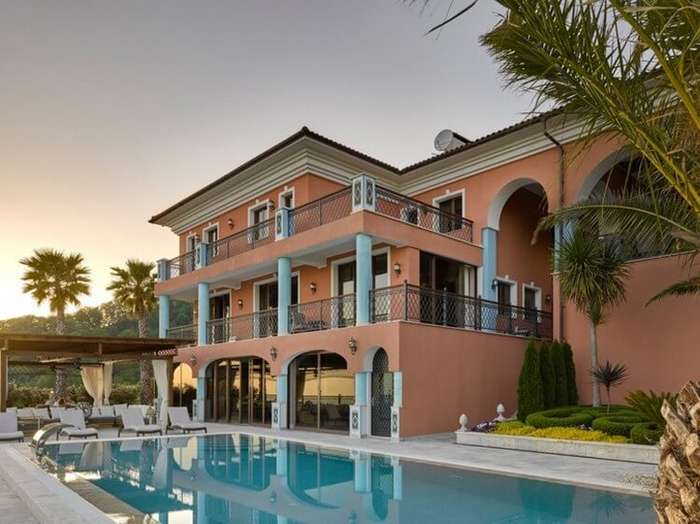

Арслан\
Арслангууд эрх чөлөөнд дуртай учираас том талбайд дуртай. Тиймээс, санаанд багтамгүй том байшин барьж, баян тансаг эд зүйлсээр дүүргэн амьдрахыг мөрөөддөг. Эдгээр нь, зочид гийчидийнхээ бахархал, атаархал төрүүлэм байлгахыг хичээнэ.

---

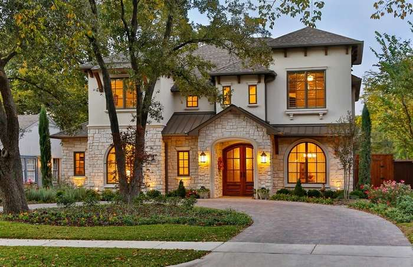

Охин\
Их бодит, бодь сэтгэлтэй учираас, тэр бүр байр байшингийнхаа чимэглэл, нарийн ширийн зүйлд ач холбогдол өгдөггүй. Харин, гэр доторхоо, өөрсдийнх нь өмнөөс бүхнийг хийж байх техникүүдээр дүүргэнэ. Орчин цагийнхаа хамгийн сүүлийн үеийн техник технологийн эд зүйлсийг хэргэлдэг хүмүүс. Үүний зэрэгцээ, эд өлгийн зүйл цуглуулах сонирхолтой. Хачин сайхан тохилог бут, модот цэцэрлэг өөрийн гараар бүтээчихдэг чадварлаг хүмүүс дээ.

---

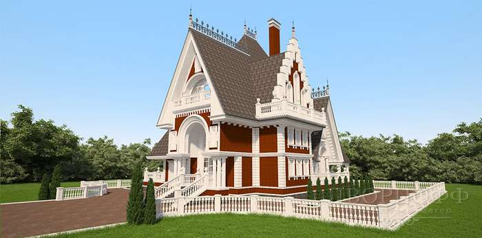

Жинлүүр\
Энэ ордынхны эргэн тойронд нь хамгийн сайхан зүйлс байх учиртай. Өнгө алагласан, өөдрөг дэврүүн сэтгэл дуудах зүйлээр орчиноо тохижуулдаг. Гол нь, тав тухтай маш гоё, өрөө бүр нь өөр өөрийн онцлогтой байдаг. Өнгөyий хоршил нь хэтэрчихгүй бол үлгэрийн юм шиг сайхан байшинд амьдардаг.

---

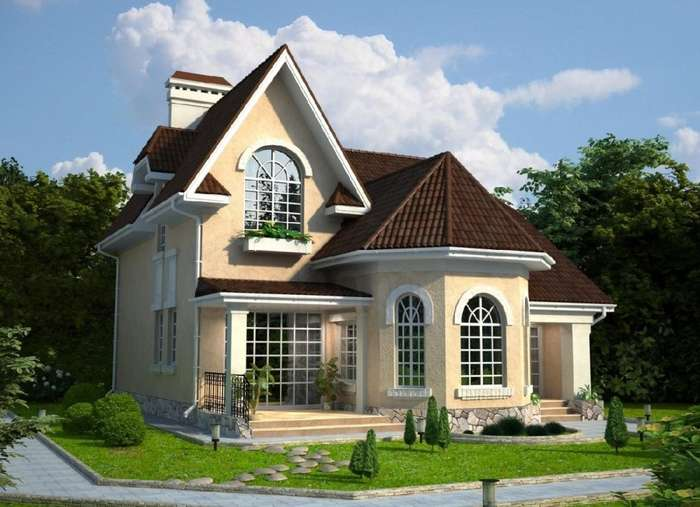

Хилэнц\
Хилэнцийнхэн, өөрийнх нь “Би”г илэрхийлсэн бүх зүйлд дуртай. Тиймээс, түүний байшин, тухайн үеийн сэтгэл санааных нь тусгал болж байдаг. урд өмнөх дурсамжийг нь илэрхийлэх орон зайг бүтээхээ мартдаггүй. Өндөр газар эсвэл ойн чөлөөнд барьсан байшин тэдэнд зохимжтой байдаг гэнэ.

---

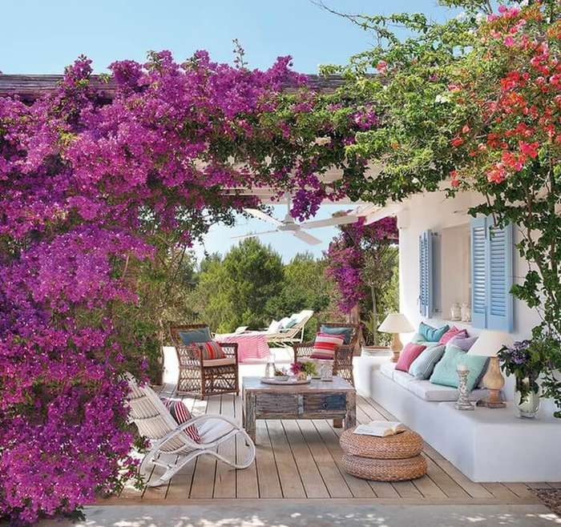

Нум\
Эрх чөлөөнд дуртай, эрч хүчтэй нумууд, бохиртож сааралтсан хот суурин газарт амьдрахаас залхдаг. Энэ ордынхон, тансаг хорооллын, дөрвөн өрөө байраа, хотын чимээнээс хол, буйдхан газрын аятайхан эдлэнгээр дуртайяа солино. Тэдний хувьд, хамгийн гол, дуртай нөхцөл нь, эдлэнгээ тойрон явах жаргалтай үе, романтик сэтгэлийг нь хөөрөн дэвэргэх үзэсгэлэнт байгаль, ой мод, нар, агаар байдаг.

---

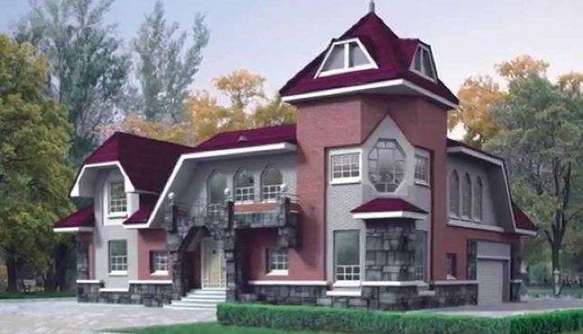

Матар\
Матрууд байшин сонгохдоо жинхэнэ мөрөөдөгчид. Тэдэнд, үүх түүхтэй, өөрийн гэсэн нууцтай, сүнслэг байшин хэрэгтэй. Хуучны эд зүйлс, түүх өгүүлэх эд өлгийн зүйлсээр гоёж чимэх хүсэл нуугдаж байдаг. Эртний үнэр ханхалсан, ван гүнгийн эдлэн, цайзтай төстэй, орчин үеийн хувилбар болсон байшин сонирхдог.

---

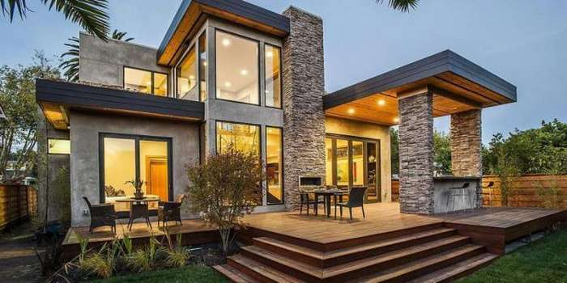

Хумх\
Хумхынхан, элдэв маяггүй хэнэггүй хүмүүс, хөгжилтэй газар, мөн ганцаараа бодолдоо сэлэх бололцоо бүхий тусгаар өрөөтэй л бол хаана ч хамаагүй тухлана. Тэдний мөрөөдлийн байшин, эвтэй хялбар хийцтэй, технологийн дэвшилтэт түвшинд тоноглогдсон, орчин үеийн загвартай байх ёстой. Энэхүү нүдэнд тусахуйц, ялгарам байшин түүний жинхэнэ жаргал юм. Тэд заавал, ажлын өрөө, урлантай байхаар тусгаж тооцон барьдаг.

---

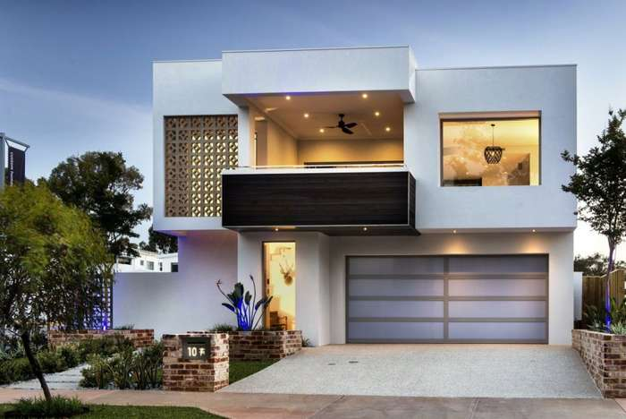

Загас\
Загаснууд, гэгээлэг сайхан өнгөнд уртай учираас байшин нь, саруулхан тохилог байдаг. Энэ ордынхон, орон гэрийн ая тух, орчины тохижилт, эмх цэгцийг гайхалтай хослуулж бүрдүүлж чаддаг. Тэдэнд, хотын захад, том биш, тохилог, гоёмсог байшин тохирно. Хамгийн гол нь, тэдний хувьд, хайртай гэр бүл, ойр дотныхон нь багтахуйц байхад л болох нь тэр. Мөн сайхан хөршүүдтэй байхыг чухалчилдаг.
