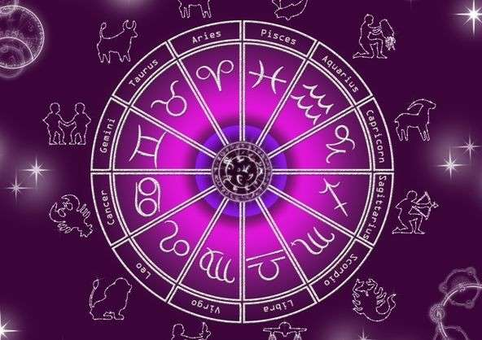

# Ордуудын зан чанарын гол шинжүүд ба энэ оны сүүлийн хагаст од эрхэсийн байрлалаар нээгдэх боломжууд

**Хонь** Эрүүлээр сэтгэдэг. Түргэн ууртай, цухалдуу. Мөрөөдөмтгий. Зоримог. Хэнэггүй байдалтай. Өөрийн эрх ашгийг хамгийн түрүүнд тавьдаг.\
-Таны өмнө олон шинэ боломжууд нээгдэж байна. Өөрийн ажил мэргэжил, харилцаа холбоогоо тодорхойлох нь чухал. Шинэ мэдлэг эзэмшиснээр амьдралаа өөрчилөх боломжтой. \
**Үхэр** Эзэрхүү. Алсын хараатай, ажигч гярхай, сэтгэлийн хөдөлгөөн ихтэй, бууж өгөмтгий, хартай, зөрүүд, юу хүсч буйгаа сайн мэддэг. \
-Танд биеэ дааж, өөртөө итгэлтэйгээр алхах боломжууд нээгднэ. Амьдралд тань томоохон өөрчилөлт гарах магадлалтай. Харц дээгүүр бүхнийг даван туулахад суралцах нь. Та, өөртөө итгэлтэй байснаар өөрийн хүчээр хүссэндээ хүрч болдогт, мөн өөрийн хүчиндээ итгэж сурна. Бодол, дотоод ухамсараа чагнах боломжийг эрэлхийл. Энэ нь эрч хүчийг тань сэлбэнэ гэдгийг мартаж болохгүй. \
**Ихэр** Шинэ зүйлсийг эрэлхийлэн тэмүүлэгч, сониуч, хурц ухаантай, бүтээлч, сэтгэлийн хөдлөл нь тогтвортой. \
-Та, өөртөө чухал хүмүүсийг үнэлж цэгнэж сурна. Хувийн харилцаа болон хамт ажиллагсадтайгаа нягт холбоогоо бататгана. Урам зоригийг өгөх үлгэр жишээ болно. Оны сүүлд та, хэн нэгэнд санаа тавихын сайхныг мэдэрч, хичнээн ихийг бусдад өгнө тэр чинээгээр буцаж ирдэг болохыг ойлгоно. \
**Мэлхий** Аливааг хайрлаж байдаг сайхан чанартай, сэтгэлийн хөдөлгөөн ихтэй, хянамгай, халамжтай, өндөр хөгжсөн зөн совинтой, шийдэмгий бус, сэтгэл санаа нь өөрчилөгдөмтгий, тусч, анхаарал тавимтгай. \
-Та, өөрийгөө эрэлхийлэх, илэрхийлэх оролдлого болон урсгалаар явдаг байдлаасаа сална. Урд өмнөх жилүүд дэх үеэсээ илүү нээлттэй, итгэлтэй болж, олон шинэ харилцаа тогтоож, хүрээлэл тань өргөснө. Мөн шинэ өөрчилөлтүүд гарна. Таныг хамгийн аз жаргалтай үе хүлээж байна. Түүнийг бүү алдаарай. \
**Арслан** Өгөөмөр, тусч, шударга, хүчирхэг, шийдэмгий, амьдралын баяр баясгалантай, эрч хүчтэй, өөртөө итгэлтэй, нээлттэй. \
-Гойд зүйлгүй, намуухан үе хүлээж байна. Хүрсэн зүйлээрээ сайрхаж явсан үе тань, амжилтад хүргэх чадавхи чадвартаа анхаарах байдлаар солигдно. Аливааг сайтар сонсч, байр байдлаа дүгнэхийн чухлыг ойлгоно. \
**Охин** Даруу төлөв, бүрэгдүү, аливааг хэт нарийвчилан хардаг, итгэлтэй, бодит, ухаалаг, дүн шинжилгээ хийхдээ сайн, хэт шүүмжлэмтгий, төгс зүйлсийг эрхэмлэгч. \
-Хэт хянамгай байдлаа багахан сулруулж аятайхан дэврүүн байж сурна. Зорилгоо нягтлан төлөвлөнө. Өөрийн тав тухтай байдлаа хэт эрхэмлэдэг хэмжээ хязгаараа давж, мөрөөдөлдөө хүрэхэд тустай, эрсдэлгүйгээр аливаад хүрч болдоггүйг ойлгож, урагшлах замд гарна. \
**Жинлүүр** Сайхан харилцаатай, аятайхан төрхтэй, аальгүй, дур татам, хэнэггүй, шийдэмгий бус, тогтвортой бус, сайхан сэтгэлтэй, халамжтай, наалинхай. \
-Амьдралын үнэ цэнийг илүүтэйгээр ойлгоно. Зоримог алхмууд хийхээс бүү ай. Олсон амжилтуудаа үнэлж, тэмдэглэх нь чухал. \
**Хилэнц** Шийдэмгий, тууштай, яахаас ч буцахгүй, эзэрхүү, түрэмгий, сэтгэл татам, идэвхитэй, туйлшрамтгай, нууцлаг, бүтээлч, санаачлагч. \
-Та, өөртөө хэрхэн тус болохыг олж мэднэ. Аливааг шийдвэрлэх үед, гол баатар, зөвлөгч, дэмжигч, сургагч багш мэт байх нь. Үзэл бодлоо өөрчилж, боломж, ашиг тус өгөөгүй өнгөрсөн улирсан харилцаа холбоогоо тасална. \
**Нум** Шударга, хэт нэг талыг баримталдаг, оюунлаг, гүн сэтгэгч, хайхрамжгүй, хариуцлагагүй, урам зоригтой, шинийг эрэлхийлэгч, өөдрөг сэтгэлтэй, эрх чөлөөнд дуртай. \
-Бага зүйлээс ч сэтгэлийн ханамж авч сурна. Өөрийн тогтворгүй зан, аялаж жуулчилах барагдашгүй хүсэл, хязгааргүй зөгнөлөө дарах хичээл зүтгэл гаргах нь. Мөн, амьдралын чухал зүйлс заавал энгийн бус нөхцөлд болж байдаггүй, харин зөвхөн өөртэйгээ, номын ертөнцөд элин халих намуухан үдэш ч байж болдогийг ойлгох болно. \
**Матар** Сэргэлэн, хянамгай, шүүмжлэл даадаг, амиа хичээмтгий, сахилга баттай, бэрхшээл давах гайхалтай чадвартай. \
-Танд маш олон хүсэл байна, мөн та тун ч тэвчээргүй хүн юм. Та, хүсч буй зүйлд тань цаг хугацаа шаардагдаж байдаг болохыг ойлгоно. Хайр дурлалын амьдрал олон зүйлд өртөх ч, гүнзгийхэн амьсгаа аваад урсгалын дагуу хөвөх болно. Учир нь энэ асуудалд яарах зохидоггүй. \
**Хумх** Юунаас ч хамаардаггүй сэтгэхүйтэй, нөхөрсөг, санаачлагч, харилцааны доголдолтой, хэт хийсвэр, өвөрмөц зантай, бүтээлч. \
-Та харилцаандаа анхаарч, өөрийн чин хүслээ тодорхойлох бололтой. Та юу бодсоноо ярьж сурснаар тодорхой, урам зориг хайрлах харилцааг эзэмшиж сурна. Өөрийн итгэл үнэмшилдээ хэзээд үнэнч байна. \
**Загас** Төсөөлөн бодох өндөр чадвартай, тусч, бусдын төлөө өөрийгөө золиослохоос буцдаггүй, авъяаслаг, бодит бус, зөн совинтой, шинэ зүйлсийг хүлээн авахдаа сайн. \
-Өөрийн мэдрэмж болон өөртөө анхаарч сурна. Мөрөөдөл төсөөллийн сайхан амьдралд тань чухал шийдвэрүүд гарч ирэх ч цагийн юм цагтаа л болох тул бүү сандар. Өөртөө болон өөрийн ажил албаны өсөлт, сонирхол, харилцаа холбоондоо анхаараад явж бай.
