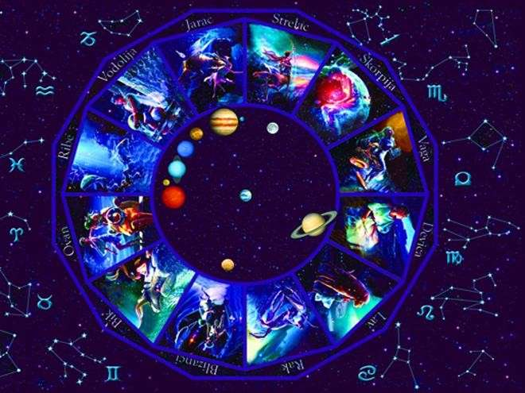
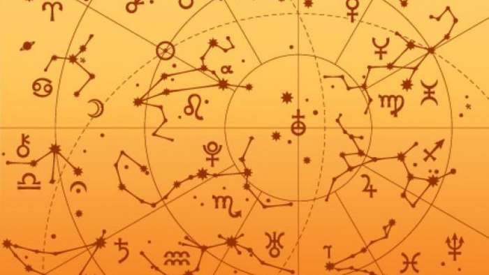

# Ордуудын зурхайн, орд тус бүрийн сонсох дургүй үгс

Үгийн хүчний тухай мэдэхгүй хүн байхгүй биз ээ. Сэтгэлийн хөдөлгөөнөө дарж чадахгүй, болох болохгүй үг хүнд хэлчихээд буцаагаад авч болдоггүй нь харамсалтай байдаг. Ер нь зарим үг сонсоход таагүй байдаг. Гэхдээ орд тус бүр, маш хүнд хүлээж авч цухалддаг үгнүүдийг танилцуулъя. Зарим хүнд хэлсэн үг, тухайн хүнийг уурлуулдаг байхад, харин өөр хүн тэр үгийг тоохгүй байх жишээтэй байдаг. Тиймээс янз бүрийн ордуудын хүмүүст ямар үгсийг хэлвэл дургүй байдаг талаар мэдээд авахад илүүдэхгүй . Хэн хэнээ гомдоож цухалдуулж яахав. Гэхдээ энэ нь ерөнхийлсөн зурхай, дэлхийн 7 тэрбум хүнийг үүгээр дүгнэх нь ч юу юм. Гэвч ойр дотныхон, танил тал, найз нөхөд болон өөрийнх маань таарч байсан шүү.

#### Хонь

“Тайвшир” гэж хэлэхэд дургүй байдаг. Учир нь энэ үг улам дэвэргэж уурлуулдаг. Хэрэв та хонины ордны хэн нэгэнд туслахыг хүсвэл, энэ үгийг бүү хэлээрэй. Өөр арга олоорой.

#### Үхэр

“Тэр ер нь догь” гэж бусдын талаар түүнд ярьж хэрэггүй. Түүнийг бусдаас илүү аятайхан гэж хэлмээр бол хэнтэй ч бүү харьцуулаарай. Зүгээр л магтчих, үгүй бол маргаан гарна.

#### Ихэр

“Энэ чинь тэнэг сонсогдож байна” гэж яриан дундаа ихрийнхэнд бүү хэл. Тэдний “эго” үүнийг хүлээж авахгүйгээс гадна өөрийнхөө хир хэмжээг мэддэг учраас тэд жинхэнэ уурлаж хилэгнэн аймшигт маргаан гарна .

#### Мэлхий

“Болио, чи ямар залхмаар юм бэ” энэ үг ер нь хэнд ч таалагдахгүй л дээ, гэхдээ мэлхийнхэн иймэрхүү үгнээс болж жинхэнээсээ шаналдаг. Маш хүндээр хүлээж авдаг учраас ийм үг битгий хэлээрэй.

#### Арслан

“Чи сайнгүй харагдаж байна шүү”. Арслангийнхан гадаад үзэмжиндээ гойд анхаардаг улс. Тиймээс маш дургүйцэж хүлээж авдаг. Ер нь төрх байдалтай нь холбоотой таагүй зүйл хэлж хэрэггүй.

#### Охин

“Бид яагаад тэдэнтэй адил байж болдоггүй юм бэ?”. Охиныхныг өөр бусадтай харьцуулсан үг битгий хэлээрэй. Түүнтэй харьцдаг харьцаанд чинь хүндрэл гарна.

#### Жинлүүр

“Найз нар чинь таалагдахгүй байна”. Найз нөхдийн холбоог үнэлдэг жинлүүрийнхэн энэ үгийг өөрийнхөө нэр дээр хүлээж аван бөөн маргаан үүсгэнэ.

#### Хилэнц

“Миний хуучин.../эхнэр, нөхөр, найз/ байсан”. Харьцуулсан үгийг үзэж чаддаггүй. Энэ тэдний хувьд эмгэнэл. Яагаад гэвэл тэд их хартай. Иймэрхүү зүйл хэлэх нь түүнийг холдуулдаг.

#### Нум

“Чи галзуу солиотой”. Энэ үгийг нумынхан жинхэнэ муу утгаар нь хүлээж авдаг бөгөөд өөрийнхөө сэтгэлийн хөдөлгөөн, оюун ухааныг доромжлуулсанд тооцдог. Та ингэж хэлж тоглоогүй нь дээр.

#### Матар

“Чи манайханд таалагдахгүй байна”. Матрынхан ер нь бусдад таалагддаг. Тэгтэл ийм үг нь түүнд хүндээр тусах бөгөөд хэрэв та ингээд хэлчихсэн бол, та өөрөө хэлсэн юм шиг байдалд орж холдно.

#### Хумх

“Чи бүр яг ээж шүү”. Хумхынхан ээжүүддээ хайртай байлгүй яахав. Гэхдээ тэд өөрөөрөө байж өөрийнхөө нэр дээр магтаалыг хүсдэг. Ер нь тэд өөрийг нь хэн нэгтэй харьцуулахад туйлаас дургүй.

#### Загас

“Чамд ч ёстой олон асуудлууд байна даа”. Энэ ордынхон маш сэтгэлийн хөдөлгөөнтэй, ер нь хөдөлгөөнтэй хүмүүс учраас олон асуудалд умбаж явдаг. Бүр өөрөөсөө ч асуудал хайдаг. Энэ байдлаа ч мэддэг. Тиймээс тэд, бусдаас үүнийгээ сонсох дургүй байдаг. Энэ үгийг хэлсэн хүнийг голчихно.
